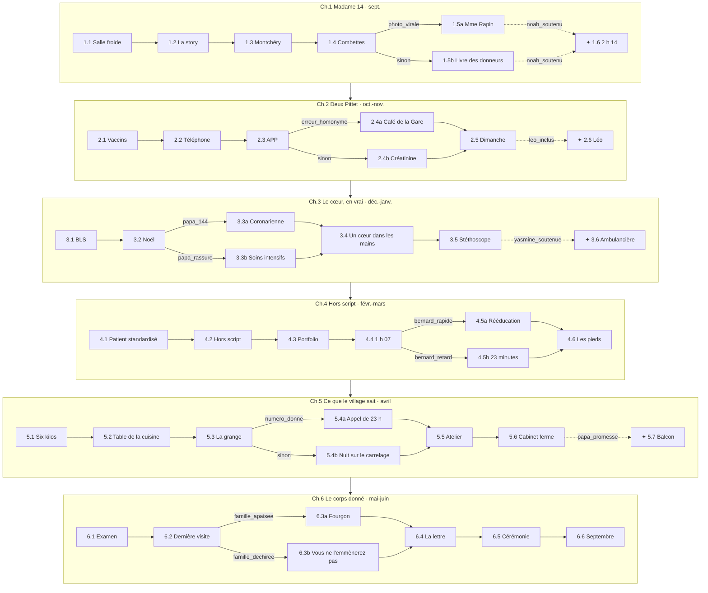

# MedStudents Y2 v2 — « Le corps donné » — Plan narratif

> **Statut (04.10.2026) : livre complet — 6 chapitres, 43 scènes écrites, 463 interactions,
> 1 812 réponses ; validé par le build (0 erreur, 0 avertissement) et par les tests.**
> Source de vérité du contenu : `scripts/medstudents_y2_v2/` (DSL, distribution, chapitres) →
> `data/chapters/MedStudents_Y2_v2.json` par `scripts/build_medstudents_y2_v2.py`, qui écrit
> aussi `docs/MedStudents_Y2_v2_soft_skills.md` et `docs/MedStudents_Y2_v2_assets.md`.
> `books.py` pointe déjà vers la v2 ; `MedStudents_Y2_v1.json` est conservé pour référence.

## 1. Ce que disent les trois programmes de 2ᵉ année

Sources : `docs/programmes_medecine/` (UNIL plan d'études B2 2025-2026, UNIGE PE Bachelor 2025
art. 12-16, UZH Informationsbroschüre 2. Studienjahr 2026).

| | UNIL — BMed2 | UNIGE — 2ᵉ Bachelor | UZH — 2. Studienjahr |
|---|---|---|---|
| Logique | Systèmes « normaux », modules de 4-5 semaines | Unités par système + programmes longitudinaux | « Der gesunde Mensch » : Humanbiologie I et II |
| Systèmes | 2.1 Cellules et signaux (pharmaco, pathologie générale) · 2.2 Sang, immunité, microbes · 2.3 Neurosciences · 2.4 Circulation, respiration · 2.5 Digestion, métabolisme · 2.6 Urogénital et homéostasie | Croissance et vieillissement cellulaire · Nutrition, digestion, métabolisme · Reproduction · Cœur et circulation · Excrétion et homéostasie · Respiration · Os et articulations (neuro et immunité en 3ᵉ) | HB I : sang et immunité, cœur-circulation, respiration, digestion-nutrition, endocrinologie · HB II : SNC, organes des sens, rein, reproduction |
| Premier contact patient | 2.7 MSC *Patient·es dans la communauté* : rôle du médecin de famille et de l'équipe interprofessionnelle, en milieu professionnel | Stage IMFE chez un·e interniste généraliste ou un·e pédiatre | Workshadowing physiothérapie ; tracks Lucerne (urgence) et Saint-Gall (premier recours, interprofessionnalité) |
| Compétences cliniques | 2.8 Anamnèse et communication (patients simulés), urgences et réanimation, examen neuro, cardio-respiratoire, digestif | CC : attitudes, gestes de base, relation médecin-malade ; stations formatives | Klinischer Untersuchungskurs I-II (thorax, abdomen, statut neuro), sonographie |
| Anatomie | 2.10 TP anatomie, histologie | TP anatomie, histologie | Praktikum klinische Anatomie I-II |
| Professionnalisme | 2.9 Ateliers design de recherche | Identité professionnelle, Enseignement interprofessionnel 1 (facteurs humains), plagiat et IA générative, portfolio | POL-Tutorat (travail en groupe), Fokuswoche Forschung |

**Ce qu'on en tire pour le livre**

1. **Alex est pré-clinique.** Il·elle observe, fait une anamnèse supervisée, prend une tension, fait
   un BLS — jamais de décision thérapeutique. Le drame vient d'être « trop tôt » : savoir un peu,
   et qu'on vous en demande beaucoup (famille, patient·e·s, camarades).
2. **Trois lieux communs aux trois facultés** : la salle de dissection, le centre de simulation
   (patients standardisés), le cabinet de médecine de famille. Ce sont les trois décors du livre.
3. **Le calendrier suit les systèmes** : le thème médical de chaque chapitre est le module du
   moment (le cœur en décembre-janvier, le rein en avril…).
4. **L'interprofessionnel et l'identité professionnelle** sont explicites (UNIL 2.7, UNIGE IP1 et
   identité professionnelle, UZH physio) → assistante médicale, infirmier du CMS, physiothérapeute,
   diététicienne à l'écran.
5. UNIGE voit la neuro et l'immunité en 3ᵉ année : les chapitres 2 et 4 ne supposent aucune
   connaissance physiologique ; la compétence visée est relationnelle.

## 2. Intention et fil rouge

Une année universitaire de 2ᵉ, de septembre à juin. Le lundi, Alex dissèque un corps anonyme :
**« Madame 14 »**, une hirondelle tatouée au poignet. Le jeudi, au cabinet de médecine de famille
de Montchéry, Alex suit **Jeannine Pittet**, 81 ans, ancienne sage-femme du village — qui a signé
son don du corps à la faculté et ne l'a dit à personne, surtout pas à son fils.

À mesure qu'Alex apprend le corps sain, module par module, le corps de Jeannine lâche, organe par
organe : le cœur en janvier, les pieds en mars, les reins en avril. En juin, Jeannine meurt chez
elle, et Alex est invité·e à prendre la parole à la cérémonie d'hommage aux donneurs.

**La question qui traverse le livre : qu'est-ce qu'on doit à un corps ?** Au corps anonyme de la
salle de dissection, au corps du comédien qui « joue » le malade, au corps de son propre père, au
corps de Jeannine qui se donne.

Trois fils parallèles s'entrecroisent :

- **Montchéry** (fil rouge) — Jeannine, son fils Daniel, sa petite-fille Océane, le cabinet.
- **La faculté** — la dissection, le centre de simulation, le groupe de tutorat.
- **Alex et ses proches** — Noah qui se noie, Léo qui s'isole, Yasmine qui cache une blessure, le
  père d'Alex et son cœur.

## 3. L'entourage

| Personnage | Âge | Rôle | Ce qu'il/elle apporte |
|---|---|---|---|
| **Alex** | 20 | Étudiant·e en 2ᵉ année (joueur·euse) | Jamais à l'écran, neutre en genre. Même Alex que dans le Y4, deux ans plus tôt (aucune dépendance). |
| **Jeannine Pittet** | 81 | Patiente, ancienne sage-femme | Insuffisance cardiaque, diabète, reins qui lâchent. A mis au monde la moitié du village. Drôle, têtue, lucide. Fil rouge. |
| **Daniel Pittet** | 54 | Son fils, agriculteur | Débordé, aimant, en colère. Veut l'EMS et la dialyse. Apprendra le don du corps — par elle ou par le village. |
| **Océane Pittet** | 17 | Petite-fille, apprentie fleuriste | Proche de sa grand-mère, cash. Enceinte au chapitre 5. |
| **Jean-Paul Pittet** | 58 | Cousin brouillé, même village | L'homonyme. La langue la plus rapide du Café de la Gare. |
| **Dre Isabelle Golay** | 56 | Médecin de famille à Montchéry | Vingt-cinq ans de cabinet, trois générations de patients. Pas de successeur. |
| **Sandra Nicolet** | 38 | Assistante médicale | Fait tourner le cabinet. Débordée le jour des vaccins. |
| **Thierry Bovet** | 45 | Infirmier du CMS (soins à domicile) | Voit Jeannine trois fois par semaine. Sait ce qu'il y a dans le frigo. |
| **Laura Steiner** | 29 | Physiothérapeute | Chutes, rééducation (workshadowing physio). |
| **Pre Hélène Vautier** | 58 | Anatomiste, responsable des TP de dissection | Gardienne du programme de don. Sévère sur la dignité, bouleversante à la cérémonie. |
| **Dre Anne-Laure Chevalley** | 47 | Responsable du centre de simulation | Débriefe sans humilier. Mène la revue d'incident du chapitre 4. |
| **Bernard Gilliéron** | 66 | Patient standardisé, ancien comédien | Feedback cruel et juste. Fait un AVC réel en pleine station. |
| **Odile Gilliéron** | 64 | Sa femme | « Pourquoi personne n'a rien fait pendant vingt-trois minutes ? » |
| **Dr Tomás Ibarra** | 34 | Tuteur APP/POL, médecin assistant en pédiatrie | Laisse le groupe se débrouiller, voit tout. |
| **Noah Berthoud** | 20 | Camarade, fils d'un chirurgien | Brillant, anxieux, se noie : chatbot, plagiat, épuisement, idées noires. |
| **Maëlle Dupasquier** | 21 | Camarade | Drôle, sur les réseaux. La story de la salle de dissection. |
| **Yasmine Benkirane** | 27 | Camarade, ex-ambulancière | Connaît le terrain, corrige tout le monde. Un nourrisson qu'elle n'a pas sauvé. |
| **Léo Studer** | 19 | Camarade, transféré de Zurich (UZH) | Bilingue, timide, isolé. Voit ce que les autres ne voient pas. |
| **Philippe** | 54 | Père d'Alex | Fumeur, hypertendu, « c'est l'estomac ». |
| **Nadia** | 52 | Mère d'Alex | « Toi qui fais médecine… » |
| **Mme Françoise Rapin** | 55 | Fille de « Madame 14 » | N'apparaît que si la photo a circulé. Reconnaît le tatouage de sa mère ; c'est elle qui lui avait verni les ongles. |

Lieux (fictifs) : Montchéry, village du pied du Jura ; la ferme des Combettes ; le Café de la Gare ;
« la faculté » (jamais nommée, pour valoir dans les trois universités).

## 4. Mécanique : branches parallèles et histoires annexes

Le moteur actuel le permet déjà (voir `static/play/engine.js`) :

- **Dans une scène** — graphe d'interactions ramifié, 4 à 6 réponses par point de choix,
  plusieurs fins possibles (bonne issue, issue ratée, issue grave).
- **⑂ Branche parallèle** — deux scènes au même rang (`Slot`), une seule est jouée selon les choix
  précédents (`Condition`). Les deux existent : deux joueur·euse·s ne vivent pas la même histoire.
- **✦ Histoire annexe** — scène conditionnelle débloquée par un choix (s'être occupé·e de Noah,
  avoir inclus Léo…). On peut la manquer.
- **Points d'entrée** (`EntryPoints`) — une même scène commence différemment selon ce que le
  village sait, ce qu'Alex a promis, etc.
- **Mémoire inter-chapitres** — les états (`SetFlags`) posés au chapitre 1 sont relus au
  chapitre 6. **Écran de départ** (`StartChoice`) pour jouer un chapitre isolé.

Volume : **45 scènes écrites**, **35 à 38 jouées** par parcours (5 à 7 par chapitre), 15 à 25
interactions par scène.

Petit ajustement moteur prévu : le compteur « Scène x / y » compte aujourd'hui toutes les scènes
du chapitre, y compris les annexes non débloquées. Il devra ne compter que les scènes jouables.

## 5. Chapitres et scènes

Légende : **RD** Respect et dignité · **EM** Empathie · **CO** Compassion · **ER** Régulation
émotionnelle · **CC** Clarté de communication · **PB** Frontières professionnelles · **IC**
Collaboration interprofessionnelle. ⚑ = état posé. ⑂ = branche parallèle. ✦ = annexe.

### Chapitre 1 — Madame 14 (septembre) — écrit
Focus (dominantes réelles) : RD · EM · PB · CC — 92 interactions, 398 réponses.
Ancrage : UNIL BMed2.1, BMed2.10 (TP anatomie), BMed2.7 · UNIGE Croissance et vieillissement
cellulaire, TP anatomie, stage IMFE, identité professionnelle · UZH Praktikum klinische
Anatomie I, Humanbiologie I.

| Scène | Type | Focus | Ce qui s'y joue |
|---|---|---|---|
| 1.1 La salle froide | — | RD · ER · IC | Première dissection. La Pre Vautier fait lire le texte des donneurs. Corps n°14 : une hirondelle sous la compresse, du vernis rouge écaillé. Noah blêmit (malaise si personne ne le voit), Maëlle soulève la compresse et sort son téléphone, Alex vacille à son tour au moment de couper. ⚑ `noah_soutenu`, `maelle_avertie` |
| 1.2 La story | — | PB · RD · IC | 22 h. Maëlle publie « Day 1 avec notre nouvelle coloc » : l'hirondelle se voit. Lui écrire en privé, liker, signaler, prévenir la Pre Vautier, ne rien faire. Entrée propre si Maëlle avait juré l'avoir effacée. ⚑ `photo_supprimee` / `photo_virale` (issue obligatoire), `maelle_vautier` |
| 1.3 Montchéry | — | CC · RD · IC | Premier jeudi au cabinet. Sandra tient tout ; les deux Pittet se lèvent à l'appel. Première anamnèse supervisée : Jeannine, deux oreillers, chevilles gonflées, le mari mort sous le tracteur. Elle montre sa carte de donneuse et invite Alex aux Combettes. ⚑ `anecdote_donneuse` (Alex raconte la donneuse en public), `golay_pas_informee` |
| 1.4 La ferme des Combettes | — | PB · EM · RD | Visite à domicile avec Thierry (trois ouvertures selon `anecdote_donneuse` et `golay_pas_informee`). L'enveloppe « à ouvrir après ». « Pas un mot à Daniel. » Daniel entre et demande ce qu'est l'enveloppe. ⚑ `promesse_jeannine` (promesse intenable), `revele_a_daniel` (faute grave), `numero_donne` |
| 1.5a La lettre | ⑂ si `photo_virale` | RD · CO · PB | Une femme a reconnu l'hirondelle de sa mère. La Pre Vautier convoque la table ; Maëlle demande à Alex de mentir (« une blague de groupe »). Rencontre avec Mme Rapin : « C'est moi, le vernis. » ⚑ `mensonge_groupe`, `rencontre_rapin` |
| 1.5b Le livre des donneurs | ⑂ sinon | RD · CO · ER | Écrire une page au livre de remerciements. Une cicatrice de césarienne : « Quelqu'un a été cet enfant. » La tentation de retrouver la famille. Noah n'arrive pas à écrire ; Léo propose « Danke. Merci. Grazie. » ; Yasmine laisse échapper une route à trois heures du matin. |
| 1.6 2 h 14 | ✦ si `noah_soutenu` | EM · ER · PB | Noah écrit en pleine nuit : son père chirurgien, le classement, « je ne dors plus depuis la salle ». Il demande à Alex de signer la feuille de présence pour lui. ⚑ `noah_confie`, `promesse_noah` (secret absolu promis), `signature_noah` |

### Chapitre 2 — Deux Pittet (octobre-novembre)
Focus : PB · CC · IC · RD
Ancrage : UNIL BMed2.2 (épidémiologie), BMed2.8 (anamnèse et communication), BMed2.7 (équipe
interprofessionnelle) · UNIGE Dimensions communautaires (médecine ambulatoire, éthique, santé
publique), APP/CBCL, plagiat et IA générative, IMFE (pédiatre) · UZH HB I Blut und Immunsystem,
POL-Tutorat I.

| Scène | Type | Focus | Ce qui s'y joue |
|---|---|---|---|
| 2.1 Le jour des vaccins | — | CC · RD · EM | Journée grippe au cabinet. Une jeune mère hésite à faire vacciner son bébé de 2 mois : « Vous, vous le feriez ? » Informer sans faire la leçon, sans sortir de son rôle. |
| 2.2 Le téléphone | — | PB · CC · IC | Sandra, débordée : « Rappelle Pittet pour ses résultats. » Deux « Pittet J. » dans le logiciel — Jeannine et Jean-Paul, le cousin brouillé. Vérifier la date de naissance… ou pas. Issue obligatoire : ⚑ `bon_pittet` / `appel_rattrape` (quasi-incident) / `erreur_homonyme` (+ `info_lachee` si Alex parle des reins) |
| 2.3 L'APP du jeudi | — | IC · CC · PB | Tutorat sur un cas d'anémie. Noah répond à tout avec un chatbot, Yasmine explose, Léo se tait. Noah demande ensuite à Alex son texte de portfolio « juste pour s'inspirer ». ⚑ `texte_partage`, `leo_inclus` |
| 2.4a Le Café de la Gare | ⑂ si `erreur_homonyme` | PB · RD · ER · CC | Jean-Paul raconte au café que la Jeannine est malade (les reins, si `info_lachee`). Daniel l'apprend devant tout le village et débarque au cabinet. Reconnaître l'erreur sans la rejeter sur Sandra ; déclaration d'incident. Le don du corps, lui, reste secret. ⚑ `aveu_homonyme` / `esquive_homonyme` |
| 2.4b La créatinine | ⑂ sinon | RD · CC · CO | La fonction rénale baisse. Dre Golay parle de dialyse ; Jeannine refuse, lucide. « À Noël, je le dirai à Daniel. Vous serez là ? » ⚑ `noel_annonce` |
| 2.5 Le dimanche aux Combettes | — | EM · RD · CC · PB | Océane coince Alex dans la grange : « C'est vrai qu'ils vont la découper ? » (si fuite) ou « Elle te parle à toi, pas à nous. » Parler du don du corps à une ado sans trahir sa grand-mère. ⚑ `oceane_confiance` |
| 2.6 Léo | ✦ si `leo_inclus` | EM · IC · RD | Léo a fait sa 1ʳᵉ année à Zurich ; il se noie dans le français médical et la solitude. Réviser ensemble ; il raconte le POL zurichois. ⚑ `leo_allie` |

### Chapitre 3 — Le cœur, en vrai (décembre-janvier)
Focus : ER · CC · IC · EM
Ancrage : UNIL BMed2.4, BMed2.8 (urgences-réanimation, examen cardio-respiratoire) · UNIGE Cœur
et circulation, Respiration, CC gestes de base · UZH HB I Herz-Kreislauf et Atmung, Klinischer
Untersuchungskurs I, Praktikum Physiologie I (ECG, tension, spirométrie).

| Scène | Type | Focus | Ce qui s'y joue |
|---|---|---|---|
| 3.1 BLS | — | IC · CC · ER | Centre de simulation. Yasmine corrige tout le monde, Noah fait le clown. Communication en boucle fermée. Quand le mannequin est un nourrisson, Yasmine se fige. ⚑ `yasmine_soutenue` |
| 3.2 Le repas de Noël | — | PB · CC · ER · IC | Philippe, fumeur, hypertendu, se tient la poitrine après la fondue : « C'est l'estomac. » Nadia : « Toi qui fais médecine… » Appeler le 144, rassurer, sortir l'aspirine du placard, « on verra demain ». ⚑ `papa_144` / `papa_rassure` |
| 3.3a L'unité coronarienne | ⑂ si `papa_144` | ER · EM · RD | Stent à 1 h du matin. Philippe furieux d'avoir « gâché Noël », puis sa main qui tremble. L'ambulancier : « Vous avez bien fait. » Rester l'enfant, pas le médecin. ⚑ `papa_promesse` |
| 3.3b Les soins intensifs | ⑂ si `papa_rassure` | ER · EM · PB | Réveil à 6 h, en sueur : infarctus étendu. Le cardiologue : « Ça a commencé quand ? » Nadia : « Alex a dit que c'était l'estomac. » Ni s'effondrer, ni se disculper. ⚑ `papa_promesse` |
| 3.4 Un cœur dans les mains | — | ER · RD · IC | La dissection arrive au cœur ; celui de Madame 14 porte trois pontages. Les mains d'Alex tremblent ; la Pre Vautier le remarque. Dire ou non ce qui se passe à la maison. |
| 3.5 Le stéthoscope | — | CC · RD · IC · EM | Jeannine décompense. Dre Golay fait ausculter Alex : les crépitants « comme au cours ». « Alors, mon cœur, c'est comme dans vos livres ? » Refus d'hospitalisation, plan avec Thierry et le pharmacien. Entrées : Noël a-t-il eu lieu ? ⚑ `daniel_sait` |
| 3.6 L'ambulancière | ✦ si `yasmine_soutenue` | EM · ER · IC | Yasmine raconte pourquoi elle a quitté l'ambulance : un nourrisson, une nuit de 2019. ⚑ `yasmine_alliee` |

### Chapitre 4 — Hors script (février-mars)
Focus : ER · IC · CC · PB
Ancrage : UNIL BMed2.3, BMed2.8 (système nerveux, pratique simulée avec patient standardisé) ·
UNIGE CC stations formatives, Enseignement interprofessionnel 1 (facteurs humains), identité
professionnelle, plagiat et IA générative · UZH HB II ZNS et Sinnesorgane, Klinischer
Untersuchungskurs II (statut neurologique), Workshadowing Physiotherapie.

| Scène | Type | Focus | Ce qui s'y joue |
|---|---|---|---|
| 4.1 Le patient standardisé | — | CC · EM · RD | Bernard Gilliéron joue « M. Rossier, céphalées ». « Vous m'avez regardé trois fois. Votre tablette, quarante. » Dre Chevalley rappelle le mot d'arrêt : « Pause réelle ». |
| 4.2 Hors script | — | ER · IC · CC · PB | Minute 6 : la parole de Bernard s'empâte, son verre tombe. Derrière la vitre, on rit : « Il est trop fort. » Dire « Pause réelle », noter l'heure, appeler — ou continuer l'anamnèse. Léo (`leo_allie`) et Yasmine (`yasmine_alliee`) peuvent aider. ⚑ `bernard_rapide` / `bernard_retard` |
| 4.3 Le portfolio | — | PB · IC · ER | L'anti-plagiat signale le texte de Noah (IA générative, et passages d'Alex si `texte_partage`) ; la feuille de présence signée en septembre ressort si `signature_noah`. Noah supplie : « Dis que c'est toi qui m'as aidé à reformuler. » ⚑ `mensonge_portfolio` / `verite_portfolio` |
| 4.4 1 h 07 | — | EM · CO · ER · PB | Veille d'examen. Noah : « je crois que je vais tout arrêter. tout. » Lui demander directement s'il pense au suicide, rester en ligne, appeler de l'aide, ne pas porter seul·e. Très mauvais : « dors, ça ira demain ». ⚑ `noah_aide` / `noah_seul` |
| 4.5a La rééducation | ⑂ si `bernard_rapide` | RD · IC · CO | Workshadowing chez Laura. Bernard réapprend à tenir un verre et rit : « Maintenant je joue un AVC pour de vrai. » Il veut revenir au centre. |
| 4.5b Vingt-trois minutes | ⑂ si `bernard_retard` | RD · CO · PB · CC | Bernard est aphasique. Odile : « Pourquoi personne n'a rien fait pendant vingt-trois minutes ? » Puis la revue d'incident du centre (facteurs humains, culture juste). Dire sa part. |
| 4.6 Les pieds qui ne savent plus | — | IC · RD · CC | Jeannine est tombée : neuropathie diabétique, « mes pieds ne savent plus où est le sol ». Évaluation avec Laura. Bracelet d'alarme ? Jeannine refuse « la laisse ». ⚑ `alarme_posee` |

### Chapitre 5 — Ce que le village sait (avril)
Focus : IC · RD · PB · EM
Ancrage : UNIL BMed2.5 (besoins nutritionnels), BMed2.6 (filtration glomérulaire), BMed2.7 ·
UNIGE Nutrition, digestion et métabolisme, Excrétion et homéostasie, Dimensions communautaires
(éthique), IMFE · UZH HB I Verdauung und Ernährung, HB II Niere, Mantelstudium Grundversorgung
und Interprofessionalität.

| Scène | Type | Focus | Ce qui s'y joue |
|---|---|---|---|
| 5.1 Six kilos | — | EM · CC · IC | Jeannine a perdu six kilos : goût de métal, frigo vide. Dépistage nutritionnel avec Thierry et la diététicienne du CMS. Jeannine ment sur ses repas ; Alex le voit. |
| 5.2 La table de la cuisine | — | IC · RD · PB · CC | Réunion de famille. Daniel veut l'EMS et la dialyse ; Jeannine refuse. Le don du corps sur la table. « Dites-leur ce que je vous ai dit en octobre. » Entrées selon `daniel_sait`, `promesse_jeannine`. ⚑ `famille_apaisee` / `famille_dechiree` |
| 5.3 La grange | — | EM · RD · PB · CO | Océane : « Elle ne peut pas mourir maintenant. Je suis enceinte. Personne ne sait. » Mineure capable de discernement : secret, orientation (Dre Golay, centre de santé sexuelle), ne pas choisir à sa place. ⚑ `oceane_orientee` / `oceane_trahie` |
| 5.4a L'appel de 23 h | ⑂ si `numero_donne` | PB · ER · IC | Jeannine appelle Alex sur son portable : elle étouffe, ne veut « pas déranger la garde ». Prendre la voiture, ou appeler le 144 et rester en ligne ? ⚑ `alex_y_va` |
| 5.4b La nuit sur le carrelage | ⑂ sinon | IC · PB · CC | Thierry trouve Jeannine au matin, par terre depuis 3 h (bracelet ou pas, selon `alarme_posee`). Plan de crise, directives anticipées. |
| 5.5 L'atelier | — | IC · PB · EM | Atelier de recherche. Maëlle propose une enquête sur le don du corps ; Alex connaît une donneuse vivante. Entrées : Noah revient (`noah_aide`) ou sa chaise reste vide (`noah_seul`). |
| 5.6 Le cabinet ferme | — | ER · PB · IC | Dre Golay ferme en septembre, faute de successeur. Sandra pleure — ou ne parle plus à Alex (`esquive`). « Tu reviendras, toi ? » |
| 5.7 Le balcon | ✦ si `papa_promesse` | EM · PB · RD | Trois mois après l'infarctus, Philippe refume en cachette. « Arrête de me parler comme un médecin. » Être son enfant et le dire quand même. |

### Chapitre 6 — Le corps donné (mai-juin)
Focus : CO · RD · ER · PB
Ancrage : UNIL BMed2.6 (reproduction), BMed2.10 (fin des TP d'anatomie) · UNIGE Reproduction,
identité professionnelle · UZH HB II Reproduktion, Praktikum klinische Anatomie II · les trois
facultés : hommage aux donneurs du corps.

| Scène | Type | Focus | Ce qui s'y joue |
|---|---|---|---|
| 6.1 L'examen | — | ER · PB · CO | À la pause, Sandra appelle : Jeannine décline et demande Alex. Partir, finir, rappeler ? Le message de Jeannine : « Dis-lui de finir son examen, sinon je lui botte les fesses. » ⚑ `examen_quitte` / `examen_fini` |
| 6.2 La dernière visite | — | CO · RD · ER · IC | Soins palliatifs à domicile. Jeannine pose la main sur le ventre d'Océane — elle sait. Elle donne l'enveloppe à Alex. Entrées selon `famille_*`, `oceane_*`. |
| 6.3a Le fourgon | ⑂ si `famille_apaisee` | CO · IC · RD | Jeannine meurt au petit matin. Le fourgon de l'institut d'anatomie arrive. Daniel tient la porte. |
| 6.3b « Vous ne l'emmènerez pas » | ⑂ si `famille_dechiree` | RD · PB · IC · ER | Daniel s'oppose au départ du corps. Dre Golay au téléphone avec la Pre Vautier : un don qu'on n'arrache pas. Alex au milieu. |
| 6.4 La lettre | — | CO · ER · RD | Alex ouvre l'enveloppe ; le texte change selon le parcours (la promesse, le téléphone, l'appel de 23 h, la grange). La Pre Vautier propose qu'Alex parle à la cérémonie. |
| 6.5 La cérémonie | — | RD · CO · PB · ER | Hommage aux donneurs. Dans la salle : Mme Rapin (si `photo_virale`), Bernard (selon 4.5), Noah (selon 4.4). Dire « Madame 14 » — ou le nom de Jeannine, et briser l'anonymat qu'elle a choisi. ⚑ `nom_prononce` |
| 6.6 Septembre | — | ER · PB · CO | Dernier jour du cabinet. Les cartons, Sandra. Océane : « Si c'est une fille, Jeanne. » Rattrapage en août (si `examen_quitte`). Ce qu'Alex emporte en 3ᵉ année. |

## 6. Carte globale

## 7. États narratifs (mémoire des choix)

| État | Posé en | Relu en | Effet |
|---|---|---|---|
| `photo_virale` / `photo_supprimee` | 1.2 | 1.5, 6.5 | Mme Rapin et le programme de dons ; sa présence à la cérémonie. |
| `maelle_avertie` | 1.1 | 1.2 | Maëlle avait juré avoir effacé la photo. |
| `maelle_vautier` | 1.2 | 1.5b | Alex et Maëlle sont allés voir la Pre Vautier. |
| `mensonge_groupe` / `rencontre_rapin` | 1.5a | 1.5a (bilan), 6.5 | Le mensonge collectif ; la rencontre avec Mme Rapin. |
| `anecdote_donneuse` | 1.3 | 1.4 | Le village a entendu Alex raconter la donneuse ; Jeannine hésite. |
| `golay_pas_informee` | 1.3 | 1.4 | Alex est venu·e aux Combettes sans le dire à la Dre Golay. |
| `revele_a_daniel` | 1.4 | 2.x, 5.2 | Daniel sait par Alex ; Jeannine ne fait plus confiance (à intégrer aux ch. 2 et 5). |
| `promesse_noah` / `signature_noah` | 1.6 | 4.3, 4.4 | « Tu m'avais promis » ; la signature de complaisance ressort avec le portfolio. |
| `noah_soutenu` → `noah_confie` | 1.1 → 1.6 | 1.6, 4.4 | Noah écrit à Alex en premier quand il va mal. |
| `promesse_jeannine` | 1.4 | 5.2, 6.4 | « Vous m'aviez promis » — Alex coincé·e entre la patiente et la famille. |
| `numero_donne` | 1.4 | 5.4 | Jeannine appelle Alex au lieu de la garde. |
| `erreur_homonyme`, `info_lachee` / `bon_pittet` / `appel_rattrape` | 2.2 | 2.4, 2.5, 3.5, 5.2, 6.4 | Le village apprend la maladie ; Daniel l'apprend au café. Quasi-incident sinon. |
| `aveu_homonyme` / `esquive_homonyme` | 2.4a | 5.6 | Sandra ne parle plus à Alex jusqu'au soir de la fermeture. |
| `noel_annonce` | 2.4b | 3.5 | Jeannine a promis de parler à Noël, Alex présent·e. |
| `daniel_sait` | 3.5 | 5.2 | La Dre Golay a expliqué la maladie à Daniel ; entrée de la réunion de famille. |
| `yasmine_soutenue` → `yasmine_alliee` | 3.1 → 3.6 | 3.6, 4.2 | Yasmine frappe à la vitre pendant l'AVC de Bernard. |
| `leo_allie` | 2.6 | 4.2 | Léo, à l'interphone : « Das ist kein Theater. » |
| `texte_partage` | 2.3 | 4.3 | Les deux textes signalés par l'anti-plagiat. |
| `leo_inclus` → `leo_allie` | 2.3 → 2.6 | 4.2 | Léo voit l'AVC en même temps qu'Alex et l'appuie. |
| `oceane_confiance` | 2.5 | 5.3 | Océane se confie — ou Alex découvre la grossesse autrement. |
| `yasmine_soutenue` → `yasmine_alliee` | 3.1 → 3.6 | 4.2 | Yasmine prend le relais pendant l'AVC. |
| `papa_144` / `papa_rassure` | 3.2 | 3.3, 3.4, 5.7 | Stent à temps, ou infarctus étendu. |
| `papa_promesse` | 3.3 | 5.7 | Débloque l'annexe du balcon. |
| `bernard_rapide` / `bernard_retard` | 4.2 | 4.5, 6.5 | Bernard rééduqué, ou aphasique. |
| `mensonge_portfolio` / `verite_portfolio` | 4.3 | 6.1 | Avertissement pour fausse déclaration ; Noah remercie ou s'excuse, en juin. |
| `noah_aide` / `noah_seul` | 4.4 | 5.5, 6.1, 6.5 | Noah revient au groupe, ou arrête la médecine. |
| `alarme_posee` | 4.6 | 5.4b | La nuit sur le carrelage dure 4 heures — ou 20 minutes. |
| `famille_apaisee` / `famille_dechiree` | 5.2 | 6.2, 6.3 | La mort à la ferme ; le départ du corps. |
| `oceane_orientee` / `oceane_trahie` / `oceane_seule` | 5.3 | 6.4, 6.6 | Océane orientée, trahie devant son père, ou repartie seule. |
| `alex_y_va` | 5.4a | 5.4a (bilan) | Quarante minutes de route de nuit pour un œdème pulmonaire. |
| `alarme_posee` | 4.6 | 5.4b | La chute de la nuit : quatre minutes au lieu de cinq heures. |
| `examen_quitte` / `examen_fini` | 6.1 | 6.2 | Jeannine : « Pas un seul n'est arrivé à l'heure prévue. » Rattrapage en août. |
| `nom_prononce` | 6.5 | 6.5 (bilan) | Océane au premier rang quand le nom tombe. |

Écrans de départ (`StartChoice`) pour jouer un chapitre isolé : ch. 5 (la nuit de Noah) et
ch. 6 (la réunion de famille et Océane). Les autres chapitres ont une version par défaut
cohérente quand les états précédents sont inconnus.

## 8. Erreurs graves et leurs suites

Selon la préférence du projet : des erreurs réalistes pour une 2ᵉ année, dont les conséquences
continuent dans l'histoire.

| Erreur | Où | Suites |
|---|---|---|
| Ne pas vérifier l'identité au téléphone (homonyme) | 2.2 | Secret médical rompu (art. 321 CP, qui vise aussi les étudiant·e·s) → café, Daniel, réunion de famille, départ du corps contesté. |
| Liker ou ignorer la story de la salle de dissection | 1.2 | Une fille reconnaît son père → programme de dons menacé → sa présence à la cérémonie. |
| Rassurer son père au lieu d'appeler le 144 | 3.2 | Infarctus étendu, soins intensifs, culpabilité, mère qui accuse. |
| Ne pas sortir du script quand Bernard fait un AVC | 4.2 | 23 minutes perdues, aphasie, épouse, revue d'incident. |
| Couvrir le plagiat de Noah / laisser Noah seul la nuit | 4.3, 4.4 | Procédure disciplinaire ; Noah hospitalisé et qui quitte la médecine. |
| Donner son numéro perso, puis conduire seul·e de nuit | 1.4, 5.4a | Jeannine attend Alex au lieu des secours. |
| Trahir Océane auprès de son père | 5.3 | Océane ne parle plus à Alex à la mort de sa grand-mère. |
| Prononcer le nom de Jeannine à la cérémonie | 6.5 | Anonymat du don brisé devant sa famille. |

Les choix qui mènent à l'erreur ne sont **pas** caricaturaux : ce sont les réponses d'un·e
étudiant·e pressé·e, gentil·le, qui veut aider.

## 9. Barème

Identique au Y4 v2 : chaque réponse est notée de −3 à +3 sur les 7 dimensions. Très bon ≥ +9 ·
bon +4 à +8 · moyen −1 à +3 · mauvais −6 à −2 · très mauvais ≤ −7. **4 à 6 réponses par point de
choix**, au moins une très bonne ou bonne, une moyenne, une mauvaise ou très mauvaise, souvent un
geste non verbal. Chaque chapitre a au moins un choix ≥ +9 et un choix ≤ −7.

## 10. Repères médicaux et juridiques (contexte suisse)

- **Secret professionnel** : art. 321 CP — vise aussi les étudiant·e·s pour ce qu'ils et elles
  apprennent pendant leurs études. Vérifier l'identité (nom, prénom, date de naissance) avant
  toute information au téléphone.
- **Mineur·e capable de discernement** : décide seul·e de ses soins et de qui est informé ;
  orientation vers son médecin et un centre de santé sexuelle.
- **Refus de traitement** (dialyse) : droit de la personne capable de discernement ; directives
  anticipées (art. 370 ss CC).
- **Don du corps** : déclaration écrite à l'institut d'anatomie ; anonymat des donneur·euse·s ;
  l'institut peut renoncer à un don ; cérémonie annuelle d'hommage dans les facultés.
- **Infarctus** : appeler le 144, ne pas conduire le patient ; aspirine seulement sur conseil de
  la centrale, en l'absence de contre-indication.
- **AVC** : BE-FAST, heure de début des symptômes, 144 ; thrombolyse dans les 4 h 30.
  En simulation : mot d'arrêt convenu pour signaler une urgence réelle.
- **Risque suicidaire** : poser la question directement, ne pas laisser seul·e, 144 en cas de
  danger immédiat, 143 (La Main Tendue), service de consultation psychologique de l'université.
- **Insuffisance cardiaque** : pesée quotidienne, prise de poids rapide → appeler ; diurétiques.
- **Dénutrition de la personne âgée** : dépistage (MNA), urémie, goût métallique.

## 11. Mise en œuvre

Fait le 04.10.2026 :

1. Outillage propre au Y2 (indépendant du Y4) : `scripts/medstudents_y2_v2/dsl.py` (scènes
   `annex=True`, réponse `go()` pour « Continuer »), `cast.py` (toute la distribution du livre),
   `book.py` (`MUTEX`, `OUTCOMES`), et `scripts/build_medstudents_y2_v2.py`, qui valide en plus :
   4 à 6 réponses par point de choix, une scène par emplacement pour toute combinaison d'états
   (zéro ou une pour une annexe), et les issues obligatoires (chaque parcours de 1.2 pose
   exactement `photo_virale` ou `photo_supprimee`).
2. Chapitre 1 écrit en entier (`ch1.py`), joué de bout en bout dans le navigateur.
3. `books.py` pointe vers `MedStudents_Y2_v2.json` ; tests `tests/test_medstudents_y2_v2.py`.
4. Parcours joueur (`static/play/`) : le compteur « Scénario x sur y » ne compte plus les annexes
   non débloquées ; une interaction finale sans réponse est maintenant affichée avant le bilan
   (son texte était sauté) ; Entrée valide un bouton « Continuer » unique.

Fait ensuite (même jour) : chapitres 2 à 6 (`ch2.py` à `ch6.py`), écrans de départ des
chapitres 5 et 6, issues obligatoires de 2.2, 2.4a, 3.2, 4.2, 4.3, 4.4, 5.2, 5.3 et 6.1
(`book.py`). Le village apprend la maladie de Jeannine au chapitre 2, et non le don du corps :
celui-ci arrive par Alex (1.4), par Jeannine elle-même (Noël) ou à la table de la cuisine (5.2).

Reste à faire : les images des personnages (`docs/MedStudents_Y2_v2_assets.md`).
