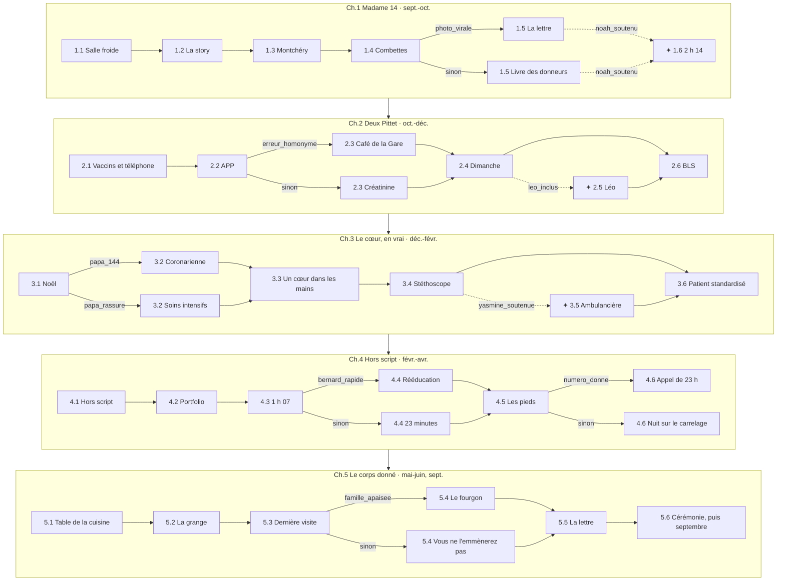

# MedStudents Y2 v2 — « Le corps donné » — Plan narratif

> **Statut (10.10.2026) : livre complet, refondu — 5 chapitres, 36 scènes écrites (5 ou 6
> scénarios joués par chapitre), 509 interactions, 2 068 réponses ; validé par le build
> (0 erreur, 0 avertissement), par l'audit du score et par les tests.**
> Source de vérité du contenu : `scripts/medstudents_y2_v2/` (DSL, distribution, chapitres) →
> `data/chapters/MedStudents_Y2_v2.json` par `scripts/build_medstudents_y2_v2.py`, qui écrit
> aussi `docs/MedStudents_Y2_v2_soft_skills.md` et `docs/MedStudents_Y2_v2_assets.md`.
> `books.py` pointe déjà vers la v2 ; `MedStudents_Y2_v1.json` est conservé pour référence.

## 1. Ce que disent les trois programmes de 2ᵉ année

Sources : `docs/programmes_medecine/` (UNIL plan d'études B2 2025-2026, UNIGE PE Bachelor 2025
art. 12-16, UZH Informationsbroschüre 2. Studienjahr 2026).

| | UNIL — BMed2 | UNIGE — 2ᵉ Bachelor | UZH — 2. Studienjahr |
|---|---|---|---|
| Logique | Systèmes « normaux », modules de 4-5 semaines | Unités par système + programmes longitudinaux | « Der gesunde Mensch » : Humanbiologie I et II |
| Systèmes | 2.1 Cellules et signaux (pharmaco, pathologie générale) · 2.2 Sang, immunité, microbes · 2.3 Neurosciences · 2.4 Circulation, respiration · 2.5 Digestion, métabolisme · 2.6 Urogénital et homéostasie | Croissance et vieillissement cellulaire · Nutrition, digestion, métabolisme · Reproduction · Cœur et circulation · Excrétion et homéostasie · Respiration · Os et articulations (neuro et immunité en 3ᵉ) | HB I : sang et immunité, cœur-circulation, respiration, digestion-nutrition, endocrinologie · HB II : SNC, organes des sens, rein, reproduction |
| Premier contact patient | 2.7 MSC *Patient·es dans la communauté* : rôle du médecin de famille et de l'équipe interprofessionnelle, en milieu professionnel | Stage IMFE chez un·e interniste généraliste ou un·e pédiatre | Workshadowing physiothérapie ; tracks Lucerne (urgence) et Saint-Gall (premier recours, interprofessionnalité) |
| Compétences cliniques | 2.8 Anamnèse et communication (patients simulés), urgences et réanimation, examen neuro, cardio-respiratoire, digestif | CC : attitudes, gestes de base, relation médecin-malade ; stations formatives | Klinischer Untersuchungskurs I-II (thorax, abdomen, statut neuro), sonographie |
| Anatomie | 2.10 TP anatomie, histologie | TP anatomie, histologie | Praktikum klinische Anatomie I-II |
| Professionnalisme | 2.9 Ateliers design de recherche | Identité professionnelle, Enseignement interprofessionnel 1 (facteurs humains), plagiat et IA générative, portfolio | POL-Tutorat (travail en groupe), Fokuswoche Forschung |

**Ce qu'on en tire pour le livre**

1. **Alex est pré-clinique.** Il·elle observe, fait une anamnèse supervisée, prend une tension, fait
   un BLS — jamais de décision thérapeutique. Le drame vient d'être « trop tôt » : savoir un peu,
   et qu'on vous en demande beaucoup (famille, patient·e·s, camarades).
2. **Trois lieux communs aux trois facultés** : la salle de dissection, le centre de simulation
   (patients standardisés), le cabinet de médecine de famille. Ce sont les trois décors du livre.
3. **Le calendrier suit les systèmes** : le thème médical de chaque chapitre est le module du
   moment (le sang en novembre, le cœur en décembre-janvier, le système nerveux en février, le rein
   et la reproduction en mai-juin).
4. **L'interprofessionnel et l'identité professionnelle** sont explicites (UNIL 2.7, UNIGE IP1 et
   identité professionnelle, UZH physio) → assistante médicale, infirmier du CMS, physiothérapeute,
   diététicienne, pharmacien, infirmière de soins palliatifs à l'écran.
5. UNIGE voit la neuro et l'immunité en 3ᵉ année : les chapitres 2 et 4 ne supposent aucune
   connaissance physiologique ; la compétence visée est relationnelle.
6. **Ce qu'on demande à Alex reste à sa portée de 2ᵉ année** : écouter, transmettre mot pour mot,
   vérifier une identité, appeler le 144, dire « pause réelle », poser une question directe sur le
   suicide, se taire dans une réunion de famille. Jamais un diagnostic ni un traitement.

## 2. Intention et fil rouge

Une année universitaire de 2ᵉ, de septembre à juin. Le lundi, Alex dissèque un corps anonyme :
**« Madame 14 »**, une hirondelle tatouée au poignet. Le jeudi, au cabinet de médecine de famille
de Montchéry, Alex suit **Jeannine Pittet**, 81 ans, ancienne sage-femme du village — qui a signé
son don du corps à la faculté et ne l'a dit à personne, surtout pas à son fils.

À mesure qu'Alex apprend le corps sain, module par module, le corps de Jeannine lâche, organe par
organe : les reins dès novembre, le cœur en janvier, les pieds et l'appétit en avril. En juin,
Jeannine meurt chez elle, et Alex est invité·e à prendre la parole à la cérémonie d'hommage aux
donneurs.

**La question qui traverse le livre : qu'est-ce qu'on doit à un corps ?** Au corps anonyme de la
salle de dissection, au corps du comédien qui « joue » le malade, au corps de son propre père, au
corps de Jeannine qui se donne.

Trois fils parallèles s'entrecroisent :

- **Montchéry** (fil rouge) — Jeannine, son fils Daniel, sa petite-fille Océane, le cabinet.
- **La faculté** — la dissection, le centre de simulation, le groupe de tutorat.
- **Alex et ses proches** — Noah qui se noie, Léo qui s'isole, Yasmine qui cache une blessure, le
  père d'Alex et son cœur.

## 3. L'entourage

| Personnage | Âge | Rôle | Ce qu'il/elle apporte |
|---|---|---|---|
| **Alex** | 20 | Étudiant·e en 2ᵉ année (joueur·euse) | Jamais à l'écran, neutre en genre. Même Alex que dans le Y4, deux ans plus tôt (aucune dépendance). |
| **Jeannine Pittet** | 81 | Patiente, ancienne sage-femme | Insuffisance cardiaque, diabète, reins qui lâchent. A mis au monde six cents enfants. Drôle, têtue, lucide. Fil rouge. |
| **Daniel Pittet** | 54 | Son fils, agriculteur | A trouvé son père sous le tracteur en 1998. Veut l'EMS et la dialyse. Apprend le don du corps — par elle, par Alex ou par le village. |
| **Océane Pittet** | 17 | Petite-fille, apprentie fleuriste | Proche de sa grand-mère, cash. Enceinte au chapitre 5. |
| **Jean-Paul Pittet** | 58 | Cousin brouillé, même village | L'homonyme. La langue la plus rapide du Café de la Gare. |
| **Dre Isabelle Golay** | 56 | Médecin de famille à Montchéry | Vingt-cinq ans de cabinet, trois générations de patients. Pas de successeur : fermeture en septembre. |
| **Sandra Nicolet** | 38 | Assistante médicale | Fait tourner le cabinet. Le post-it « PITTET J. = 2 ! ». Part au cabinet de groupe d'Orbe. |
| **Thierry Bovet** | 45 | Infirmier du CMS (soins à domicile) | Voit Jeannine trois fois par semaine. « Le jour où je meurs, tu ouvres la fenêtre. » |
| **Laura Steiner** | 29 | Physiothérapeute | Chutes, équilibre, rééducation de Bernard (workshadowing physio). |
| **Aline Morel** | 44 | Diététicienne du CMS | Dépistage de la dénutrition, sans calories ni protéines. |
| **M. Chappuis** | 62 | Pharmacien du village | Fait répéter l'ordonnance ; rappelle la médecin en cas de doute. |
| **Véronique Bühler** | 52 | Infirmière, équipe mobile de soins palliatifs | « On le fait un jour après l'autre. » |
| **Pre Hélène Vautier** | 58 | Anatomiste, responsable des TP de dissection | Gardienne du programme de don. Sévère sur la dignité, bouleversante à la cérémonie. |
| **Dre Anne-Laure Chevalley** | 47 | Responsable du centre de simulation | Débriefe sans humilier. Mène la revue d'incident du chapitre 4. |
| **Bernard Gilliéron** | 66 | Patient standardisé, ancien comédien | Feedback cruel et juste. Fait un AVC réel en pleine station. |
| **Odile Gilliéron** | 64 | Sa femme | « Pourquoi personne n'a rien fait pendant vingt-trois minutes ? » |
| **Dr Tomás Ibarra** | 34 | Tuteur APP/POL, médecin assistant en pédiatrie | Laisse le groupe se débrouiller, voit tout. |
| **Pr Lambelet** | 61 | Identité professionnelle, commission d'intégrité | Le portfolio de Noah ; la fausse déclaration. |
| **Dre Ammann** | 41 | Cardiologue, soins intensifs | Le stent, ou l'infarctus étendu ; l'échographie du père. |
| **Coralie Duc** | 29 | Patiente, mère d'Elio (2 mois) | « Vous, vous le feriez ? » |
| **Noah Berthoud** | 20 | Camarade, fils d'un chirurgien | Brillant, anxieux, se noie : chatbot, plagiat, épuisement, idées noires. |
| **Maëlle Dupasquier** | 21 | Camarade | Drôle, sur les réseaux. La story de la salle de dissection. |
| **Yasmine Benkirane** | 27 | Camarade, ex-ambulancière | Connaît le terrain, corrige tout le monde. Un nourrisson qu'elle n'a pas sauvé. |
| **Léo Studer** | 19 | Camarade, transféré de Zurich (UZH) | Bilingue, timide, isolé. Voit ce que les autres ne voient pas. |
| **Philippe** | 54 | Père d'Alex | Fumeur, hypertendu, « c'est l'estomac ». |
| **Nadia** | 52 | Mère d'Alex | « Toi qui fais médecine… » |
| **Mme Françoise Rapin** | 55 | Fille de « Madame 14 » | Reconnaît le tatouage de sa mère si la photo a circulé ; c'est elle qui lui avait verni les ongles. À la cérémonie dans tous les parcours. |

Lieux (fictifs) : Montchéry, village du pied du Jura ; la ferme des Combettes ; le Café de la Gare ;
« la faculté » (jamais nommée, pour valoir dans les trois universités).

## 4. Mécanique : branches parallèles et histoires annexes

Le moteur actuel le permet (voir `static/play/engine.js`) :

- **Dans une scène** — graphe d'interactions ramifié, 4 à 6 réponses par point de choix,
  plusieurs fins possibles (bonne issue, issue ratée, issue grave), et des **rattrapages** (le
  144 appelé à minuit au lieu de 20 h 40, le réveil à 3 h 12 après le « bonne nuit » de Noah).
- **⑂ Branche parallèle** — deux scènes au même rang (`Slot`), une seule est jouée selon les choix
  précédents (`Condition`). Les deux existent : deux joueur·euse·s ne vivent pas la même histoire.
- **✦ Histoire annexe** — scène conditionnelle débloquée par un choix (s'être occupé·e de Noah,
  avoir inclus Léo, être resté·e près de Yasmine). On peut la manquer.
- **Points d'entrée** (`EntryPoints`) — une même scène commence différemment selon ce que le
  village sait, ce qu'Alex a promis, etc. Le moteur ne fait varier une scène qu'à son début :
  quand deux mémoires se croisent (la lettre de 5.5 : post-scriptum × Noah), les combinaisons
  de points d'entrée sont générées par le code (`_entrees_lettre`).
- **Mémoire inter-chapitres** — les états (`SetFlags`) posés au chapitre 1 sont relus jusqu'au
  chapitre 5. **Écran de départ** (`StartChoice`) pour jouer le chapitre 5 isolé (la nuit de
  Noah) ; les autres chapitres ont une version par défaut quand les états précédents manquent.

Volume : **36 scènes écrites** sur 30 emplacements (27 obligatoires, 3 annexes) ; **27 à 30
scénarios joués** par parcours, 5 ou 6 par chapitre ; **509 interactions**, 2 068 réponses,
424 points de choix.

## 5. Chapitres et scènes

Légende : **RD** Respect et dignité · **EM** Empathie · **CO** Compassion · **ER** Régulation
émotionnelle · **CC** Clarté de communication · **PB** Frontières professionnelles · **IC**
Collaboration interprofessionnelle. ⚑ = état posé. ⑂ = branche parallèle. ✦ = annexe.
Les dominantes réelles de chaque scène sont dans `docs/MedStudents_Y2_v2_soft_skills.md`.

### Chapitre 1 — Madame 14 (septembre-octobre)
Focus : RD · EM · PB · CC — 7 scènes, 103 interactions, 453 réponses.
Ancrage : UNIL BMed2.10 (TP anatomie), BMed2.1 (cellules et signaux : vieillissement, pathologie
générale), BMed2.8 (anamnèse et communication), BMed2.7 (médecin de famille et équipe) · UNIGE TP
d'anatomie, Croissance et vieillissement cellulaire, compétences cliniques, stage IMFE, identité
professionnelle · UZH Praktikum klinische Anatomie I, Klinischer Untersuchungskurs I.

| Scène | Type | Focus | Ce qui s'y joue |
|---|---|---|---|
| 1.1 La salle froide | — | RD · ER · IC | Première dissection, le texte des donneurs, « Madame 14 » : une hirondelle tatouée, du vernis rouge écaillé. Noah fait un malaise ; Maëlle soulève la compresse et sort son téléphone ; Alex vacille au moment de couper, Léo prend le relais. ⚑ `noah_soutenu`, `maelle_avertie` |
| 1.2 La story | — | PB · RD · IC | 22 h 07 : la story de Maëlle, l'hirondelle visible ; à 23 h 41, un compte de mèmes la reprend. Lui écrire en privé, l'appeler, signaler, prévenir la Pre Vautier ; Noah veut qu'on se taise ; à 0 h 32, Maëlle a honte. ⚑ `photo_virale` / `photo_supprimee` (issue obligatoire), `maelle_vautier` |
| 1.3 Montchéry | — | CC · RD · IC | Premier jeudi au cabinet : Sandra, la salle d'attente, deux Pittet à l'appel. Anamnèse supervisée de Jeannine (chevilles, deux kilos, le mari mort sous le tracteur) ; ne pas lancer d'hypothèses devant elle. La carte de donneuse, l'invitation aux Combettes. ⚑ `anecdote_donneuse`, `golay_pas_informee` |
| 1.4 La ferme des Combettes | — | PB · EM · RD | Tournée avec Thierry (trois ouvertures selon 1.3). L'enveloppe « à ouvrir après » ; « pas un mot à Daniel » ; Daniel entre, puis attend Alex dans la cour. ⚑ `promesse_jeannine`, `revele_a_daniel`, `numero_donne` |
| 1.5 La lettre | ⑂ si `photo_virale` | RD · CO · PB | Convocation au bureau 112. Maëlle demande de mentir (« une blague de groupe »), Yasmine refuse. La lettre de la fille ; Mme Rapin : « C'est moi, le vernis. » ⚑ `mensonge_groupe`, `rencontre_rapin` |
| 1.5 Le livre des donneurs | ⑂ sinon | RD · CO · ER | Une page au livre de remerciements ; une cicatrice de césarienne ; Noah n'arrive pas à écrire, Léo propose « Danke. Merci. Grazie. », Yasmine laisse échapper une route à trois heures du matin ; la page de 2019. |
| 1.6 2 h 14 | ✦ si `noah_soutenu` | EM · ER · PB | Noah écrit en pleine nuit : le formol, son père, « tu signes pour moi la feuille de présence ? », « tu dis rien aux autres ? ». ⚑ `noah_confie`, `promesse_noah`, `signature_noah` |

### Chapitre 2 — Deux Pittet (octobre-décembre)
Focus : PB · CC · IC · EM — 7 scènes, 105 interactions, 433 réponses.
Ancrage : UNIL BMed2.2 (sang, immunité, microbes : immunité adaptative, épidémiologie), BMed2.8
(anamnèse et communication ; urgences et réanimation), BMed2.7 (équipe interprofessionnelle) ·
UNIGE dimensions communautaires (médecine ambulatoire, éthique, santé publique), APP/CBCL, plagiat
et IA générative, stage IMFE (pédiatre), gestes de base · UZH Humanbiologie I (Blut und
Immunsystem), POL-Tutorat I, Mantelstudium Notfall- und Rettungsmedizin (Lucerne).

| Scène | Type | Focus | Ce qui s'y joue |
|---|---|---|---|
| 2.1 Le jour des vaccins | — | CC · PB · EM · IC | Matin : Coralie Duc hésite à faire vacciner Elio, 2 mois — « Vous, vous le feriez ? ». Informer sans faire la leçon ni sortir de son rôle. Après-midi : les résultats arrivent, deux « Pittet J. » dans le logiciel ; vérifier nom, prénom et date de naissance avant de dire un mot. ⚑ `bon_pittet` / `appel_rattrape` / `erreur_homonyme` (+ `info_lachee`) (issue obligatoire) |
| 2.2 L'APP du jeudi | — | IC · CC · PB | Tutorat sur une anémie : Noah et son chatbot, Yasmine explose, Léo voit ce que personne n'a vu (« elle mange ce qui reste »), Maëlle veut tout confier à l'IA ; tour de table. Noah demande le texte de portfolio d'Alex. ⚑ `leo_inclus`, `texte_partage` |
| 2.3 Le Café de la Gare | ⑂ si `erreur_homonyme` | PB · RD · ER · IC | Jean-Paul a parlé au café ; Daniel débarque au cabinet : « C'est qui ? ». Dire « c'est moi » sans laisser Sandra porter l'erreur ; déclaration d'incident avec la Dre Golay (ce qui l'a rendu possible, ce qui change). ⚑ `aveu_homonyme` / `esquive_homonyme` |
| 2.3 La créatinine | ⑂ sinon | RD · CC · CO · ER | La fonction rénale baisse ; Jeannine refuse la dialyse, lucide. Ne pas plaider à la place de la médecin. « À Noël, je le dirai à Daniel. Vous serez là ? » ⚑ `noel_annonce` |
| 2.4 Le dimanche aux Combettes | — | EM · RD · PB · CO | Tournée du dimanche avec Thierry. Océane coince Alex dans la grange (trois ouvertures selon ce que la famille sait) ; le repas ; Jeannine parle de ses reins à sa petite-fille ; « T'as Insta ? ». ⚑ `oceane_confiance` |
| 2.5 Léo | ✦ si `leo_inclus` | EM · IC · CO | Réviser le sang à la bibliothèque ; Léo n'a parlé à personne depuis septembre ; le POL zurichois ; relire son portfolio sans l'écrire. ⚑ `leo_allie` |
| 2.6 BLS | — | IC · CC · ER · CO | Centre de simulation : communication en boucle fermée, qui mène, qui appelle ; Noah se fige quand c'est son tour ; quand le mannequin est un nourrisson, Yasmine sort. ⚑ `yasmine_soutenue` |

### Chapitre 3 — Le cœur, en vrai (décembre-février)
Focus : ER · CC · EM · CO — 7 scènes, 90 interactions, 356 réponses.
Ancrage : UNIL BMed2.4 (circulation, respiration : cycle cardiaque, physiopathologie), BMed2.8
(examen cardio-respiratoire ; anamnèse avec patient standardisé), BMed2.10 (anatomie du cœur) ·
UNIGE Cœur et circulation, Respiration, compétences cliniques (stations formatives) · UZH
Humanbiologie I (Herz-Kreislauf, Atmung), Klinischer Untersuchungskurs I, Praktikum Physiologie I
(ECG, tension, spirométrie), Praktikum klinische Anatomie I.

| Scène | Type | Focus | Ce qui s'y joue |
|---|---|---|---|
| 3.1 Le repas de Noël | — | PB · CC · ER · CO | Philippe, gris, la main sur la poitrine : « C'est la fondue. » Nadia : « Toi qui fais médecine… » Appeler le 144, ne pas le laisser conduire, l'aspirine sur conseil de la centrale — ou rassurer. Rattrapage possible à minuit. ⚑ `papa_144` / `papa_rassure` (issue obligatoire), `papa_minuit` |
| 3.2 L'unité coronarienne | ⑂ si `papa_144` | ER · EM · CO · PB | Stent à 1 h (ou à 3 h 10 après l'appel de minuit). « J'ai gâché Noël » ; la Dre Ammann ; rester l'enfant, pas le médecin ; Nadia au salon des familles. ⚑ `papa_promesse` |
| 3.2 Les soins intensifs | ⑂ sinon | ER · EM · PB · CO | Infarctus étendu. « Ça a commencé quand ? » ; « Tu as dit que c'était l'estomac. » Ni s'effondrer, ni se disculper ; l'infirmière qui s'accroupit dans le couloir. ⚑ `papa_promesse` |
| 3.3 Un cœur dans les mains | — | ER · RD · IC · CO | Le cœur de Madame 14 et ses trois pontages ; les mains d'Alex tremblent ; le droit de ne pas tenir ce cœur aujourd'hui ; Noah et le pontage de son père ; Maëlle range son téléphone. |
| 3.4 Le stéthoscope | — | CC · RD · IC · CO | Jeannine décompense : les crépitants « comme au cours ». Refus d'hospitalisation ; plan avec Thierry et le pharmacien (lire l'ordonnance mot pour mot) ; parler à Daniel. Entrées : Noël a-t-il eu lieu ? Daniel sait-il ? ⚑ `daniel_sait` |
| 3.5 L'ambulancière | ✦ si `yasmine_soutenue` | EM · ER · CO · IC | 23 h, Yasmine sur le muret : un nourrisson à Renens, une nuit de 2019. Écouter sans faire de cours. ⚑ `yasmine_alliee` |
| 3.6 Le patient standardisé | — | CC · EM · RD · IC | Bernard joue M. Rossier, céphalées : « Vous m'avez regardé trois fois. Votre tablette, quarante. » Le mot d'arrêt « pause réelle » ; la peur de l'attaque ; feedback des pairs. |

### Chapitre 4 — Hors script (février-avril)
Focus : ER · IC · PB · EM — 8 scènes, 114 interactions, 461 réponses.
Ancrage : UNIL BMed2.3 (neurosciences), BMed2.8 (système nerveux, pratique simulée), BMed2.5
(besoins nutritionnels), BMed2.7 · UNIGE stations formatives, enseignement interprofessionnel 1
(facteurs humains), identité professionnelle, plagiat et IA générative, Nutrition, digestion et
métabolisme · UZH Humanbiologie II (ZNS, Sinnesorgane), Klinischer Untersuchungskurs II (statut
neurologique), Workshadowing Physiotherapie, Humanbiologie I (Verdauung und Ernährung).

| Scène | Type | Focus | Ce qui s'y joue |
|---|---|---|---|
| 4.1 Hors script | — | ER · IC · CC · PB | Minute 6 : la parole de Bernard s'empâte, le verre tombe ; derrière la vitre, on rit. « Pause réelle », l'heure de début, les signes, transmettre — ou continuer l'anamnèse. Léo (`leo_allie`) et Yasmine (`yasmine_alliee`) peuvent aider. Thrombolyse à 14 h 52, ou vingt-trois minutes perdues. ⚑ `bernard_rapide` / `bernard_retard` (issue obligatoire) |
| 4.2 Le portfolio | — | PB · IC · ER · EM | Le texte de Noah écrit par une IA (et celui d'Alex dedans si `texte_partage`) ; la feuille de présence signée en septembre (`signature_noah`). « Dis que c'est toi qui m'as aidé à reformuler. » Le Pr Lambelet. ⚑ `mensonge_portfolio` / `verite_portfolio` (issue obligatoire) |
| 4.3 1 h 07 | — | EM · CO · ER · PB | Veille d'examen : « je crois que je vais tout arrêter. tout. » Demander directement s'il pense au suicide, rester en ligne, 144, ne pas porter seul·e. Entrées selon la promesse et la confidence de 1.6 ; rattrapage à 3 h 12. ⚑ `noah_aide` / `noah_seul` (issue obligatoire), `noah_tard` |
| 4.4 La rééducation | ⑂ si `bernard_rapide` | RD · IC · CO · EM | Workshadowing chez Laura : ne pas finir les phrases de Bernard ; le transfert du fauteuil au lit ; Odile qui n'ose plus le laisser seul. |
| 4.4 Vingt-trois minutes | ⑂ sinon | RD · CO · PB · IC | Bernard aphasique ; Odile : « vingt-trois minutes » ; « PAUSE RÉELLE » écrit de la main gauche ; revue d'incident du centre (facteurs humains, culture juste) ; Maëlle. |
| 4.5 Les pieds qui ne savent plus | — | IC · RD · EM · CO | Le cabinet fermera le 30 septembre ; Sandra part à Orbe (et ne parle plus à Alex si `esquive_homonyme`). Jeannine est tombée : neuropathie, diapason et équilibre avec Laura ; le bracelet d'alarme (« une laisse ») ; six kilos perdus : dépistage avec Aline et Thierry, Jeannine ment sur ses repas. ⚑ `alarme_posee` |
| 4.6 L'appel de 23 h | ⑂ si `numero_donne` | PB · ER · IC · CO | Jeannine appelle Alex : elle étouffe, ne veut « pas déranger la garde ». Appeler le 144 et rester en ligne — ou prendre la voiture. La carte des bons numéros. ⚑ `alex_y_va` |
| 4.6 La nuit sur le carrelage | ⑂ sinon | IC · PB · CC · CO | Cinq heures par terre — ou quatre minutes avec le bracelet (`alarme_posee`). Directives anticipées avec la Dre Golay ; Daniel dans la cour. |

### Chapitre 5 — Le corps donné (mai-juin, puis septembre)
Focus : CO · RD · PB · ER — 7 scènes, 97 interactions, 365 réponses.
Ancrage : UNIL BMed2.6 (urogénital et homéostasie : filtration glomérulaire, hormones de la
reproduction), BMed2.10 (fin des TP d'anatomie), BMed2.7 · UNIGE Excrétion et homéostasie,
Reproduction, dimensions communautaires (éthique), identité professionnelle · UZH
Humanbiologie II (Niere, Reproduktion), Praktikum klinische Anatomie II · dans les trois
facultés : cérémonie d'hommage aux donneuses et aux donneurs du corps.

| Scène | Type | Focus | Ce qui s'y joue |
|---|---|---|---|
| 5.1 La table de la cuisine | — | IC · RD · PB · CO | Réunion de famille : Daniel veut l'EMS d'Orbe et la dialyse ; Jeannine refuse et annonce le don du corps — ou Daniel le sait déjà (entrées selon `revele_a_daniel`, `noel_annonce`, `daniel_sait`, `erreur_homonyme`…). « Dites-leur, vous. » Rester à sa place. ⚑ `famille_apaisee` / `famille_dechiree` (issue obligatoire) |
| 5.2 La grange | — | EM · RD · PB · CO | Océane : enceinte, dix semaines, personne ne sait. Elle se confie (`oceane_confiance`) ou Alex la trouve malade dans le noir. Secret d'une mineure capable de discernement, orientation sans décider à sa place ; puis Jeannine : « Elle est enceinte, n'est-ce pas ? » ⚑ `oceane_orientee` / `oceane_trahie` / `oceane_seule` (issue obligatoire) |
| 5.3 La dernière visite | — | CO · ER · RD · PB | Soins palliatifs à domicile avec Véronique Bühler ; la main sur le ventre d'Océane ; l'enveloppe et « pour tous, pas pour moi ». Le lendemain, l'examen de fin d'année et l'appel de Sandra : des heures ou des jours ? ⚑ `examen_fini` / `examen_quitte` (issue obligatoire) |
| 5.4 Le fourgon | ⑂ si `famille_apaisee` | CO · IC · RD · ER | Jeannine est morte à 4 h 50. Les ongles rouges ; Thierry ouvre la fenêtre ; ne pas « constater » soi-même ; le fourgon de l'institut ; Daniel tient la porte. |
| 5.4 Vous ne l'emmènerez pas | ⑂ sinon | RD · PB · IC · ER | Daniel s'oppose au départ du corps ; la Pre Vautier au téléphone : un don se fait en paix ou ne se fait pas. Ne pas plaider ; Océane parle à son père ; Daniel tient la porte. |
| 5.5 La lettre | — | CO · ER · RD · PB | La lettre de Jeannine, avec un post-scriptum qui dépend du parcours (Daniel, l'homonyme, la grange, la promesse, le numéro) ; Noah selon la nuit de mars et le portfolio ; la Pre Vautier demande à Alex de parler, sans nom ; Léo ; la tentation de publier la lettre. |
| 5.6 La cérémonie | — | RD · CO · PB · ER | Hommage aux donneurs : Mme Rapin au troisième rang (reconnue ou non selon 1.2 et 1.5) ; le nom de Jeannine sur les lèvres. Épilogue, fin septembre : le dernier jour du cabinet, le post-it de Sandra, « Tu reviendras, toi ? ». ⚑ `nom_prononce` |

## 6. Carte globale

## 7. États narratifs (mémoire des choix)

| État | Posé en | Relu en | Effet |
|---|---|---|---|
| `photo_virale` / `photo_supprimee` | 1.2 | 1.5, 5.6 | Mme Rapin et le programme de dons ; comment Alex la voit à la cérémonie. |
| `maelle_avertie` | 1.1 | 1.2 | Maëlle avait juré avoir effacé la photo. |
| `maelle_vautier` | 1.2 | 1.2 (bilan), 1.5 | Alex et Maëlle sont allés voir la Pre Vautier. |
| `mensonge_groupe` / `rencontre_rapin` | 1.5 (lettre) | 1.5 (bilan), 5.6 | Le mensonge collectif ; la rencontre avec Mme Rapin. |
| `anecdote_donneuse`, `golay_pas_informee` | 1.3 | 1.4 | Ouvertures de la visite aux Combettes. |
| `revele_a_daniel` | 1.4 | 1.4 (bilan), 2.3, 2.4, 3.4, 5.1, 5.5 | Daniel sait le don par Alex : confiance perdue, post-scriptum de la lettre. |
| `promesse_jeannine` | 1.4 | 1.4 (bilan), 5.5 | « Ne promettez plus jamais l'impossible à un malade. » |
| `numero_donne` | 1.4 | 4.6, 5.5 | Jeannine appelle Alex au lieu de la garde. |
| `noah_soutenu` | 1.1 | 1.6 | Débloque l'annexe « 2 h 14 ». |
| `noah_confie` / `promesse_noah` | 1.6 | 4.3 | Noah écrit à Alex en premier ; « tu m'avais promis ». |
| `signature_noah` | 1.6 | 4.2 | La signature de complaisance ressort avec le portfolio. |
| `erreur_homonyme` (+ `info_lachee`) / `bon_pittet` / `appel_rattrape` | 2.1 | 2.1 (bilan), 2.3, 2.4, 3.4, 5.1, 5.5 | Le village apprend la maladie ; Daniel l'apprend au café. Quasi-incident sinon. |
| `aveu_homonyme` / `esquive_homonyme` | 2.3 (café) | 2.3 (bilan), 4.5 | Sandra ne parle plus à Alex jusqu'à l'annonce de la fermeture. |
| `noel_annonce` | 2.3 (créatinine) | 3.4, 5.1 | Jeannine a promis de parler à Daniel à Noël, Alex présent·e. |
| `leo_inclus` → `leo_allie` | 2.2 → 2.5 | 2.5, 4.1 | Léo à l'interphone pendant l'AVC de Bernard. |
| `texte_partage` | 2.2 | 4.2 | Les deux textes signalés par l'anti-plagiat. |
| `oceane_confiance` | 2.4 | 5.2 | Océane se confie, ou Alex la trouve malade dans la grange. |
| `yasmine_soutenue` → `yasmine_alliee` | 2.6 → 3.5 | 3.5, 4.1 | Yasmine frappe à la vitre pendant l'AVC. |
| `papa_144` / `papa_rassure` (+ `papa_minuit`) | 3.1 | 3.1 (bilan), 3.2, 3.3 | Stent à temps, à minuit, ou infarctus étendu. |
| `papa_promesse` | 3.2 | 3.2 (bilan) | Alex promet de revenir samedi. |
| `daniel_sait` | 3.4 | 5.1 | La Dre Golay a parlé à Daniel : entrée de la réunion de famille. |
| `bernard_rapide` / `bernard_retard` | 4.1 | 4.4 | Rééducation, ou aphasie et revue d'incident. |
| `mensonge_portfolio` / `verite_portfolio` | 4.2 | 5.5 | En juin, Noah s'excuse de l'avertissement, ou remercie. |
| `noah_aide` (+ `noah_tard`) / `noah_seul` | 4.3 | 4.3 (bilan), 5.5 | Noah revient à la fac, ou travaille chez son oncle à Neuchâtel. |
| `alarme_posee` | 4.5 | 4.6 (carrelage) | La nuit par terre : cinq heures, ou quatre minutes. |
| `alex_y_va` | 4.6 (appel) | 4.6 (bilan) | Quarante minutes de route de nuit pour un œdème pulmonaire. |
| `famille_apaisee` / `famille_dechiree` | 5.1 | 5.1 (bilan), 5.3, 5.4 | Daniel au chevet ou dans la cour ; le départ du corps. |
| `oceane_orientee` / `oceane_trahie` / `oceane_seule` | 5.2 | 5.2 (bilan), 5.5 | Le post-scriptum de la lettre. |
| `examen_quitte` / `examen_fini` | 5.3 | 5.3 (bilan) | « Pas un seul n'est arrivé à l'heure prévue. » Rattrapage en août. |
| `nom_prononce` | 5.6 | 5.6 (bilan) | Océane au premier rang quand le nom tombe. |

Écran de départ (`StartChoice`) : chapitre 5 (la nuit de Noah). Les autres chapitres ont une
version par défaut cohérente quand les états précédents sont inconnus.

## 8. Erreurs graves et leurs suites

Selon la préférence du projet : des erreurs réalistes pour une 2ᵉ année, dont les conséquences
continuent dans l'histoire.

| Erreur | Où | Suites |
|---|---|---|
| Liker ou ignorer la story de la salle de dissection | 1.2 | Une fille reconnaît sa mère → programme de dons menacé → elle est à la cérémonie. |
| Révéler le don du corps à Daniel | 1.4 | Confiance perdue ; réunion de famille plus dure ; post-scriptum de la lettre. |
| Ne pas vérifier l'identité au téléphone (homonyme) | 2.1 | Secret médical rompu (art. 321 CP, qui vise aussi les étudiant·e·s) → café, Daniel, Sandra, réunion de famille. |
| Rassurer son père au lieu d'appeler le 144 | 3.1 | Infarctus étendu, soins intensifs, mère qui accuse (rattrapage à minuit possible). |
| Ne pas sortir du script quand Bernard fait un AVC | 4.1 | Vingt-trois minutes, aphasie, Odile, revue d'incident. |
| Mentir pour Noah / le laisser seul la nuit | 4.2, 4.3 | Avertissement pour fausse déclaration ; Noah retrouvé au matin, qui quitte la médecine. |
| Donner son numéro, puis conduire seul·e de nuit | 1.4, 4.6 | Jeannine attend Alex au lieu des secours. |
| Trahir Océane auprès de son père | 5.2 | La Dre Golay ne mentira pas pour Alex ; post-scriptum de la lettre. |
| Prononcer le nom de Jeannine à la cérémonie | 5.6 | Anonymat du don brisé devant sa famille. |

Les choix qui mènent à l'erreur ne sont **pas** caricaturaux : ce sont les réponses d'un·e
étudiant·e pressé·e, gentil·le, qui veut aider.

## 9. Barème et audit du score

Chaque réponse est notée de −3 à +3 sur les 7 dimensions. Très bon ≥ +9 · bon +4 à +8 · moyen
−1 à +3 · mauvais −6 à −2 · très mauvais ≤ −7. **4 à 6 réponses par point de choix**, une seule
meilleure, au moins une moyenne et une mauvaise, souvent un geste non verbal. Chaque chapitre a
au moins un choix ≥ +9 et un choix ≤ −7.

**Audit du 10.10.2026.** Le rejeu serveur (`replay_scene`, puis `choice_quality`) était juste :
toujours la meilleure réponse = 100, toujours la pire = 0. Mais la **clé** avait trois défauts :

| Mesure (livre entier) | Avant la refonte | Après |
|---|---:|---:|
| Choisir toujours la réponse la plus longue | **89,5**/100 | 46,4 |
| La meilleure réponse est la plus longue | 80 % des points de choix | 29 % |
| Part de la Compassion dans les points positifs | 6 % | 11 % |
| Compétences non notées (moins de 8 preuves) sur certains parcours | oui (CO, ER) | aucune |
| Au hasard | ≈ 48 | 46,7 |

Ce qui a été fait : longueur des réponses équilibrée (le rang de longueur de la meilleure réponse
est réparti de 1 à 6), meilleure réponse unique à chaque point de choix, gestes de soin concrets
notés en Compassion, chemins les plus courts allongés pour que chaque compétence soit en jeu dans
au moins 8 choix. Depuis, **le build vérifie tout cela à chaque génération** (et échoue sinon) ;
le détail chapitre par chapitre est dans `docs/MedStudents_Y2_v2_soft_skills.md`, section
« Audit du score ».

## 10. Repères médicaux et juridiques (contexte suisse)

- **Secret professionnel** : art. 321 CP — vise aussi les étudiant·e·s pour ce qu'ils et elles
  apprennent pendant leurs études. Vérifier l'identité (nom, prénom, date de naissance) avant
  toute information au téléphone.
- **Mineur·e capable de discernement** : décide seul·e de ses soins et de qui est informé ;
  orientation vers son médecin et un centre de santé sexuelle.
- **Interruption de grossesse** : non punissable dans les 12 semaines sur demande écrite de la
  femme (art. 119 CP), au-delà sur avis médical ; consultation d'un centre spécialisé obligatoire
  avant 16 ans. À 17 ans, Océane décide seule.
- **Refus de traitement** (dialyse) : droit de la personne capable de discernement ; directives
  anticipées (art. 370 ss CC).
- **Don du corps** : déclaration écrite à l'institut d'anatomie ; anonymat des donneur·euse·s ;
  l'institut peut renoncer à un don ; cérémonie annuelle d'hommage dans les facultés.
- **Infarctus** : appeler le 144, ne pas conduire le patient ; aspirine seulement sur conseil de
  la centrale, en l'absence de contre-indication.
- **AVC** : BE-FAST, heure de début des symptômes, 144 ; thrombolyse dans les 4 h 30.
  En simulation : mot d'arrêt convenu pour signaler une urgence réelle.
- **Risque suicidaire** : poser la question directement, ne pas laisser seul·e, 144 en cas de
  danger immédiat, 143 (La Main Tendue), service de consultation psychologique de l'université.
- **Insuffisance cardiaque** : pesée quotidienne, prise de poids rapide → appeler ; diurétiques.
- **Dénutrition de la personne âgée** : dépistage (MNA), urémie, goût métallique.
- **Soins palliatifs à domicile** : équipe mobile, réserves anticipées (morphine pour la
  dyspnée, midazolam en cas d'agitation) ; le décès est constaté par un·e médecin.

## 11. Mise en œuvre

Fait le 04.10.2026 :

1. Outillage propre au Y2 (indépendant du Y4) : `scripts/medstudents_y2_v2/dsl.py` (scènes
   `annex=True`, réponse `go()` pour « Continuer »), `cast.py` (toute la distribution du livre),
   `book.py` (`MUTEX`, `OUTCOMES`), et `scripts/build_medstudents_y2_v2.py`, qui valide en plus :
   4 à 6 réponses par point de choix, une scène par emplacement pour toute combinaison d'états
   (zéro ou une pour une annexe), et les issues obligatoires (chaque parcours de 1.2 pose
   exactement `photo_virale` ou `photo_supprimee`).
2. Chapitres 1 à 6 écrits ; `books.py` pointe vers `MedStudents_Y2_v2.json` ; tests
   `tests/test_medstudents_y2_v2.py`.
3. Parcours joueur (`static/play/`) : le compteur « Scénario x sur y » ne compte plus les annexes
   non débloquées ; une interaction finale sans réponse est affichée avant le bilan ; Entrée
   valide un bouton « Continuer » unique.

Refonte du 10.10.2026 :

1. **Cinq chapitres de cinq ou six scénarios** au lieu de six : le vaccin et le téléphone ne font
   plus qu'une journée (2.1) ; le BLS passe au chapitre 2 ; le patient standardisé au chapitre 3 ;
   la fermeture du cabinet, les chutes et la dénutrition se rejoignent en 4.5 ; l'appel de 23 h
   passe au chapitre 4 ; l'examen et la dernière visite se rejoignent en 5.3 ; septembre devient
   l'épilogue de la cérémonie. L'annexe du balcon et l'atelier de recherche sont retirés.
2. **509 interactions** (463 avant) : nouvelles interactions dans toutes les scènes, rattrapages
   (minuit à Noël, 3 h 12 pour Noah), nœuds d'entrée selon la mémoire.
3. **Clé de notation rééquilibrée** et contrôlée par le build (voir §9).

Reste à faire : les images des personnages (`docs/MedStudents_Y2_v2_assets.md`) ; jouer les
chapitres 1 à 4 de la nouvelle version dans le navigateur ; faire valider la clé de cotation par
le panel d'experts (étape 2 du scoring v2).
