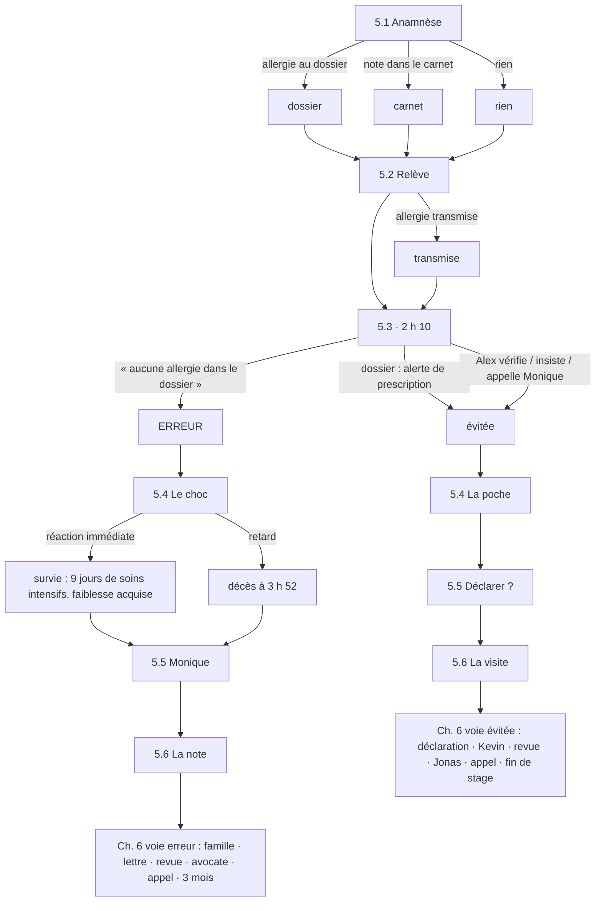

# MedStudents Y4 v2 — Bible narrative

> Document de conception du livre **MedStudents Y4** (version 2).
> Source de vérité du contenu : `scripts/medstudents_y4_v2/` → généré dans
> `data/chapters/MedStudents_Y4_v2.json` par `scripts/build_medstudents_y4_v2.py`.
> La répartition chiffrée des soft skills (calculée sur les scores réels) est dans
> `docs/MedStudents_Y4_v2_soft_skills.md`, régénérée à chaque build.

## 1. Intention

La v1 était une anthologie : quatre chapitres, quatre services, des patients qui ne
se croisent jamais. La v2 raconte **six semaines de stage d'Alex au 3ᵉ étage de
médecine interne de l'Hôpital du Val-Clair** (établissement fictif), avec toujours
la même équipe autour. Les compétences travaillées restent celles de la v1
(annonce par paliers, pacte de silence, incertitude, parole à l'enfant) ; ce qui
change, c'est que **les choix ont une mémoire** :

- une phrase rassurante du chapitre 1 revient en pleine figure au chapitre 4 ;
- une promesse intenable faite à une fille inquiète ressort deux jours plus tard ;
- une ligne d'anamnèse bâclée à 19 h tue — ou pas — un patient à 3 h du matin,
  et toute la suite (famille, avocate, revue d'incident, collègue suspendu)
  découle de ce qui s'est passé cette nuit-là.

Le but est que la personne qui joue **se souvienne du chapitre 5**.

## 2. L'entourage

| Personnage | Âge | Rôle | Ce qu'il/elle apporte au récit |
|---|---|---|---|
| **Alex** | 23 | Étudiant·e en M1 (joueur·euse) | Jamais à l'écran. Neutre en genre (« prêt·e »). |
| **Dr Moreau** | 42 | Médecin-chef, médecine interne | Mentor exigeant. Pose les questions qui fâchent, protège sans couvrir. |
| **Dr Samuel Neuhaus** | 31 | Médecin assistant, 3ᵉ année | Brillant, drôle, épuisé. Enchaîne les gardes, coupe les virages quand il est débordé. Prescrit l'antibiotique de la nuit du 14. |
| **Inès Rey** | 36 | Infirmière référente (jour) | La conscience du service. « C'est moi qui reste dans la chambre après. » |
| **Kevin Da Silva** | 34 | Infirmier de nuit | Dix ans de nuits, calme, fiable. C'est lui qui branche la perfusion. Deuxième victime. |
| **Fatou Diallo** | 55 | ASSC (assistante en soins) | Trente ans d'hôpital. Entend ce que les familles ne disent pas aux médecins. |
| **Jonas Meier** | 24 | Co-stagiaire M1 | Humour noir en guise d'armure, compte les gestes comme des trophées. Miroir d'Alex. |
| **Dre Keller** | 51 | Oncologue consultante | Directe, parfois brusque. L'information n'est pas négociable, son rythme l'est. |
| **Mathilde Favre** | 47 | Infirmière, équipe mobile de soins palliatifs | Arrive au chapitre 4. Sait nommer la mort sans la brandir. |
| **Nathalie Perrin** | 50 | Responsable sécurité des patients | Mène la revue d'incident. Culture juste : chercher le système, pas le coupable. |
| **Pierre-Alain Rochat** | 58 | Juriste de l'hôpital | Explique à Alex ses droits et ses devoirs quand arrive la lettre recommandée. |
| **Me Claire Dufaux** | 46 | Avocate de la famille Jaquier | Précise, pas cruelle. Veut les faits, heure par heure. |

**Patients et familles**

| Chapitre | Patient·e | Entourage |
|---|---|---|
| 1, 4 | **M. António Ferreira**, 58 ans, carreleur — adénocarcinome pulmonaire métastatique | **Carla** (31, fille aînée, organise tout), **Joana** (27, cadette, se marie en septembre), **Lina** (9, fille de Carla) |
| 2, 6 | **Mme Haddad**, 74 ans, institutrice retraitée — masse pancréatique | **Sofia** (45, fille, a vécu l'annonce brutale du cancer de son père) |
| 3 | **Yann Dubois**, 26 ans — céphalées et paresthésies sans diagnostic | sa compagne (hors champ) |
| 3 | **Malick Sow**, 31 ans — test de dépistage VIH réactif | **Chloé Martin** (29, sa compagne) |
| 5, 6 | **M. Roland Jaquier**, 71 ans, aiguilleur CFF retraité — pneumonie, **allergie grave à la pénicilline non documentée** | **Monique** (69, épouse, celle qui sait), **Olivier** (43, fils, ingénieur, celui qui prend un avocat) |

## 3. L'arc

| Chap. | Semaine | Titre | Fil rouge |
|---|---|---|---|
| 1 | S1 | Les mots qu'on n'a pas appris | Première annonce grave (M. Ferreira). Rencontre de l'équipe. |
| 2 | S2 | Et si on ne disait rien ? | Pacte de silence (Mme Haddad / Sofia). |
| 3 | S3 | Le doute | Semaine de policlinique : annoncer sans diagnostic (Yann, Malick). |
| 4 | S5 | Ceux qui restent | M. Ferreira revient pour mourir. Les deux sœurs, Lina, le mariage dans la chambre, la dernière nuit. |
| 5 | S6 | Une seule ligne | La nuit du 14. L'anamnèse de M. Jaquier, la relève, 2 h 10 : l'antibiotique. |
| 6 | S7-8 (+3 mois) | Ce qui reste | Les conséquences : famille, lettre d'avocate, revue d'incident, audition — ou le quasi-accident et ce qu'on en fait. |

Le chapitre 4 prépare le chapitre 5 sans le dire : Alex sort de la mort de
M. Ferreira, et Jonas lui demande d'échanger une nuit de garde. Accepter, c'est
arriver à la nuit du 14 avec deux nuits dans les jambes — ce que l'avocate
demandera au chapitre 6.

## 4. Chapitres et scènes

Légende des soft skills : **RD** Respect et dignité · **EM** Empathie ·
**CO** Compassion · **ER** Régulation émotionnelle · **CC** Clarté de
communication · **PB** Frontières professionnelles · **IC** Collaboration
interprofessionnelle. Les compétences listées par scène sont le **focus visé** ;
le focus de chapitre reprend les dominantes réellement obtenues. La répartition
chiffrée (par chapitre et par scène) est dans `docs/MedStudents_Y4_v2_soft_skills.md`.

### Chapitre 1 — Les mots qu'on n'a pas appris (S1)
Focus chapitre : CC · RD · EM · IC

| Scène | Origine | Focus | Ce qui s'y joue |
|---|---|---|---|
| 1.1 Premier matin | **nouvelle** | IC · RD · PB | Arrivée au 3ᵉ. Neuhaus lance Alex dans le tour, Inès teste, Jonas veut « le patient intéressant ». Un diagnostic lâché devant le voisin de chambre. |
| 1.2 Avant d'entrer | v1 1.1 | CC · IC · ER | Préparer l'annonce avec Dr Moreau et Inès. |
| 1.3 L'annonce | v1 1.2 | CC · EM · ER · RD | L'annonce par paliers. ⚑ La réponse sur le mariage de septembre est mémorisée. |
| 1.4 Le lendemain | v1 1.3 | RD · EM · IC | « Une infection au poumon » : dire à Carla sans déposséder le père. |
| 1.5 Le vestiaire | **nouvelle** | ER · RD · IC | Vendredi soir. Jonas plaisante sur « le carreleur qui a pleuré », Inès propose un débriefing, Dr Moreau demande ce qu'Alex fait de tout ça. |

### Chapitre 2 — Et si on ne disait rien ? (S2)
Focus chapitre : RD · CC · PB · EM

| Scène | Origine | Focus | Ce qui s'y joue |
|---|---|---|---|
| 2.1 Dans le couloir | v1 2.1 | EM · PB · RD | Sofia demande le silence. ⚑ Une promesse intenable est mémorisée (effacée si Alex rectifie). |
| 2.2 Ce que la patiente demande | v1 2.2 | RD · CC · EM · CO | Mme Haddad veut savoir — et décider qui sait. |
| 2.3 Le colloque | v1 2.3 | IC · PB · CC | Défendre une position devant Keller, Moreau, Inès. |
| 2.4 Sofia | **nouvelle** | ER · EM · PB | Sofia découvre que sa mère sait. Colère au desk infirmier. Si Alex avait promis : « Vous m'aviez promis. » |
| 2.5 La chaise du jardin | **nouvelle** | RD · CO · CC · EM | Mme Haddad parle à sa fille, avec Alex dans la pièce. Rentrer à la maison. |

### Chapitre 3 — Le doute (S3, policlinique)
Focus chapitre : CC · PB · RD · ER

| Scène | Origine | Focus | Ce qui s'y joue |
|---|---|---|---|
| 3.1 La consultation | v1 3.1 | CC · EM · ER | Yann, IRM normale. ⚑ Filet de sécurité remis ou non ; symptômes réduits « au stress » ou non. |
| 3.2 Le résultat qui n'en est pas un | v1 3.2 | CC · EM · RD | Malick, dépistage VIH réactif. ⚑ Affirmer un diagnostic non confirmé est mémorisé (effacé si Alex rectifie). |
| 3.3 Le débriefing | v1 3.3 | ER · PB · IC | Tolérer sa propre incertitude. |
| 3.4 Au guichet | **nouvelle** | PB · EM · RD | Chloé, la compagne de Malick, demande. Secret médical. ⚑ Secret rompu ou non. |
| 3.5 Jeudi, 14 h | **nouvelle** | CC · EM · RD · ER | Confirmation négative. Ce que les 48 h ont coûté dépend de 3.2 et 3.4. |
| 3.6 Douze jours plus tard | **nouvelle** | CC · EM · PB · ER | Yann revient : névrite optique. Est-il venu le jour même, ou a-t-il attendu parce qu'on lui avait dit « le stress » ? |

### Chapitre 4 — Ceux qui restent (S5)
Focus chapitre : CO · IC · CC · RD

| Scène | Focus | Ce qui s'y joue |
|---|---|---|
| 4.1 Chambre 312 | RD · EM · PB · IC | M. Ferreira revient, très affaibli : « Je veux arrêter. Vous m'aidez à le dire ? » Alex ne décide pas seul·e. |
| 4.2 Les deux sœurs | IC · EM · ER · CC | Réunion de famille. Carla veut « tout faire », Joana veut qu'on écoute son père. |
| 4.3 Lina | EM · RD · CC · CO | « Est-ce que Vovô va mourir ? » Parler à une enfant de 9 ans, avec sa mère qui veut la protéger. |
| 4.4 Le mariage | CO · IC · RD | Joana veut sa cérémonie dans la chambre. Si Alex avait dit au ch. 1 que septembre « devrait aller », M. Ferreira s'en souvient. |
| 4.5 La dernière nuit | CO · ER · IC · CC | Détresse respiratoire, Carla réclame la réanimation, réserves palliatives, le décès. Le premier d'Alex. |
| 4.6 Le matin d'après | ER · IC · CO · PB | La toilette mortuaire avec Fatou, le dessin de Lina. Jonas demande d'échanger la nuit du 14. ⚑ Nuits enchaînées ou non. |

### Chapitre 5 — Une seule ligne (S6, la nuit du 14)
Focus chapitre : PB · CC · IC · ER

Trois scènes communes, puis deux voies de trois scènes (6 scènes jouées dans tous les cas).

| Scène | Condition | Focus | Ce qui s'y joue |
|---|---|---|---|
| 5.1 L'entrée de 19 h | — | CC · RD · PB | Anamnèse de M. Jaquier. Monique : « Il a fait une réaction à la pénicilline. » Roland : « C'était rien. » La lettre des urgences dit « aucune allergie connue ». ⚑ Allergie documentée au dossier / notée dans le carnet d'Alex / rien. |
| 5.2 La relève | — | IC · CC · ER | Transmissions à Kevin et Neuhaus. Fatou : « La dame m'a parlé de pénicilline, c'est noté ? » ⚑ Allergie transmise. |
| 5.3 Deux heures dix | — | IC · PB · CC | Neuhaus au téléphone depuis les urgences : « Il a des allergies ? » Quatre entrées selon ce qu'Alex a fait avant. ⚑ **Erreur** ou **évitée**. |
| 5.4 Le choc | erreur | ER · IC · PB | Anaphylaxie sous bêtabloquant. Chaque seconde compte. ⚑ **Décès** ou **survie**. |
| 5.5 Quatre heures | erreur | RD · CO · PB · ER | Monique arrive. « Je l'avais dit. Je vous l'avais dit à vous. » ⚑ Aveu ou esquive. |
| 5.6 La ligne | erreur | PB · ER · IC | Salle de repos. Neuhaus propose de « rédiger la note ensemble ». La tentation de corriger la ligne d'anamnèse. ⚑ Dossier modifié. |
| 5.4 La poche | évitée | IC · CC · ER | Kevin montre la poche d'amoxicilline déjà préparée. |
| 5.5 Sept heures | évitée | PB · IC · ER | Neuhaus : « Pas besoin de déclarer, il ne s'est rien passé. » ⚑ Déclaration CIRS. |
| 5.6 La visite | évitée | RD · CC · CO | M. Jaquier réveillé, Monique reconnaissante. Dire ou non que la poche était prête. ⚑ Quasi-accident dit. |

### Chapitre 6 — Ce qui reste (S7-8, puis trois mois)
Focus chapitre : PB · ER · IC · CC

Si le chapitre 5 n'a pas été joué, un écran propose de choisir la nuit vécue
(décès / survie / erreur évitée). Deux voies de cinq scènes, plus une scène commune.

| Scène | Voie | Focus | Ce qui s'y joue |
|---|---|---|---|
| 6.1 La rencontre | erreur | RD · CO · CC · ER | Entretien d'annonce d'incident avec Monique et Olivier, Dr Moreau, N. Perrin. Présenter des excuses sans spéculer. Variantes décès / survie et aveu / esquive. |
| 6.2 La lettre | erreur | PB · CC · ER | Lettre de Me Dufaux. Le juriste. Le carnet d'Alex. Si le dossier a été modifié : l'historique d'accès l'a enregistré. |
| 6.3 La revue | erreur | IC · PB · CC | Revue d'incident. Tout le monde regarde Kevin. Alex dit sa part — ou non. |
| 6.4 Me Dufaux | erreur | PB · CC · ER · RD | L'avocate interroge Alex, heure par heure. « Combien d'heures aviez-vous dormi ? » |
| 6.1 La déclaration | évitée | IC · PB · ER | Suite de la déclaration CIRS (ou de son absence). Neuhaus : « Tu m'as balancé. » |
| 6.2 Kevin | évitée | EM · IC · ER | Kevin a failli brancher la poche. Douze nuits d'affilée. Il pense à arrêter. |
| 6.3 La revue | évitée | IC · CC · PB | Revue du quasi-accident : copier-coller, effectifs de nuit, entrées faites par des étudiants. |
| 6.4 Jonas | évitée | PB · IC · EM | Jonas a inversé deux étiquettes de tubes. Il demande à Alex de se taire. |
| 6.5 Un appel | commune | CO · EM · ER | Sofia Haddad appelle : sa mère est morte chez elle, dans la chaise du jardin. |
| 6.6 Trois mois plus tard | erreur | CO · ER · RD | Décès : Monique demande à voir Alex. Survie : Roland, en fauteuil, en rééducation. Puis l'évaluation de fin de stage. |
| 6.6 Fin de stage | évitée | ER · RD · IC | L'évaluation avec Dr Moreau, la carte de Monique, ce qu'Alex emporte. |

## 5. Carte des embranchements (ch. 5-6)

## 6. États narratifs (flags)

Un choix peut poser ou effacer un état (`SetFlags` / `ClearFlags`). Une scène peut
être conditionnelle (`Condition`) et avoir plusieurs points d'entrée
(`EntryPoints`, le premier qui correspond gagne, avec une introduction propre).
Les états sont mémorisés par livre dans le navigateur : ceux du chapitre 1 sont
relus au chapitre 4. Rejouer un chapitre efface les états qu'il pose ; « Refaire
ce scénario » restaure ceux qui existaient à l'entrée de la scène.

| État | Posé en | Relu en | Effet |
|---|---|---|---|
| `mariage_rassure` | 1.3 | 4.4 | M. Ferreira : « Vous m'aviez dit que septembre, ça irait. » |
| `mariage_anticipe` | 1.3 | 4.4 | « Vous m'aviez dit de ne pas attendre. On a bien fait. » |
| `promesse_sofia` | 2.1 | 2.4 | Sofia : « Vous m'aviez promis. » |
| `yann_filet` / `yann_stress` | 3.1 | 3.6 | Yann est venu le jour même, ou a attendu six jours. |
| `sow_affirme` | 3.2 | 3.4, 3.5 | Malick a cru 48 h qu'il était séropositif, l'a dit à Chloé. |
| `secret_rompu` | 3.4 | 3.5 | Malick sait qu'on a parlé à Chloé. |
| `nuits_enchainees` | 4.6 | 5.1, 6.4 | Alex arrive à la nuit du 14 après une nuit blanche. L'avocate le demande. |
| `allergie_dossier` / `allergie_carnet` | 5.1, 5.2 | 5.3, 6.2 | Détermine l'entrée de 5.3 ; le carnet devient une pièce au ch. 6. |
| `allergie_transmise` | 5.2 | 5.3 | Kevin se souvient de la relève. |
| `erreur` / `evite` | 5.3 | 5.4-6.6 | Sépare les deux voies. |
| `deces` / `survie` | 5.4 | 5.5, 6.1, 6.6 | Monique veuve, ou Roland en fauteuil. |
| `aveu` / `esquive` | 5.5 | 6.1 | Ce que Monique a entendu la nuit même. |
| `dossier_modifie` | 5.6 | 6.2, 6.4 | L'historique du dossier trahit la correction de 6 h 47. |
| `cirs_declare` | 5.5 (évitée) | 6.1 (évitée) | Déclaré par Alex, ou découvert par Kevin. |
| `quasi_dit` | 5.6 (évitée) | 6.2, 6.6 (évitée) | La famille sait que la poche était prête. |

## 7. Barème des choix

Chaque réponse porte un score de −3 à +3 sur chacune des 7 dimensions
(+3 exemplaire, +2 net, +1 partiel, 0 non concerné, −1 écart léger, −2 écart net,
−3 manquement grave). La somme classe le choix :

| Catégorie | Somme | Usage |
|---|---|---|
| Très bon | ≥ +9 | Au moins un par interaction décisive |
| Bon | +4 à +8 | |
| Moyen | −1 à +3 | La réponse « raisonnable » qui ferme une porte |
| Mauvais | −6 à −2 | |
| Très mauvais | ≤ −7 | Mensonge, abandon, faute de sécurité, dissimulation |

Chaque point de choix propose **4 à 6 réponses** : au moins une très bonne ou bonne, une moyenne, une mauvaise ou très mauvaise, souvent un geste non verbal. Le parcours joueur mélange l'ordre d'affichage (toujours le même pour une interaction donnée), pour que la meilleure réponse ne soit pas toujours la première.

Au chapitre 5, les choix qui mènent à l'erreur ne sont **pas** caricaturaux : ce
sont les réponses qu'un·e étudiant·e fatigué·e, pressé·e et respectueux·se de la
hiérarchie choisirait. Leur coût se lit dans l'histoire, pas dans l'intitulé.

## 8. Repères médicaux et juridiques (contexte suisse)

- **Anaphylaxie** : arrêter l'agent, appeler l'équipe d'urgence, adrénaline
  0,5 mg IM (cuisse, répétable à 5 min), décubitus jambes surélevées (demi-assis
  si détresse respiratoire), O₂, remplissage. Un **bêtabloquant** rend la réaction
  plus sévère et moins sensible à l'adrénaline (M. Jaquier en prend un pour sa
  fibrillation auriculaire).
- **Pneumonie communautaire** : amoxicilline-clavulanate IV en première
  intention ; en cas d'allergie grave aux pénicillines, lévofloxacine.
- **CIRS** (Critical Incident Reporting System) : déclaration anonyme et non
  punitive des incidents et quasi-incidents, répandue dans les hôpitaux suisses.
- **Communication après incident** (Sécurité des patients Suisse, *Quand un
  incident survient*) : informer rapidement, exprimer ses regrets et présenter
  des excuses, ne pas spéculer sur les responsabilités avant l'analyse, désigner
  un interlocuteur, assurer un suivi.
- **Responsabilité** : pour un hôpital public, c'est en principe l'établissement
  qui répond civilement envers le patient (lois cantonales sur la responsabilité
  de l'État). Au pénal (homicide ou lésions corporelles par négligence,
  art. 117 et 125 CP), une enquête peut viser des personnes.
- **Dossier** : toute correction se fait par un ajout daté et signé, jamais par
  réécriture ; les systèmes gardent l'historique. Réécrire après coup peut
  constituer un faux dans les titres (art. 251 CP).
- **Fin de vie** : décision de non-réanimation documentée, réserves de morphine
  et midazolam sous-cutanés pour la dyspnée et l'angoisse, constat de décès par
  le médecin.

## 9. Ancrage curriculaire

Conservé de la v1 (UNIL M1.5-M1.7, UNIGE M1 AMC médecine interne et médecine de
premier recours, disciplines transversales éthique et médecine légale), complété
par la sécurité des patients et la communication après incident (UNIL M1.7
droit médical ; UNIGE enseignement interprofessionnel). Le volet anténatal et
pédiatrique de la v1 (Léa Vernier, Lina diabétique) n'est pas repris : la
compétence « parler à l'enfant » passe par Lina, petite-fille de M. Ferreira.
La v1 reste disponible dans `data/chapters/MedStudents_Y4_v1.json`.
