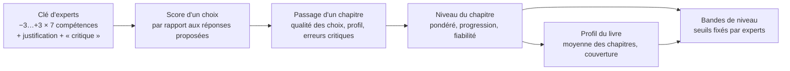

# Scoring v2 — ce que dit la recherche, et le plan pour End of Life

> Statut (06.10.2026) : **étape 1 implémentée** (§ 3.2 à 3.5 : qualité des choix, passage de
> chapitre, niveau / progression / fiabilité, profil du livre), avec les réglages par défaut
> du § 6. **Étape 2 outillée** (§ 3.1) : grille ancrée provisoire, grille d'experts à
> l'aveugle, import, accord (ICC), synthèse Delphi, champs « critique » et « justification » ;
> reste à constituer le panel et à appliquer la clé consensuelle. Restent aussi les bandes
> (§ 3.6) et la validation (§ 4).
> Mesures faites sur MedStudents Y2 v2 avec des joueur·euse·s simulé·e·s
> (`scripts/seed_demo.py`, base jetable) ; références vérifiées une à une (§ 7).
> Mise à jour (10.10.2026) : la clé du livre 2 a été auditée et corrigée (indice de longueur,
> Compassion sous-mesurée), et le build la contrôle désormais (§ 3.1, point 6).
> Mise à jour (12.10.2026) : bibliographie refaite. Ne restent que des articles publiés avec
> comité de lecture **et lisibles gratuitement** : 33 références (§ 7), chacune avec un lien
> qui ouvre son PDF.
> **Proposition v3 (12.10.2026), non implémentée :** après lecture intégrale des 33 articles,
> [Scoring_v3_proposition.md](Scoring_v3_proposition.md) garde l'essentiel de ce plan et en
> corrige trois points : la progression, les bandes et ce que voit l'étudiant·e.
> **Clé du livre 2 (12.10.2026) :** plutôt qu'un panel humain (2 017 réponses à coter),
> Claude a coté chaque réponse : un tour à l'aveugle, un tour de revue des divergences avec
> l'auteur, puis un tour de calibrage pour le build. Cette clé est appliquée au jeu, mais
> reste **provisoire** : il faut encore qu'un échantillon ciblé soit relu par des
> enseignant·e·s. Méthode, accord (ICC du total : 0,90) et limites :
> [MedStudents_Y2_v2_cle.md](MedStudents_Y2_v2_cle.md).

## 0. En bref

1. **Le scoring actuel a deux défauts mesurables.**
   - Répondre au hasard donne déjà **48/100**.
   - Un·e joueur·euse parfait·e plafonne à **83/100**.
   - L'échelle utile ne fait donc que 35 points, et « 50/100 » veut dire « au hasard ».
2. **Les points des réponses ne sont pas encore justifiés.** Les −3…+3 par compétence ont été
   écrits par l'auteur seul, sans grille ni validation. La littérature sur les tests de jugement
   situationnel (SJT), dont nos scènes sont une variante, est unanime : la clé de cotation doit
   venir d'un panel d'experts, avec une grille ancrée et un accord mesuré.
3. **Le plan proposé :**
   - noter **chaque choix** par rapport aux réponses proposées à ce moment-là, ce qui donne une
     échelle de 0 à 100, 100 étant atteignable ;
   - additionner ces choix **par chapitre** ;
   - suivre **chaque chapitre dans le temps**, avec trois indicateurs : niveau, progression et
     fiabilité ;
   - calculer le profil du livre à partir des chapitres, sans exiger de rejouer tout le livre ;
   - traiter les erreurs critiques à part ;
   - transformer les nombres en quatre niveaux fixés par des experts.

## 1. Le scoring actuel, et ce que la mesure montre

Aujourd'hui (`services/scoring_service.py`) :

- **Points des réponses :** chaque réponse vaut de −3 à +3 sur 7 compétences.
- **Note d'une scène :** pour chaque compétence, on compare les points obtenus au pire et au
  meilleur total *possibles depuis le point d'entrée*. Ces bornes sont calculées **séparément pour
  chaque compétence**.
- **Note de session :** les scènes s'additionnent sur tout le livre. Une session n'est notée que
  quand **tous les chapitres** sont finis. Seule la 1ʳᵉ tentative d'une scène compte.
- **Note pondérée du livre :** les sessions terminées sont combinées, la Nᵉ pesant
  1 + 0,25 × (N − 1).

Mesure sur le livre Y2 : 30 parties au hasard, 15 parties « moyennes » (meilleure réponse une fois
sur deux), 5 parties « gloutonnes » (toujours la réponse au meilleur total) :

| Joueur·euse simulé·e | Note globale actuelle | « Qualité des choix » proposée (§ 3.2) |
|---|---|---|
| Au hasard | **48** (43–52) | 49 |
| Moyen·ne | 64 | 74 |
| Toujours la meilleure réponse | **80** | **100** |
| Meilleur chemin possible | 83 (plafond) | 100 |

Ce que montrent les chiffres :

1. **Pas de zéro de référence.** 48/100 pour le hasard : une note « moyenne » ne dit pas si
   l'étudiant·e a réfléchi.
2. **Un plafond inatteignable.** Les maxima de chaque compétence se trouvent sur des chemins
   différents, et personne ne peut les emprunter tous à la fois. Résultat : 83/100 au mieux, et
   la compassion plafonne à 64 même pour le joueur glouton.
3. **Une note liée à la session entière.** Refaire un seul chapitre ne compte pas : il faut
   rejouer tout le livre.
4. **Des compétences peu mesurées par chapitre.** Nombre de choix où chaque compétence est en jeu,
   pour un parcours :

   | Compétence | ch.1 | ch.2 | ch.3 | ch.4 | ch.5 | ch.6 |
   |---|---|---|---|---|---|---|
   | Choix notés | 43 | 27 | 30 | 23 | 26 | 23 |
   | Compassion | 11 | 5 | 10 | 6 | 5 | 14 |
   | Régulation émotionnelle | 17 | 6 | 19 | 11 | 10 | 15 |
   | Respect et dignité | 39 | 20 | 19 | 18 | 24 | 21 |

   Une note de compassion au chapitre 2 repose sur 5 choix : elle n'est pas fiable seule (§ 2.5).

## 2. Ce que dit la recherche

### 2.1 Concevoir l'évaluation à partir des preuves (Evidence-Centered Design)
Une évaluation par le jeu se construit en trois modèles :
- les **compétences** à inférer ;
- les **preuves**, c'est-à-dire quels comportements renseignent sur quelles compétences et avec
  quelles règles ;
- les **tâches** qui provoquent ces comportements.

Le score n'est pas un compteur de points. C'est un *argument* qui va de l'action observée à la
compétence. C'est le cadre de l'Evidence-Centered Design, que Arieli-Attali et al. (2019) étendent
aux systèmes qui mêlent apprentissage et évaluation. L'« évaluation furtive » applique ce cadre
dans le jeu lui-même : dans un jeu vidéo, les estimations tirées des actions des élèves corrèlent
avec des tests externes de résolution de problèmes (Shute et al. 2016).

→ Pour nous : documenter, pour chaque compétence, quels choix la renseignent et pourquoi. La
grille du § 3.1 sert à ça.

### 2.2 Nos scènes sont des tests de jugement situationnel
Un SJT présente une situation et des réponses possibles ; on note la réponse choisie par rapport
à une **clé**. C'est exactement notre format.
- **En médecine :** le guide AMEE n° 100 fait la synthèse du format, de son origine (la
  « simulation basse fidélité ») et de sa validité (Patterson, Zibarras & Ashworth 2016).
- **Validité prédictive :** une mesure des connaissances sur le comportement interpersonnel chez des
  étudiant·e·s en médecine prédit leur performance en stage 7 ans plus tard, et au travail 9 ans
  plus tard (Lievens & Sackett 2012).

**La manière de noter change la qualité de la mesure :**
- à l'admission en médecine, la fidélité et les écarts entre groupes dépendent de la méthode
  de cotation (de Leng et al. 2017) ;
- parmi cinq méthodes de cotation par consensus, l'une des plus courantes (la cote brute) était
  la moins valide ; les méthodes qui neutralisent les réponses extrêmes donnent une meilleure
  validité (Weng et al. 2018) ;
- revue d'ensemble récente : Kepes et al. 2025.

→ Pour nous : la clé (les −3…+3) doit être **établie par des experts, puis contrôlée sur les
données**. Elle ne peut pas rester le jugement d'un seul auteur.

### 2.3 Une clé d'experts se construit avec une méthode
- **Consensus :** méthode Delphi, en décrivant les tours, la définition du consensus et le choix
  des experts. Une revue des études Delphi en soins palliatifs en tire des recommandations
  (CREDES ; Jünger et al. 2017).
- **Mesure de l'accord :** coefficient de corrélation intraclasse (ICC). Il est bon à partir de
  0,75 et excellent à partir de 0,90 (Koo & Li 2016).
- **Ancrage des compétences :**
  - le cadre suisse PROFILES, adapté de CanMEDS (Michaud & Jucker-Kupper 2016) : rôles
    communicateur, collaborateur, professionnel ;
  - les éléments essentiels de la communication de Kalamazoo, dont la grille se cote de façon
    cohérente par les tuteurs, les patients standardisés et les étudiant·e·s (Joyce et al. 2010) ;
  - le guide Calgary-Cambridge, utilisable pour évaluer des étudiant·e·s en début de cursus
    (Simmenroth-Nayda et al. 2014).

### 2.4 Ramener chaque mesure sur 0–100 de façon interprétable
- **Pourcentage du maximum possible :** exprimer un score entre le minimum et le maximum d'une
  échelle. C'est ce que fait déjà notre code, mais sur des bornes impossibles à atteindre
  ensemble (§ 1).
- **Correction du hasard :** en QCM, on corrige la part due au hasard (Frary 1988). Même logique
  ici : 50/100 obtenu au hasard ne doit pas ressembler à une compétence moyenne.

### 2.5 Une performance dépend de la situation : il faut plusieurs situations
- **Spécificité du cas :** la performance varie d'une situation à l'autre. Sur un ECOS de 18
  stations passé par 278 étudiant·e·s, la station est l'une des principales sources de variance ;
  la théorie de la généralisabilité, utilisée dans cette étude, quantifie combien de situations
  il faut pour une note fiable (Trejo-Mejía et al. 2016). Une note fiable demande donc beaucoup
  d'occasions de mesure.
- **Évaluation programmatique :** chaque point de mesure sert l'apprentissage ; les décisions
  importantes se prennent sur l'agrégation de nombreux points (Heeneman et al. 2021).

→ Pour nous : afficher l'incertitude, et ne pas publier une note de compétence par chapitre
quand elle repose sur trop peu de choix.

### 2.6 Suivre la progression sur plusieurs passages
- **Courbes d'apprentissage :** elles relient l'effort (les passages) à la performance, et des
  seuils leur donnent un sens (Howard et al. 2023).
- **Gain normalisé :** progression rapportée à la progression encore possible,
  g = (après − avant) / (100 − avant). Le « changement normalisé » en est la version individuelle,
  qui gère aussi les reculs. Les deux favorisent les personnes qui partent haut : ils se lisent
  avec prudence (Nissen et al. 2018).
- **Modèles de l'apprenant :** ils estiment le niveau courant en donnant plus de poids aux
  observations récentes (Corbett & Anderson 1995 ; Pelánek 2016 ; Pelánek 2017). Dans ce domaine,
  on juge un modèle à sa capacité à prédire la réponse suivante (Pelánek 2017).
- **Oubli :** même apprises en simulation, des compétences baissent dans les mois qui suivent
  (Legoux et al. 2021). Une vieille performance représente moins bien le niveau actuel.

### 2.7 Attention : rejouer le même scénario gonfle le score
- **Effet de répétition :** à l'admission en médecine en Belgique, les candidat·e·s qui repassent
  un SJT gagnent environ un tiers d'écart-type (Lievens, Buyse & Sackett 2005).
- **Méta-analyse :** les gains au retest sont plus forts quand on repasse **exactement le même
  test** (Hausknecht et al. 2007).
- **Fidélité test-retest des SJT :** environ 0,70 (Harenbrock et al. 2023).
- **Versions alternatives :** même de petits changements de contexte changent la mesure (Lievens &
  Sackett 2007).
- **« Jouer avec le système » :** dans les logiciels d'apprentissage, exploiter les régularités du
  logiciel au lieu d'apprendre est lié à un apprentissage plus faible (Baker et al. 2004).

→ Pour nous : séparer le **premier passage**, la mesure la plus pure, des passages suivants ;
espacer les passages comptés ; varier l'ordre des réponses.

### 2.8 Erreurs critiques : non compensables
À l'ECOS, beaucoup de facultés ajoutent à la note globale une règle **non compensatoire** : un
nombre minimal de stations réussies, pour qu'une bonne note ailleurs ne masque pas un échec.
Homer & Russell (2021) en discutent les raisons et les méthodes.

→ Pour nous : violer le secret médical ou ne pas appeler le 144 ne doit pas se compenser par
dix réponses polies.

### 2.9 Seuils, validité et feedback
- **Seuils de réussite :** on les fixe avec des juges et une méthode explicite, par exemple Angoff
  modifié, comparé aux méthodes des cas limites (Dwyer et al. 2016).
- **Validité selon Kane :** on vérifie quatre inférences. La **cotation** (la note reflète-t-elle
  la performance ?), la **généralisation** (à d'autres scènes), l'**extrapolation** (au monde réel)
  et les **conséquences** (Cook & Hatala 2016).
- **Contre-exemple :** un jeu sérieux infirmier dont le score ne distinguait pas étudiant·e·s et
  expert·e·s. Les auteurs concluent qu'il ne doit pas servir à noter (Blanié et al. 2020).
- **Feedback :** il a un effet moyen sur l'apprentissage (d = 0,48 sur 435 études), d'autant plus
  fort qu'il apporte d'information sur la tâche (Wisniewski, Zierer & Hattie 2020). Il doit être
  précis et non jugeant (Shute 2008).
- **Patients virtuels en communication :** ce qui marche, c'est le débriefing, l'étayage et le
  **feedback humain**, pas le feedback automatique seul (Lee et al. 2020).

## 3. Le modèle proposé

### 3.1 Niveau 0 — La clé de cotation (ce qui vaut des points)
1. **Une grille ancrée par compétence.** On écrit ce que veut dire −3, −1, 0, +1, +3, avec des
   exemples, aligné sur PROFILES, Kalamazoo et Calgary-Cambridge. Exemple pour Frontières
   professionnelles :
   - +3 : reste dans son rôle et oriente vers la bonne personne ;
   - 0 : neutre ;
   - −3 : sort de son rôle d'une manière qui expose le patient, par exemple en donnant un
     résultat ou un numéro personnel.
2. **Un panel d'au moins 5 experts** cote les réponses sans voir les cotes de l'auteur, en deux
   tours Delphi. Profils : médecin de famille, infirmier·ère, enseignant·e en communication
   médicale, psychologue, médecin assistant·e. On retient la médiane et on mesure l'accord
   (ICC ≥ 0,75 visé). On revoit les réponses où les experts divergent.
3. **Une justification d'une phrase par réponse**, montrée dans le feedback. Le score cesse
   d'être « sorti de nulle part ».
4. **Un marqueur `critique`** sur les réponses dangereuses pour le patient ou contraires à la loi :
   secret médical (art. 321 CP), absence d'appel au 144, absence de question directe sur le
   suicide…
5. **Analyse des réponses après un pilote**, avec l'export Excel déjà en place. On regarde quelle
   réponse est choisie par les meilleur·e·s et par les plus faibles, et on écarte les réponses qui
   ne discriminent pas.

6. **Aucun indice de forme.** La meilleure réponse ne doit pas se reconnaître à sa forme
   (longueur, ton), sinon on mesure l'habileté à « lire le test » et non le jugement. Audit du
   10.10.2026 sur le livre 2, avec des joueur·euse·s simulé·e·s rejoué·e·s par le calcul
   serveur : choisir toujours la réponse la plus longue donnait **89,5/100** (la meilleure était
   la plus longue dans 80 % des points de choix) ; après correction, 46,4 (au hasard : 46,7).
   Le build du livre échoue désormais si une stratégie fondée sur la longueur dépasse 62/100 sur
   un chapitre, si deux réponses sont ex aequo au meilleur, ou si une compétence est en jeu dans
   moins de 8 choix sur le parcours le plus court (sinon elle n'est pas notée).

*Outil :* exporter la clé du livre vers Excel, une ligne par réponse avec une colonne par expert,
puis réimporter la clé de consensus.

### 3.2 Niveau 1 — Le score d'un choix
À chaque point de choix, on compare la réponse choisie aux réponses **proposées à ce moment-là**.

- **Qualité du choix (total)** = (total choisi − pire total proposé) / (meilleur total proposé −
  pire total proposé) × 100.
- **Par compétence :** même calcul sur la compétence, seulement quand elle est en jeu, c'est-à-dire
  quand les réponses diffèrent sur elle.
- **Corrigé du hasard** (affichage optionnel) = (gain − gain moyen au hasard) / (écart − gain moyen
  au hasard). On obtient 0 au hasard, 100 pour le meilleur choix, et une valeur négative pour un
  choix pire que le hasard.

*Exemple :* quatre réponses valent +9, +3, −2 et −8 ; l'étudiant·e choisit +3.
- Qualité = (3 + 8) / (9 + 8) = **65**.
- Au hasard, on gagnerait en moyenne (17 + 11 + 6 + 0) / 4 = 8,5 sur 17.
- Corrigé du hasard = (11 − 8,5) / (17 − 8,5) = **29** : un peu mieux que le hasard.

**Pourquoi c'est mieux :**
- 100 devient atteignable (ce n'est pas le cas aujourd'hui, § 1) ;
- un choix est jugé par rapport à ses vraies alternatives, comme un item de SJT ;
- la note ne dépend plus de bornes calculées sur des chemins incompatibles.

**Les conséquences de l'histoire restent visibles,** mais à part : la fin de scène atteinte (bonne,
mitigée, grave) et les erreurs critiques sont montrées à côté du nombre, pas mélangées dedans.

### 3.3 Niveau 2 — Le passage d'un chapitre (l'unité de note)
Un **passage** = jouer un chapitre en entier, dans un parcours complet ou seul.

- **Qualité des choix du chapitre** = Σ gains / Σ écarts sur tous ses choix. Un choix décisif,
  avec un grand écart entre les réponses, pèse plus qu'un choix anodin.
- **Profil par compétence :** même somme, compétence par compétence. Une compétence n'est affichée
  que si elle est en jeu dans **au moins 8 choix** du chapitre ; sinon « pas assez de données
  dans ce chapitre » et elle ne compte qu'au niveau du livre.
- **Erreurs critiques :** liste et nombre. **Règle non compensatoire :** un passage avec une erreur
  critique ne peut pas dépasser la bande « À consolider », quel que soit son nombre.
- **Fins atteintes :** nombre de scènes terminées sur une issue bonne, mitigée ou grave (le ton
  des bilans, déjà dans les livres).

### 3.4 Niveau 3 — Le chapitre dans le temps : plusieurs passages
Pour chaque couple (étudiant·e, chapitre), les passages comptés forment une courbe
d'apprentissage. Trois indicateurs, affichés ensemble :

| Indicateur | Calcul | Ce qu'il dit |
|---|---|---|
| **Niveau** | Moyenne pondérée des passages, le n-ième pesant 1 + 0,25 × (n − 1) | Où en est l'étudiant·e aujourd'hui |
| **Progression** | Changement normalisé entre le 1ᵉʳ passage et le niveau (Nissen et al. 2018) | Combien il ou elle a gagné sur ce qui restait à gagner |
| **Fiabilité** | Nombre de passages et de choix, fourchette d'incertitude | Combien la note est solide |

Ces indicateurs répondent à « plus il ou elle fait de sessions, plus son parcours compte » :
1. **Les passages récents pèsent plus.** C'est la règle actuelle, mais appliquée par chapitre.
2. **Plus de passages = une note plus sûre.** La fourchette se resserre. Un niveau est « confirmé »
   quand il est atteint sur 2 passages, comme en apprentissage jusqu'à la maîtrise.
3. **Le parcours est noté.** La progression et la courbe font partie du bilan, pas seulement la
   dernière note.

**Choix du coefficient 0,25.** C'est aujourd'hui un choix pédagogique. Une fois les données pilotes
recueillies, on le calibre comme on évalue un modèle de l'apprenant : on garde la pondération qui
**prédit le mieux le passage suivant** (Pelánek 2017). On peut aussi comparer avec une moyenne mobile exponentielle.

**Répétition et apprentissage par cœur** (§ 2.7) :
- le **1ᵉʳ passage** d'un chapitre est gardé à part comme « score à froid » ;
- un nouveau passage ne compte que s'il a lieu **au moins 7 jours** après le précédent passage
  compté de ce chapitre. Avant, c'est de l'entraînement, comme les rejeux d'aujourd'hui ;
- l'ordre des réponses change à chaque passage. Aujourd'hui il est toujours le même
  (`stableShuffle` utilise l'interaction comme graine) ;
- la meilleure preuve de progrès est un progrès qui se transfère : une compétence qui monte aussi
  dans des chapitres **jamais rejoués**.

**Ne pas mélanger effort et compétence.** Le nombre de passages est montré et valorisé (fiabilité,
courbe), mais il n'ajoute pas de points à la compétence. Sinon, la note mesure l'assiduité, et
l'inférence « cette note = ce niveau » ne tient plus (Kane).

### 3.5 Niveau 4 — Le profil du livre, sans session obligatoire
- **Note du livre** = moyenne des **niveaux des chapitres**, chaque chapitre pesant autant
  (un chapitre = un module du programme). Refaire le chapitre 3 met à jour le chapitre 3, puis le
  livre. Plus besoin de rejouer les autres.
- **Profil par compétence :** pondéré par la quantité de preuves. Chaque chapitre contribue selon
  le nombre de choix où la compétence est en jeu. La compassion vient donc surtout des
  chapitres 1, 3 et 6.
- **Couverture :** « 4/6 chapitres évalués ». La note du livre est **partielle** tant qu'un
  chapitre n'a aucun passage compté.
- **L'histoire continue de fonctionner.** Quand on rejoue un chapitre seul :
  - il démarre avec les états narratifs enregistrés au début de ce chapitre lors du dernier
    passage, enregistrés à chaque passage à partir de maintenant ;
  - sinon, avec l'écran de départ, qui existe déjà pour les chapitres 5 et 6.

  La « session » reste utile pour jouer l'histoire d'un bout à l'autre, mais elle n'est plus
  l'unité de note.

### 3.6 Niveau 5 — Des bandes plutôt qu'un nombre seul

| Bande | Seuils provisoires (qualité des choix) | Repère |
|---|---|---|
| Insuffisant | < 60 | proche du hasard (≈ 50) |
| À consolider | 60–74 | un·e joueur·euse « moyen·ne » simulé·e ≈ 74 |
| Compétent | 75–89 | |
| Avancé | ≥ 90 | |

Ces seuils sont **provisoires**. Ils sont à remplacer par un Angoff modifié : les experts estiment
chapitre par chapitre ce que ferait un·e étudiant·e « tout juste compétent·e » de 2ᵉ année
(Dwyer et al. 2016).

### 3.7 Niveau 6 — Expliquer chaque note
- **Pour chaque choix :** la réponse choisie, la meilleure réponse et **la justification des
  experts**.
- **Pour chaque chapitre :** les deux plus grandes occasions manquées (déjà calculées), les erreurs
  critiques, la courbe.
- **Pour le formateur :** l'export et le tableau de bord servent au **débriefing humain**, qui est ce
  qui rend les patients virtuels efficaces (Lee et al. 2020).

## 4. Valider le score (Kane)

| Inférence | Question | Ce qu'on fait |
|---|---|---|
| Cotation | La note reflète-t-elle la qualité des choix ? | Clé d'experts (Delphi), ICC ≥ 0,75, justification par réponse |
| Généralisation | Une autre scène donnerait-elle la même note ? | Fidélité par chapitre (moitiés de chapitre, théorie de la généralisabilité), fidélité test-retest à 7 jours ou plus |
| Extrapolation | Dit-elle quelque chose du comportement réel ? | Corrélation avec les ECOS de communication et l'avis des tuteurs ; groupes contrastés : étudiant·e·s de 2ᵉ, de 6ᵉ, médecins assistant·e·s (le test raté par Blanié et al. 2020) |
| Conséquences | Quels effets sur l'apprentissage ? | Usage **formatif** tant que la validation n'est pas faite ; surveiller le « jeu avec le système » |

## 5. Mise en œuvre (après validation de ce plan)
1. **Données du livre :** champs `Critical` et `Rationale` par réponse ; export et réimport de la
   clé pour le panel d'experts.
2. **Moteur :** score par choix, table des passages de chapitre (états narratifs au départ et à
   l'arrivée, compté ou non, qualité, profil, erreurs critiques), niveau, progression, fiabilité.
3. **Règles :** comptage (1ᵉʳ passage + passages espacés), pondération, seuil de 8 choix par
   compétence, plafond en cas d'erreur critique, bandes.
4. **Interface :**
   - côté joueur·euse : bouton « Rejouer ce chapitre » et courbe par chapitre dans l'historique ;
   - côté formateur : profil du livre avec la couverture, colonnes par chapitre dans le tableau de
     bord.
5. **Historique :** recalcul des anciennes parties à partir de leurs traces (indices des réponses),
   en conservant l'ancien instantané.
6. **Export :** nouvelle table `passages`, nouveaux indicateurs.
7. **Tests**, puis un pilote avec une volée : analyse des réponses, fidélité, calibrage du
   coefficient.

## 6. Décisions à prendre

Réglages retenus pour l'étape 1 (06.10.2026, recommandations par défaut, modifiables) :
- pondération des passages : **1 + 0,25 × (n − 1)** par chapitre ;
- délai entre deux passages notés : **7 jours** (`PASSAGE_SPACING_DAYS`) ;
- note du livre : **chapitres à poids égal**.

Encore ouvertes :
1. **Pondération des passages :** garder 1 + 0,25 × (n − 1) par chapitre, ou une moyenne mobile
   exponentielle ? À calibrer sur les données du pilote (§ 3.4).
2. **Espacement des passages comptés :** 7 jours, une autre durée, ou aucun délai ?
3. **Erreur critique :** plafonner la bande (recommandé) ou seulement la signaler ?
4. **Panel d'experts :** qui, et pour quand ? En attendant, les cotes actuelles restent
   « provisoires » dans l'interface.
5. **Note du livre :** chapitres à poids égal (retenu) ou pondérés par leur nombre de choix ?

## 7. Bibliographie

**Critères (revus le 12.10.2026).** Chaque référence remplit deux conditions :
- c'est un article publié dans une revue scientifique à comité de lecture, ou dans les actes
  d'une conférence à comité de lecture (CHI) ; son DOI a été vérifié auprès de Crossref,
  d'OpenAlex et de PubMed (type de publication, revue, pages, absence de rétractation) ;
- son texte intégral est **gratuit** : le lien « PDF » ouvre l'article, sans abonnement ni
  paiement. Il mène à une source sûre : l'éditeur en libre accès, PubMed Central, un dépôt
  d'université, l'archive HAL ou la page universitaire de l'auteur·e. Chaque lien a été ouvert
  dans un navigateur le 12.10.2026 ; certains sites font d'abord une vérification automatique de
  quelques secondes.

Une « version acceptée » est le texte accepté après relecture par les pairs, sans la mise en
page de la revue. Les articles payants sans version gratuite ont été retirés ou remplacés par
des articles en libre accès (journal de développement, § 2.26). 33 références.

**Concevoir une évaluation par le jeu**
- Arieli-Attali, M., Ward, S., Thomas, J., Deonovic, B., & von Davier, A. A. (2019). The expanded evidence-centered design (e-ECD) for learning and assessment systems: A framework for incorporating learning goals and processes within assessment design. *Frontiers in Psychology*, 10, 853. *Article méthodologique.* doi:10.3389/fpsyg.2019.00853 · **[PDF](https://www.frontiersin.org/articles/10.3389/fpsyg.2019.00853/pdf)** (version publiée, libre accès, Frontiers)
- Shute, V. J., Wang, L., Greiff, S., Zhao, W., & Moore, G. (2016). Measuring problem solving skills via stealth assessment in an engaging video game. *Computers in Human Behavior*, 63, 106–117. *Étude empirique.* doi:10.1016/j.chb.2016.05.047 · **[PDF](https://myweb.fsu.edu/vshute/pdf/pvz.pdf)** (version publiée, page de l'autrice, Florida State University)

**Nos scènes sont des tests de jugement situationnel (SJT)**
- Patterson, F., Zibarras, L., & Ashworth, V. (2016). Situational judgement tests in medical education and training: Research, theory and practice: AMEE Guide No. 100. *Medical Teacher*, 38(1), 3–17. *Revue de la littérature (guide AMEE).* doi:10.3109/0142159X.2015.1072619 · **[PDF](https://openaccess.city.ac.uk/id/eprint/12506/1/AMEE%20SJT%20Guide%202015.pdf)** (version acceptée, City Research Online)
- de Leng, W. E., Stegers-Jager, K. M., Husbands, A., Dowell, J. S., Born, M. P., & Themmen, A. P. N. (2017). Scoring method of a Situational Judgment Test: influence on internal consistency reliability, adverse impact and correlation with personality? *Advances in Health Sciences Education*, 22(2), 243–265. *Étude empirique.* doi:10.1007/s10459-016-9720-7 · **[PDF](https://repub.eur.nl/pub/96435/REPUB_96435-OA.pdf)** (version publiée, libre accès, Université Érasme de Rotterdam)
- Weng, Q., Yang, H., Lievens, F., & McDaniel, M. A. (2018). Optimizing the validity of situational judgment tests: The importance of scoring methods. *Journal of Vocational Behavior*, 104, 199–209. *Étude empirique.* doi:10.1016/j.jvb.2017.11.005 · **[PDF](https://ink.library.smu.edu.sg/cgi/viewcontent.cgi?article=6772&context=lkcsb_research)** (version acceptée, dépôt de la Singapore Management University)
- Lievens, F., & Sackett, P. R. (2012). The validity of interpersonal skills assessment via situational judgment tests for predicting academic success and job performance. *Journal of Applied Psychology*, 97(2), 460–468. *Étude empirique longitudinale.* doi:10.1037/a0025741 · **[PDF](https://ink.library.smu.edu.sg/cgi/viewcontent.cgi?article=6617&context=lkcsb_research)** (version acceptée, dépôt de la Singapore Management University)
- Kepes, S., Keener, S. K., Lievens, F., & McDaniel, M. A. (2025). An integrative, systematic review of the situational judgment test literature. *Journal of Management*, 51(6), 2278–2319. *Revue systématique.* doi:10.1177/01492063241288545 · **[PDF](https://ink.library.smu.edu.sg/cgi/viewcontent.cgi?article=8698&context=lkcsb_research)** (version acceptée, dépôt de la Singapore Management University)

**Répétition : pourquoi un délai avant qu'un chapitre rejoué compte**
- Lievens, F., Buyse, T., & Sackett, P. R. (2005). Retest effects in operational selection settings: Development and test of a framework. *Personnel Psychology*, 58(4), 981–1007. *Étude empirique.* doi:10.1111/j.1744-6570.2005.00713.x · **[PDF](https://ink.library.smu.edu.sg/cgi/viewcontent.cgi?article=6678&context=lkcsb_research)** (manuscrit de l'auteur, dépôt de la Singapore Management University)
- Lievens, F., & Sackett, P. R. (2007). Situational judgment tests in high-stakes settings: Issues and strategies with generating alternate forms. *Journal of Applied Psychology*, 92(4), 1043–1055. *Étude empirique.* doi:10.1037/0021-9010.92.4.1043 · **[PDF](https://ink.library.smu.edu.sg/cgi/viewcontent.cgi?article=6674&context=lkcsb_research)** (version acceptée, dépôt de la Singapore Management University)
- Hausknecht, J. P., Halpert, J. A., Di Paolo, N. T., & Moriarty Gerrard, M. O. (2007). Retesting in selection: A meta-analysis of coaching and practice effects for tests of cognitive ability. *Journal of Applied Psychology*, 92(2), 373–385. *Méta-analyse.* doi:10.1037/0021-9010.92.2.373 · **[PDF](https://ecommons.cornell.edu/server/api/core/bitstreams/4fbba765-0d9c-4940-8492-66fecaca5227/content)** (version acceptée, eCommons, Cornell University)
- Harenbrock, J., Forthmann, B., & Holling, H. (2023). Retest reliability of situational judgment tests: A meta-analysis. *Journal of Personnel Psychology*, 22(4), 169–184. *Méta-analyse.* doi:10.1027/1866-5888/a000323 · **[PDF](https://econtent.hogrefe.com/doi/pdf/10.1027/1866-5888/a000323)** (version publiée, libre accès, Hogrefe)
- Baker, R. S., Corbett, A. T., Koedinger, K. R., & Wagner, A. Z. (2004). Off-task behavior in the cognitive tutor classroom: When students “game the system”. *Proceedings of the SIGCHI Conference on Human Factors in Computing Systems (CHI 2004)*, 383–390. *Étude empirique (actes de conférence).* doi:10.1145/985692.985741 · **[PDF](https://hal.science/hal-00190176/document)** (archive ouverte HAL)

**La note sur 100 et la correction du hasard**
- Frary, R. B. (1988). Formula scoring of multiple-choice tests (correction for guessing). *Educational Measurement: Issues and Practice*, 7(2), 33–38. *Article méthodologique.* doi:10.1111/j.1745-3992.1988.tb00434.x · **[PDF](https://ncme.org/wp-content/uploads/2025/10/Module-4-Formula-Scoring-of-Multiple-choice-Tests-1.pdf)** (module ITEMS n° 4, site du NCME, éditeur de la revue)

**Fiabilité : il faut plusieurs situations pour bien mesurer**
- Trejo-Mejía, J. A., Sánchez-Mendiola, M., Méndez-Ramírez, I., & Martínez-González, A. (2016). Reliability analysis of the objective structured clinical examination using generalizability theory. *Medical Education Online*, 21, 31650. *Étude empirique (généralisabilité).* doi:10.3402/meo.v21.31650 · **[PDF](https://pmc.ncbi.nlm.nih.gov/articles/PMC4991996/pdf/MEO-21-31650.pdf)** (version publiée, PubMed Central)
- Heeneman, S., de Jong, L. H., Dawson, L. J., Wilkinson, T. J., Ryan, A., Tait, G. R., Rice, N., Torre, D., Freeman, A., & van der Vleuten, C. P. M. (2021). Ottawa 2020 consensus statement for programmatic assessment – 1. Agreement on the principles. *Medical Teacher*, 43(10), 1139–1148. *Déclaration de consensus.* doi:10.1080/0142159X.2021.1957088 · **[PDF](https://www.tandfonline.com/doi/pdf/10.1080/0142159X.2021.1957088)** (version publiée, libre accès, Taylor & Francis)

**Suivre la progression sur plusieurs passages**
- Howard, N., Edwards, R., Boutis, K., Alexander, S., & Pusic, M. (2023). Twelve tips for using learning curves in health professions education research. *MedEdPublish*, 13, 269. *Article méthodologique.* doi:10.12688/mep.19723.1 · **[PDF](https://pmc.ncbi.nlm.nih.gov/articles/PMC10696298/pdf/mep-13-21130.pdf)** (version publiée, PubMed Central)
- Nissen, J. M., Talbot, R. M., Nasim Thompson, A., & Van Dusen, B. (2018). Comparison of normalized gain and Cohen's d for analyzing gains on concept inventories. *Physical Review Physics Education Research*, 14(1), 010115. *Étude empirique.* doi:10.1103/PhysRevPhysEducRes.14.010115 · **[PDF](https://link.aps.org/pdf/10.1103/PhysRevPhysEducRes.14.010115)** (version publiée, libre accès, American Physical Society)
- Corbett, A. T., & Anderson, J. R. (1995). Knowledge tracing: Modeling the acquisition of procedural knowledge. *User Modeling and User-Adapted Interaction*, 4(4), 253–278. *Étude empirique.* doi:10.1007/BF01099821 · **[PDF](http://act-r.psy.cmu.edu/wordpress/wp-content/uploads/2012/12/893CorbettAnderson1995.pdf)** (version publiée numérisée, groupe ACT-R, Carnegie Mellon University)
- Pelánek, R. (2016). Applications of the Elo rating system in adaptive educational systems. *Computers & Education*, 98, 169–179. *Revue de la littérature.* doi:10.1016/j.compedu.2016.03.017 · **[PDF](https://www.fi.muni.cz/~xpelanek/publications/CAE-elo.pdf)** (version acceptée, page de l'auteur, Université Masaryk)
- Pelánek, R. (2017). Bayesian knowledge tracing, logistic models, and beyond: an overview of learner modeling techniques. *User Modeling and User-Adapted Interaction*, 27(3–5), 313–350. *Revue de la littérature.* doi:10.1007/s11257-017-9193-2 · **[PDF](https://www.fi.muni.cz/~xpelanek/publications/umuai-overview.pdf)** (version acceptée, page de l'auteur, Université Masaryk)
- Legoux, C., Gerein, R., Boutis, K., Barrowman, N., & Plint, A. (2021). Retention of critical procedural skills after simulation training: A systematic review. *AEM Education and Training*, 5(3), e10536. *Revue systématique.* doi:10.1002/aet2.10536 · **[PDF](https://pmc.ncbi.nlm.nih.gov/articles/PMC8166305/pdf/AET2-5-e10536.pdf)** (version acceptée, PubMed Central)

**Faire valider les points par un panel d'experts**
- Jünger, S., Payne, S. A., Brine, J., Radbruch, L., & Brearley, S. G. (2017). Guidance on Conducting and REporting DElphi Studies (CREDES) in palliative care: Recommendations based on a methodological systematic review. *Palliative Medicine*, 31(8), 684–706. *Revue systématique méthodologique.* doi:10.1177/0269216317690685 · **[PDF](https://eprints.lancs.ac.uk/id/eprint/84723/1/Submission_PM_06_12_2016.pdf)** (version acceptée, Lancaster EPrints)
- Koo, T. K., & Li, M. Y. (2016). A guideline of selecting and reporting intraclass correlation coefficients for reliability research. *Journal of Chiropractic Medicine*, 15(2), 155–163 ; erratum : 16(4), 346 (2017). *Article méthodologique.* doi:10.1016/j.jcm.2016.02.012 · **[PDF](https://pmc.ncbi.nlm.nih.gov/articles/PMC4913118/pdf/main.pdf)** (version publiée, PubMed Central)

**Les cadres qui définissent les compétences (grille d'évaluation)**
- Michaud, P.-A., & Jucker-Kupper, P. (2016). The “Profiles” document: a modern revision of the objectives of undergraduate medical studies in Switzerland. *Swiss Medical Weekly*, 146, w14270. *Article de cadre de référence.* doi:10.4414/smw.2016.14270 · **[PDF](https://smw.ch/index.php/smw/article/download/2150/3178)** (version publiée, libre accès, Swiss Medical Weekly)
- Joyce, B. L., Steenbergh, T., & Scher, E. (2010). Use of the Kalamazoo Essential Elements Communication Checklist (Adapted) in an institutional interpersonal and communication skills curriculum. *Journal of Graduate Medical Education*, 2(2), 165–169. *Étude empirique.* doi:10.4300/JGME-D-10-00024.1 · **[PDF](https://pmc.ncbi.nlm.nih.gov/articles/PMC2941375/pdf/i1949-8357-2-2-165.pdf)** (version publiée, PubMed Central)
- Simmenroth-Nayda, A., Heinemann, S., Nolte, C., Fischer, T., & Himmel, W. (2014). Psychometric properties of the Calgary Cambridge guides to assess communication skills of undergraduate medical students. *International Journal of Medical Education*, 5, 212–218. *Étude empirique.* doi:10.5116/ijme.5454.c665 · **[PDF](https://www.ijme.net/archive/5/psychometric-properties-of-the-calgary-cambridge-guides.pdf)** (version publiée, libre accès, IJME)

**Erreurs graves, seuils de réussite et validité de la note**
- Homer, M., & Russell, J. (2021). Conjunctive standards in OSCEs: The why and the how of number of stations passed criteria. *Medical Teacher*, 43(4), 448–455. *Article méthodologique.* doi:10.1080/0142159X.2020.1856353 · **[PDF](https://eprints.whiterose.ac.uk/id/eprint/168283/3/ConjunctiveStandardsOSCE_ResubUpload.pdf)** (version acceptée, White Rose Research Online)
- Dwyer, T., Wright, S., Kulasegaram, K. M., Theodoropoulos, J., Chahal, J., Wasserstein, D., Ringsted, C., Hodges, B., & Ogilvie-Harris, D. (2016). How to set the bar in competency-based medical education: standard setting after an Objective Structured Clinical Examination (OSCE). *BMC Medical Education*, 16, 1. *Étude empirique.* doi:10.1186/s12909-015-0506-z · **[PDF](https://link.springer.com/content/pdf/10.1186/s12909-015-0506-z.pdf)** (version publiée, libre accès, BMC)
- Cook, D. A., & Hatala, R. (2016). Validation of educational assessments: a primer for simulation and beyond. *Advances in Simulation*, 1, 31. *Revue méthodologique.* doi:10.1186/s41077-016-0033-y · **[PDF](https://link.springer.com/content/pdf/10.1186/s41077-016-0033-y.pdf)** (version publiée, libre accès, BMC)
- Blanié, A., Amorim, M.-A., Meffert, A., Perrot, C., Dondelli, L., & Benhamou, D. (2020). Assessing validity evidence for a serious game dedicated to patient clinical deterioration and communication. *Advances in Simulation*, 5, 4. *Étude empirique de validité.* doi:10.1186/s41077-020-00123-3 · **[PDF](https://link.springer.com/content/pdf/10.1186/s41077-020-00123-3.pdf)** (version publiée, libre accès, BMC)

**Feedback et patients virtuels**
- Wisniewski, B., Zierer, K., & Hattie, J. (2020). The power of feedback revisited: A meta-analysis of educational feedback research. *Frontiers in Psychology*, 10, 3087. *Méta-analyse.* doi:10.3389/fpsyg.2019.03087 · **[PDF](https://www.frontiersin.org/articles/10.3389/fpsyg.2019.03087/pdf)** (version publiée, libre accès, Frontiers)
- Shute, V. J. (2008). Focus on formative feedback. *Review of Educational Research*, 78(1), 153–189. *Revue de la littérature.* doi:10.3102/0034654307313795 · **[PDF](https://myweb.fsu.edu/vshute/pdf/shute%202008_b.pdf)** (version publiée, page de l'autrice, Florida State University)
- Lee, J., Kim, H., Kim, K. H., Jung, D., Jowsey, T., & Webster, C. S. (2020). Effective virtual patient simulators for medical communication training: A systematic review. *Medical Education*, 54(9), 786–795. *Revue systématique.* doi:10.1111/medu.14152 · **[PDF](https://asmepublications.onlinelibrary.wiley.com/doi/pdfdirect/10.1111/medu.14152)** (version publiée, accès libre chez l'éditeur, Wiley)
