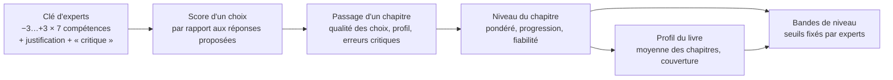

# Scoring v2 — ce que dit la recherche, et le plan pour End of Life

> Statut (06.10.2026) : **étape 1 implémentée** (§ 3.2 à 3.5 : qualité des choix, passage de
> chapitre, niveau / progression / fiabilité, profil du livre), avec les réglages par défaut
> du § 6. Restent : la clé d'experts (§ 3.1), les bandes (§ 3.6) et la validation (§ 4).
> Mesures faites sur MedStudents Y2 v2 avec des joueur·euse·s simulé·e·s
> (`scripts/seed_demo.py`, base jetable) ; références vérifiées une à une (§ 7).

## 0. En bref

1. **Le scoring actuel a deux défauts mesurables.**
   - Répondre au hasard donne déjà **48/100**.
   - Un·e joueur·euse parfait·e plafonne à **83/100**.
   - L'échelle utile ne fait donc que 35 points, et « 50/100 » veut dire « au hasard ».
2. **Les points des réponses ne sont pas encore justifiés.** Les −3…+3 par compétence ont été
   écrits par l'auteur seul, sans grille ni validation. La littérature sur les tests de jugement
   situationnel (SJT), dont nos scènes sont une variante, est unanime : la clé de cotation doit
   venir d'un panel d'experts, avec une grille ancrée et un accord mesuré.
3. **Le plan proposé :**
   - noter **chaque choix** par rapport aux réponses proposées à ce moment-là, ce qui donne une
     échelle de 0 à 100, 100 étant atteignable ;
   - additionner ces choix **par chapitre** ;
   - suivre **chaque chapitre dans le temps**, avec trois indicateurs : niveau, progression et
     fiabilité ;
   - calculer le profil du livre à partir des chapitres, sans exiger de rejouer tout le livre ;
   - traiter les erreurs critiques à part ;
   - transformer les nombres en quatre niveaux fixés par des experts.

## 1. Le scoring actuel, et ce que la mesure montre

Aujourd'hui (`services/scoring_service.py`) :

- **Points des réponses :** chaque réponse vaut de −3 à +3 sur 7 compétences.
- **Note d'une scène :** pour chaque compétence, on compare les points obtenus au pire et au
  meilleur total *possibles depuis le point d'entrée*. Ces bornes sont calculées **séparément pour
  chaque compétence**.
- **Note de session :** les scènes s'additionnent sur tout le livre. Une session n'est notée que
  quand **tous les chapitres** sont finis. Seule la 1ʳᵉ tentative d'une scène compte.
- **Note pondérée du livre :** les sessions terminées sont combinées, la Nᵉ pesant
  1 + 0,25 × (N − 1).

Mesure sur le livre Y2 : 30 parties au hasard, 15 parties « moyennes » (meilleure réponse une fois
sur deux), 5 parties « gloutonnes » (toujours la réponse au meilleur total) :

| Joueur·euse simulé·e | Note globale actuelle | « Qualité des choix » proposée (§ 3.2) |
|---|---|---|
| Au hasard | **48** (43–52) | 49 |
| Moyen·ne | 64 | 74 |
| Toujours la meilleure réponse | **80** | **100** |
| Meilleur chemin possible | 83 (plafond) | 100 |

Ce que montrent les chiffres :

1. **Pas de zéro de référence.** 48/100 pour le hasard : une note « moyenne » ne dit pas si
   l'étudiant·e a réfléchi.
2. **Un plafond inatteignable.** Les maxima de chaque compétence se trouvent sur des chemins
   différents, et personne ne peut les emprunter tous à la fois. Résultat : 83/100 au mieux, et
   la compassion plafonne à 64 même pour le joueur glouton.
3. **Une note liée à la session entière.** Refaire un seul chapitre ne compte pas : il faut
   rejouer tout le livre.
4. **Des compétences peu mesurées par chapitre.** Nombre de choix où chaque compétence est en jeu,
   pour un parcours :

   | Compétence | ch.1 | ch.2 | ch.3 | ch.4 | ch.5 | ch.6 |
   |---|---|---|---|---|---|---|
   | Choix notés | 43 | 27 | 30 | 23 | 26 | 23 |
   | Compassion | 11 | 5 | 10 | 6 | 5 | 14 |
   | Régulation émotionnelle | 17 | 6 | 19 | 11 | 10 | 15 |
   | Respect et dignité | 39 | 20 | 19 | 18 | 24 | 21 |

   Une note de compassion au chapitre 2 repose sur 5 choix : elle n'est pas fiable seule (§ 2.5).

## 2. Ce que dit la recherche

### 2.1 Concevoir l'évaluation à partir des preuves (Evidence-Centered Design)
Une évaluation par le jeu se construit en trois modèles :
- les **compétences** à inférer ;
- les **preuves**, c'est-à-dire quels comportements renseignent sur quelles compétences et avec
  quelles règles ;
- les **tâches** qui provoquent ces comportements.

Le score n'est pas un compteur de points. C'est un *argument* qui va de l'action observée à la
compétence (Mislevy, Steinberg & Almond 2003 ; Shute 2011, « évaluation furtive »).

→ Pour nous : documenter, pour chaque compétence, quels choix la renseignent et pourquoi. La
grille du § 3.1 sert à ça.

### 2.2 Nos scènes sont des tests de jugement situationnel
Un SJT présente une situation et des réponses possibles ; on note la réponse choisie par rapport
à une **clé**. C'est exactement notre format.
- **Origine :** le modèle vient de Motowidlo, Dunnette & Carter (1990).
- **En médecine :** le guide AMEE n° 100 en fait la synthèse (Patterson, Zibarras & Ashworth 2016).
- **Validité prédictive :** une mesure des connaissances sur le comportement interpersonnel chez des
  étudiant·e·s en médecine prédit leur performance en stage 7 ans plus tard, et au travail 9 ans
  plus tard (Lievens & Sackett 2012).

**La manière de noter change la qualité de la mesure :**
- la fidélité, les écarts entre groupes et la validité dépendent de la méthode de cotation
  (Bergman et al. 2006 ; de Leng et al. 2017) ;
- parmi cinq méthodes de cotation par consensus, la plus courante était la moins valide
  (Weng et al. 2018) ;
- certains ajustements (standardisation, suppression des options « moyennes » peu
  discriminantes) améliorent la validité (McDaniel et al. 2011) ;
- revue d'ensemble récente : Kepes et al. 2025.

→ Pour nous : la clé (les −3…+3) doit être **établie par des experts, puis contrôlée sur les
données**. Elle ne peut pas rester le jugement d'un seul auteur.

### 2.3 Une clé d'experts se construit avec une méthode
- **Consensus :** méthode Delphi ou groupe nominal, avec une description des étapes et des seuils
  d'accord (Humphrey-Murto et al. 2017).
- **Mesure de l'accord :** coefficient de corrélation intraclasse (ICC). Il est bon à partir de
  0,75 et excellent à partir de 0,90 (Koo & Li 2016).
- **Ancrage des compétences :**
  - le cadre suisse PROFILES, adapté de CanMEDS (Michaud & Jucker-Kupper 2016) : rôles
    communicateur, collaborateur, professionnel ;
  - les éléments essentiels de la communication de Kalamazoo (Makoul 2001) ;
  - le guide Calgary-Cambridge (Kurtz et al. 2003).

### 2.4 Ramener chaque mesure sur 0–100 de façon interprétable
- **POMP :** exprimer un score en pourcentage du maximum possible entre le minimum et le maximum
  d'une échelle (Cohen, Cohen, Aiken & West 1999). C'est ce que fait déjà notre code, mais sur des
  bornes impossibles à atteindre ensemble.
- **Correction du hasard :** en QCM, on corrige la part due au hasard (Frary 1988). Même logique
  ici : 50/100 obtenu au hasard ne doit pas ressembler à une compétence moyenne.

### 2.5 Une performance dépend de la situation : il faut plusieurs situations
- **Spécificité du cas :** la performance varie d'un cas à l'autre (Eva 2003). Une note fiable
  demande beaucoup d'occasions de mesure.
- **Théorie de la généralisabilité :** elle quantifie combien de scènes il faut pour une note
  fiable (Bloch & Norman 2012).
- **Évaluation programmatique :** chaque point de mesure sert l'apprentissage ; les décisions
  importantes se prennent sur l'agrégation de nombreux points (van der Vleuten et al. 2012).

→ Pour nous : afficher l'incertitude, et ne pas publier une note de compétence par chapitre
quand elle repose sur trop peu de choix.

### 2.6 Suivre la progression sur plusieurs passages
- **Courbes d'apprentissage :** elles relient l'effort (les passages) à la performance (Pusic,
  Boutis, Hatala & Cook 2015).
- **Gain normalisé :** progression rapportée à la progression encore possible,
  g = (après − avant) / (100 − avant). Il est faible sous 0,3, moyen de 0,3 à 0,7, fort au-dessus
  (Hake 1998). Marx & Cummings (2007) en donnent une version individuelle qui gère aussi les reculs.
- **Modèles de l'apprenant :** ils estiment le niveau courant en donnant plus de poids aux
  observations récentes (Corbett & Anderson 1994 ; Pelánek 2016 ; Pelánek 2017). Dans ce domaine,
  on juge un modèle à sa capacité à prédire la réponse suivante (Pelánek 2017).
- **Apprentissage jusqu'à la maîtrise :** on répète jusqu'à atteindre un standard fixé à l'avance
  (McGaghie et al. 2014).
- **Oubli :** les compétences cognitives s'érodent sans pratique (Arthur et al. 1998). Une vieille
  performance représente moins bien le niveau actuel.

### 2.7 Attention : rejouer le même scénario gonfle le score
- **Effet de répétition :** à l'admission en médecine en Belgique, les candidat·e·s qui repassent
  un SJT gagnent environ un tiers d'écart-type (Lievens, Buyse & Sackett 2005).
- **Méta-analyse :** les gains au retest sont plus forts quand on repasse **exactement le même
  test** (Hausknecht et al. 2007).
- **Fidélité test-retest des SJT :** environ 0,70 (Harenbrock et al. 2023).
- **Versions alternatives :** même de petits changements de contexte changent la mesure (Lievens &
  Sackett 2007).
- **« Jouer avec le système » :** dans les logiciels d'apprentissage, exploiter les régularités du
  logiciel au lieu d'apprendre est lié à un apprentissage plus faible (Baker et al. 2004).

→ Pour nous : séparer le **premier passage**, la mesure la plus pure, des passages suivants ;
espacer les passages comptés ; varier l'ordre des réponses.

### 2.8 Erreurs critiques : non compensables
À l'ECOS, certaines actions sont « critiques » pour la sécurité du patient. Payne et al. (2008)
proposent de les analyser à part pour mieux distinguer les performances, au lieu de les noyer
dans une somme de points.

→ Pour nous : violer le secret médical ou ne pas appeler le 144 ne doit pas se compenser par
dix réponses polies.

### 2.9 Seuils, validité et feedback
- **Seuils de réussite :** on les fixe avec des juges et une méthode explicite, par exemple Angoff
  modifié ou régression sur les cas limites (McKinley & Norcini 2014).
- **Validité selon Kane :** on vérifie quatre inférences. La **cotation** (la note reflète-t-elle
  la performance ?), la **généralisation** (à d'autres scènes), l'**extrapolation** (au monde réel)
  et les **conséquences** (Cook, Brydges, Ginsburg & Hatala 2015).
- **Contre-exemple :** un jeu sérieux infirmier dont le score ne distinguait pas étudiant·e·s et
  expert·e·s. Les auteurs concluent qu'il ne doit pas servir à noter (Blanié et al. 2020).
- **Feedback :** il est efficace quand il est spécifique, centré sur la tâche et le processus, et
  non jugeant (Hattie & Timperley 2007 ; Shute 2008).
- **Patients virtuels en communication :** ce qui marche, c'est le débriefing, l'étayage et le
  **feedback humain**, pas le feedback automatique seul (Lee et al. 2020).
- **Fin de vie :** en soins aigus de fin de vie, les récompenses doivent porter sur la qualité du
  processus (conversation difficile, décision partagée), pas sur le fait de « gagner » contre la
  mort (Cheng et al. 2026).

## 3. Le modèle proposé

### 3.1 Niveau 0 — La clé de cotation (ce qui vaut des points)
1. **Une grille ancrée par compétence.** On écrit ce que veut dire −3, −1, 0, +1, +3, avec des
   exemples, aligné sur PROFILES, Kalamazoo et Calgary-Cambridge. Exemple pour Frontières
   professionnelles :
   - +3 : reste dans son rôle et oriente vers la bonne personne ;
   - 0 : neutre ;
   - −3 : sort de son rôle d'une manière qui expose le patient, par exemple en donnant un
     résultat ou un numéro personnel.
2. **Un panel d'au moins 5 experts** cote les réponses sans voir les cotes de l'auteur, en deux
   tours Delphi. Profils : médecin de famille, infirmier·ère, enseignant·e en communication
   médicale, psychologue, médecin assistant·e. On retient la médiane et on mesure l'accord
   (ICC ≥ 0,75 visé). On revoit les réponses où les experts divergent.
3. **Une justification d'une phrase par réponse**, montrée dans le feedback. Le score cesse
   d'être « sorti de nulle part ».
4. **Un marqueur `critique`** sur les réponses dangereuses pour le patient ou contraires à la loi :
   secret médical (art. 321 CP), absence d'appel au 144, absence de question directe sur le
   suicide…
5. **Analyse des réponses après un pilote**, avec l'export Excel déjà en place. On regarde quelle
   réponse est choisie par les meilleur·e·s et par les plus faibles, et on écarte les réponses qui
   ne discriminent pas (McDaniel 2011).

*Outil :* exporter la clé du livre vers Excel, une ligne par réponse avec une colonne par expert,
puis réimporter la clé de consensus.

### 3.2 Niveau 1 — Le score d'un choix
À chaque point de choix, on compare la réponse choisie aux réponses **proposées à ce moment-là**.

- **Qualité du choix (total)** = (total choisi − pire total proposé) / (meilleur total proposé −
  pire total proposé) × 100.
- **Par compétence :** même calcul sur la compétence, seulement quand elle est en jeu, c'est-à-dire
  quand les réponses diffèrent sur elle.
- **Corrigé du hasard** (affichage optionnel) = (gain − gain moyen au hasard) / (écart − gain moyen
  au hasard). On obtient 0 au hasard, 100 pour le meilleur choix, et une valeur négative pour un
  choix pire que le hasard.

*Exemple :* quatre réponses valent +9, +3, −2 et −8 ; l'étudiant·e choisit +3.
- Qualité = (3 + 8) / (9 + 8) = **65**.
- Au hasard, on gagnerait en moyenne (17 + 11 + 6 + 0) / 4 = 8,5 sur 17.
- Corrigé du hasard = (11 − 8,5) / (17 − 8,5) = **29** : un peu mieux que le hasard.

**Pourquoi c'est mieux :**
- 100 devient atteignable (ce n'est pas le cas aujourd'hui, § 1) ;
- un choix est jugé par rapport à ses vraies alternatives, comme un item de SJT ;
- la note ne dépend plus de bornes calculées sur des chemins incompatibles.

**Les conséquences de l'histoire restent visibles,** mais à part : la fin de scène atteinte (bonne,
mitigée, grave) et les erreurs critiques sont montrées à côté du nombre, pas mélangées dedans.

### 3.3 Niveau 2 — Le passage d'un chapitre (l'unité de note)
Un **passage** = jouer un chapitre en entier, dans un parcours complet ou seul.

- **Qualité des choix du chapitre** = Σ gains / Σ écarts sur tous ses choix. Un choix décisif,
  avec un grand écart entre les réponses, pèse plus qu'un choix anodin.
- **Profil par compétence :** même somme, compétence par compétence. Une compétence n'est affichée
  que si elle est en jeu dans **au moins 8 choix** du chapitre ; sinon « pas assez de données
  dans ce chapitre » et elle ne compte qu'au niveau du livre.
- **Erreurs critiques :** liste et nombre. **Règle non compensatoire :** un passage avec une erreur
  critique ne peut pas dépasser la bande « À consolider », quel que soit son nombre.
- **Fins atteintes :** nombre de scènes terminées sur une issue bonne, mitigée ou grave (le ton
  des bilans, déjà dans les livres).

### 3.4 Niveau 3 — Le chapitre dans le temps : plusieurs passages
Pour chaque couple (étudiant·e, chapitre), les passages comptés forment une courbe
d'apprentissage. Trois indicateurs, affichés ensemble :

| Indicateur | Calcul | Ce qu'il dit |
|---|---|---|
| **Niveau** | Moyenne pondérée des passages, le n-ième pesant 1 + 0,25 × (n − 1) | Où en est l'étudiant·e aujourd'hui |
| **Progression** | Changement normalisé entre le 1ᵉʳ passage et le niveau (Marx & Cummings) | Combien il ou elle a gagné sur ce qui restait à gagner |
| **Fiabilité** | Nombre de passages et de choix, fourchette d'incertitude | Combien la note est solide |

Ces indicateurs répondent à « plus il ou elle fait de sessions, plus son parcours compte » :
1. **Les passages récents pèsent plus.** C'est la règle actuelle, mais appliquée par chapitre.
2. **Plus de passages = une note plus sûre.** La fourchette se resserre. Un niveau est « confirmé »
   quand il est atteint sur 2 passages, comme en apprentissage jusqu'à la maîtrise.
3. **Le parcours est noté.** La progression et la courbe font partie du bilan, pas seulement la
   dernière note.

**Choix du coefficient 0,25.** C'est aujourd'hui un choix pédagogique. Une fois les données pilotes
recueillies, on le calibre comme on évalue un modèle de l'apprenant : on garde la pondération qui
**prédit le mieux le passage suivant** (Pelánek 2017). On peut aussi comparer avec une moyenne mobile exponentielle.

**Répétition et apprentissage par cœur** (§ 2.7) :
- le **1ᵉʳ passage** d'un chapitre est gardé à part comme « score à froid » ;
- un nouveau passage ne compte que s'il a lieu **au moins 7 jours** après le précédent passage
  compté de ce chapitre. Avant, c'est de l'entraînement, comme les rejeux d'aujourd'hui ;
- l'ordre des réponses change à chaque passage. Aujourd'hui il est toujours le même
  (`stableShuffle` utilise l'interaction comme graine) ;
- la meilleure preuve de progrès est un progrès qui se transfère : une compétence qui monte aussi
  dans des chapitres **jamais rejoués**.

**Ne pas mélanger effort et compétence.** Le nombre de passages est montré et valorisé (fiabilité,
courbe), mais il n'ajoute pas de points à la compétence. Sinon, la note mesure l'assiduité, et
l'inférence « cette note = ce niveau » ne tient plus (Kane).

### 3.5 Niveau 4 — Le profil du livre, sans session obligatoire
- **Note du livre** = moyenne des **niveaux des chapitres**, chaque chapitre pesant autant
  (un chapitre = un module du programme). Refaire le chapitre 3 met à jour le chapitre 3, puis le
  livre. Plus besoin de rejouer les autres.
- **Profil par compétence :** pondéré par la quantité de preuves. Chaque chapitre contribue selon
  le nombre de choix où la compétence est en jeu. La compassion vient donc surtout des
  chapitres 1, 3 et 6.
- **Couverture :** « 4/6 chapitres évalués ». La note du livre est **partielle** tant qu'un
  chapitre n'a aucun passage compté.
- **L'histoire continue de fonctionner.** Quand on rejoue un chapitre seul :
  - il démarre avec les états narratifs enregistrés au début de ce chapitre lors du dernier
    passage, enregistrés à chaque passage à partir de maintenant ;
  - sinon, avec l'écran de départ, qui existe déjà pour les chapitres 5 et 6.

  La « session » reste utile pour jouer l'histoire d'un bout à l'autre, mais elle n'est plus
  l'unité de note.

### 3.6 Niveau 5 — Des bandes plutôt qu'un nombre seul

| Bande | Seuils provisoires (qualité des choix) | Repère |
|---|---|---|
| Insuffisant | < 60 | proche du hasard (≈ 50) |
| À consolider | 60–74 | un·e joueur·euse « moyen·ne » simulé·e ≈ 74 |
| Compétent | 75–89 | |
| Avancé | ≥ 90 | |

Ces seuils sont **provisoires**. Ils sont à remplacer par un Angoff modifié : les experts estiment
chapitre par chapitre ce que ferait un·e étudiant·e « tout juste compétent·e » de 2ᵉ année
(McKinley & Norcini 2014).

### 3.7 Niveau 6 — Expliquer chaque note
- **Pour chaque choix :** la réponse choisie, la meilleure réponse et **la justification des
  experts**.
- **Pour chaque chapitre :** les deux plus grandes occasions manquées (déjà calculées), les erreurs
  critiques, la courbe.
- **Pour le formateur :** l'export et le tableau de bord servent au **débriefing humain**, qui est ce
  qui rend les patients virtuels efficaces (Lee et al. 2020).

## 4. Valider le score (Kane)

| Inférence | Question | Ce qu'on fait |
|---|---|---|
| Cotation | La note reflète-t-elle la qualité des choix ? | Clé d'experts (Delphi), ICC ≥ 0,75, justification par réponse |
| Généralisation | Une autre scène donnerait-elle la même note ? | Fidélité par chapitre (moitiés de chapitre, théorie de la généralisabilité), fidélité test-retest à 7 jours ou plus |
| Extrapolation | Dit-elle quelque chose du comportement réel ? | Corrélation avec les ECOS de communication et l'avis des tuteurs ; groupes contrastés : étudiant·e·s de 2ᵉ, de 6ᵉ, médecins assistant·e·s (le test raté par Blanié et al. 2020) |
| Conséquences | Quels effets sur l'apprentissage ? | Usage **formatif** tant que la validation n'est pas faite ; surveiller le « jeu avec le système » |

## 5. Mise en œuvre (après validation de ce plan)
1. **Données du livre :** champs `Critical` et `Rationale` par réponse ; export et réimport de la
   clé pour le panel d'experts.
2. **Moteur :** score par choix, table des passages de chapitre (états narratifs au départ et à
   l'arrivée, compté ou non, qualité, profil, erreurs critiques), niveau, progression, fiabilité.
3. **Règles :** comptage (1ᵉʳ passage + passages espacés), pondération, seuil de 8 choix par
   compétence, plafond en cas d'erreur critique, bandes.
4. **Interface :**
   - côté joueur·euse : bouton « Rejouer ce chapitre » et courbe par chapitre dans l'historique ;
   - côté formateur : profil du livre avec la couverture, colonnes par chapitre dans le tableau de
     bord.
5. **Historique :** recalcul des anciennes parties à partir de leurs traces (indices des réponses),
   en conservant l'ancien instantané.
6. **Export :** nouvelle table `passages`, nouveaux indicateurs.
7. **Tests**, puis un pilote avec une volée : analyse des réponses, fidélité, calibrage du
   coefficient.

## 6. Décisions à prendre

Réglages retenus pour l'étape 1 (06.10.2026, recommandations par défaut, modifiables) :
- pondération des passages : **1 + 0,25 × (n − 1)** par chapitre ;
- délai entre deux passages notés : **7 jours** (`PASSAGE_SPACING_DAYS`) ;
- note du livre : **chapitres à poids égal**.

Encore ouvertes :
1. **Pondération des passages :** garder 1 + 0,25 × (n − 1) par chapitre, ou une moyenne mobile
   exponentielle ? À calibrer sur les données du pilote (§ 3.4).
2. **Espacement des passages comptés :** 7 jours, une autre durée, ou aucun délai ?
3. **Erreur critique :** plafonner la bande (recommandé) ou seulement la signaler ?
4. **Panel d'experts :** qui, et pour quand ? En attendant, les cotes actuelles restent
   « provisoires » dans l'interface.
5. **Note du livre :** chapitres à poids égal (retenu) ou pondérés par leur nombre de choix ?

## 7. Bibliographie

**Concevoir une évaluation par le jeu**
- Mislevy, R. J., Steinberg, L. S., & Almond, R. G. (2003). On the structure of educational assessments. *Measurement: Interdisciplinary Research and Perspectives*, 1, 3–66. [Introduction (rapport CSE 632)](https://files.eric.ed.gov/fulltext/ED483399.pdf)
- Shute, V. J. (2011). Stealth assessment in computer-based games to support learning. In *Computer Games and Instruction* (pp. 503–524). [Shute & Sun, Games for Assessment](https://myweb.fsu.edu/vshute/pdf/GBA2017.pdf)

**Tests de jugement situationnel et cotation**
- Motowidlo, S. J., Dunnette, M. D., & Carter, G. W. (1990). An alternative selection procedure: The low-fidelity simulation. *Journal of Applied Psychology*, 75(6), 640–647. [doi:10.1037/0021-9010.75.6.640](https://www.semanticscholar.org/paper/An-alternative-selection-procedure:-The-simulation.-Motowidlo-Dunnette/6e21a262bd404ef51532e191cf915d9063f051e3)
- Bergman, M. E., Drasgow, F., Donovan, M. A., Henning, J. B., & Juraska, S. E. (2006). Scoring situational judgment tests: Once you get the data, your troubles begin. *International Journal of Selection and Assessment*, 14(3), 223–235. [Wiley](https://onlinelibrary.wiley.com/doi/full/10.1111/j.1468-2389.2006.00345.x)
- McDaniel, M. A., Psotka, J., Legree, P. J., Yost, A. P., & Weekley, J. A. (2011). Toward an understanding of situational judgment item validity and group differences. *Journal of Applied Psychology*, 96(2), 327–336.
- Patterson, F., Zibarras, L., & Ashworth, V. (2016). Situational judgement tests in medical education and training: Research, theory and practice: AMEE Guide No. 100. *Medical Teacher*, 38(1), 3–17. [Semantic Scholar](https://www.semanticscholar.org/paper/Situational-judgement-tests-in-medical-education-Patterson-Zibarras/ac8bc91346513fae53060b702e6c49df09fdfa09)
- de Leng, W. E., Stegers-Jager, K. M., Husbands, A., Dowell, J. S., Born, M. P., & Themmen, A. P. N. (2017). Scoring method of a Situational Judgment Test: influence on internal consistency reliability, adverse impact and correlation with personality? *Advances in Health Sciences Education*, 22(2), 243–265. [Dundee](https://discovery.dundee.ac.uk/en/publications/scoring-method-of-a-situational-judgment-test-influence-on-intern/)
- Weng, Q., Yang, H., Lievens, F., & McDaniel, M. A. (2018). Optimizing the validity of situational judgment tests: The importance of scoring methods. *Journal of Vocational Behavior*, 104, 199–209. [ScienceDirect](https://www.sciencedirect.com/science/article/abs/pii/S0001879117301422)
- Lievens, F., & Sackett, P. R. (2012). The validity of interpersonal skills assessment via situational judgment tests for predicting academic success and job performance. *Journal of Applied Psychology*, 97(2), 460–468. [PDF](https://static1.squarespace.com/static/5dd4c2c45ccc387bd8ffb210/t/5ddc9f0f8ef405035ca275f3/1574739728644/The+validity+of+interpersonal+skills+assessment+via+situational+j.pdf)
- Kepes, S., Keener, S. K., Lievens, F., & McDaniel, M. A. (2025). An integrative, systematic review of the situational judgment test literature. *Journal of Management*, 51(6), 2278–2319. [SAGE](https://journals.sagepub.com/doi/abs/10.1177/01492063241288545)

**Répétition, versions alternatives, « jouer avec le système »**
- Lievens, F., Buyse, T., & Sackett, P. R. (2005). Retest effects in operational selection settings: Development and test of a framework. *Personnel Psychology*. [ResearchGate](https://www.researchgate.net/publication/227626981_Retest_Effects_in_Operational_Selection_Settings)
- Lievens, F., & Sackett, P. R. (2007). Situational judgment tests in high-stakes settings: Issues and strategies with generating alternate forms. *Journal of Applied Psychology*, 92(4), 1043–1055. [ERIC](https://eric.ed.gov/?id=EJ945879)
- Hausknecht, J. P., Halpert, J. A., Di Paolo, N. T., & Moriarty Gerrard, M. O. (2007). Retesting in selection: A meta-analysis of coaching and practice effects for tests of cognitive ability. *Journal of Applied Psychology*, 92(2), 373–385.
- Harenbrock, J., Forthmann, B., & Holling, H. (2023). Retest reliability of situational judgment tests: A meta-analysis. *Journal of Personnel Psychology*, 22(4), 169–184. [Hogrefe](https://econtent.hogrefe.com/doi/10.1027/1866-5888/a000323)
- Baker, R. S., Corbett, A. T., Koedinger, K. R., & Wagner, A. Z. (2004). Off-task behavior in the cognitive tutor classroom: When students "game the system". *Proceedings of CHI 2004*, 383–390. [ResearchGate](https://www.researchgate.net/publication/2872365_Off-Task_Behavior_in_the_Cognitive_Tutor_Classroom)

**Échelles et correction du hasard**
- Cohen, P., Cohen, J., Aiken, L. S., & West, S. G. (1999). The problem of units and the circumstance for POMP. *Multivariate Behavioral Research*, 34(3), 315–346. [doi:10.1207/S15327906MBR3403_2](https://www.tandfonline.com/doi/abs/10.1207/S15327906MBR3403_2)
- Frary, R. B. (1988). Formula scoring of multiple-choice tests (correction for guessing). *Educational Measurement: Issues and Practice*, 7(2), 33–38. [Wiley](https://onlinelibrary.wiley.com/doi/abs/10.1111/j.1745-3992.1988.tb00434.x)

**Fidélité, spécificité du cas, évaluation programmatique**
- Eva, K. W. (2003). On the generality of specificity. *Medical Education*, 37(7), 587–588. [Wiley](https://asmepublications.onlinelibrary.wiley.com/doi/10.1046/j.1365-2923.2003.01563.x)
- Bloch, R., & Norman, G. (2012). Generalizability theory for the perplexed: AMEE Guide No. 68. *Medical Teacher*, 34(11), 960–992. [Semantic Scholar](https://www.semanticscholar.org/paper/Generalizability-theory-for-the-perplexed:-A-and-68-Bloch-Norman/08e266c488a69a4d5d34d85fd09d9e8e4e628d87)
- van der Vleuten, C. P. M., Schuwirth, L. W. T., Driessen, E. W., et al. (2012). A model for programmatic assessment fit for purpose. *Medical Teacher*, 34(3), 205–214. [Maastricht](https://cris.maastrichtuniversity.nl/en/publications/a-model-for-programmatic-assessment-fit-for-purpose/)

**Progression, modèles de l'apprenant, maîtrise, oubli**
- Pusic, M. V., Boutis, K., Hatala, R., & Cook, D. A. (2015). Learning curves in health professions education. *Academic Medicine*, 90(8), 1034–1042. [Twelve Tips (PMC)](https://pmc.ncbi.nlm.nih.gov/articles/PMC10696298/)
- Hake, R. R. (1998). Interactive-engagement versus traditional methods: A six-thousand-student survey of mechanics test data for introductory physics courses. *American Journal of Physics*, 66(1), 64–74. [PER Central](https://www.per-central.org/items/detail.cfm?ID=2662)
- Marx, J. D., & Cummings, K. (2007). Normalized change. *American Journal of Physics*, 75(1), 87–91. [AIP](https://pubs.aip.org/aapt/ajp/article-abstract/75/1/87/1056280/Normalized-change)
- Corbett, A. T., & Anderson, J. R. (1994). Knowledge tracing: Modeling the acquisition of procedural knowledge. *User Modeling and User-Adapted Interaction*, 4, 253–278. [Springer](https://link.springer.com/article/10.1007/BF01099821)
- Pelánek, R. (2016). Applications of the Elo rating system in adaptive educational systems. *Computers & Education*, 98, 169–179. [PDF](https://www.fi.muni.cz/~xpelanek/publications/CAE-elo.pdf)
- Pelánek, R. (2017). Bayesian knowledge tracing, logistic models, and beyond: an overview of learner modeling techniques. *User Modeling and User-Adapted Interaction*, 27, 313–350. [Springer](https://link.springer.com/article/10.1007/s11257-017-9193-2)
- McGaghie, W. C., Issenberg, S. B., Barsuk, J. H., & Wayne, D. B. (2014). A critical review of simulation-based mastery learning with translational outcomes. *Medical Education*, 48(4), 375–385. [Wiley](https://asmepublications.onlinelibrary.wiley.com/doi/10.1111/medu.12391)
- Arthur, W., Bennett, W., Stanush, P. L., & McNelly, T. L. (1998). Factors that influence skill decay and retention: A quantitative review and analysis. *Human Performance*, 11(1), 57–101. [PDF](https://gwern.net/doc/psychology/spaced-repetition/1998-arthur.pdf)

**Clé d'experts, consensus, accord**
- Humphrey-Murto, S., Varpio, L., Gonsalves, C., & Wood, T. J. (2017). Using consensus group methods such as Delphi and Nominal Group in medical education research. *Medical Teacher*, 39(1), 14–19. [PubMed](https://pubmed.ncbi.nlm.nih.gov/27841062/)
- Koo, T. K., & Li, M. Y. (2016). A guideline of selecting and reporting intraclass correlation coefficients for reliability research. *Journal of Chiropractic Medicine*, 15(2), 155–163. [doi:10.1016/j.jcm.2016.02.012](https://www.researchgate.net/publication/299571433_A_Guideline_of_Selecting_and_Reporting_Intraclass_Correlation_Coefficients_for_Reliability_Research)

**Cadres de compétences (ancrage de la grille)**
- Michaud, P.-A., & Jucker-Kupper, P. (2016). The "Profiles" document: a modern revision of the objectives of undergraduate medical studies in Switzerland. *Swiss Medical Weekly*, 146, w14270. [PROFILES 2 (SMW)](https://smw.ch/index.php/smw/article/view/4389)
- Makoul, G. (2001). Essential elements of communication in medical encounters: the Kalamazoo consensus statement. *Academic Medicine*, 76(4), 390–393. [PubMed](https://pubmed.ncbi.nlm.nih.gov/11299158/)
- Kurtz, S., Silverman, J., Benson, J., & Draper, J. (2003). Marrying content and process in clinical method teaching: enhancing the Calgary-Cambridge guides. *Academic Medicine*, 78(8), 802–809.

**Erreurs critiques, seuils, validité**
- Payne, N. J., Bradley, E. B., Heald, E. B., et al. (2008). Sharpening the eye of the OSCE with critical action analysis. *Academic Medicine*, 83(10). [Academic Medicine](https://academic.oup.com/academicmedicine/article-abstract/83/10/900/8354268)
- McKinley, D. W., & Norcini, J. J. (2014). How to set standards on performance-based examinations: AMEE Guide No. 85. *Medical Teacher*, 36(2), 97–110. doi:10.3109/0142159X.2013.853119
- Cook, D. A., Brydges, R., Ginsburg, S., & Hatala, R. (2015). A contemporary approach to validity arguments: a practical guide to Kane's framework. *Medical Education*, 49(6), 560–575. [Semantic Scholar](https://www.semanticscholar.org/paper/A-contemporary-approach-to-validity-arguments:-a-to-Cook-Brydges/795c51628080dd22e3945daa14652c5a284affee)
- Blanié, A., et al. (2020). Assessing validity evidence for a serious game dedicated to patient clinical deterioration and communication. *Advances in Simulation*, 5, 4. [PMC](https://pmc.ncbi.nlm.nih.gov/articles/PMC7251894/)

**Feedback, patients virtuels, fin de vie**
- Hattie, J., & Timperley, H. (2007). The power of feedback. *Review of Educational Research*, 77(1), 81–112. [ERIC](https://eric.ed.gov/?id=EJ782448)
- Shute, V. J. (2008). Focus on formative feedback. *Review of Educational Research*, 78(1), 153–189. [PDF](https://myweb.fsu.edu/vshute/pdf/shute%202008_b.pdf)
- Lee, J., Kim, H., Kim, K. H., Jung, D., Jowsey, T., & Webster, C. S. (2020). Effective virtual patient simulators for medical communication training: A systematic review. *Medical Education*, 54(9), 786–795. [doi:10.1111/medu.14152](https://asmepublications.onlinelibrary.wiley.com/doi/10.1111/medu.14152)
- Cheng, F., Xu, T., Mao, J., Li, Z., & Wang, Y. (2026). Branching-scenario games in acute end-of-life care education: cultural adaptation and health equity from a public health implementation perspective. *Frontiers in Public Health*, 14, 1889780. [PMC](https://pmc.ncbi.nlm.nih.gov/articles/PMC13323315/)
