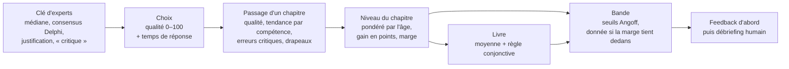

# Scoring v3 — proposition fondée sur la bibliographie du scoring

> Proposition du 12.10.2026. **Étape A implémentée le 13.10.2026** (journal § 2.33 et § 2.34),
> ainsi que les **outils des étapes B et C** : grille de relecture ciblée, seuils par la méthode
> d'Angoff (`/trainer/cle/`), protocole du pilote ([Pilote_protocole.md](Pilote_protocole.md)).
> Restent ce qui demande des personnes (juges, pilote) et l'étape D. Elle part du scoring v2 déjà en place
> ([Scoring_v2_recherche_et_plan.md](Scoring_v2_recherche_et_plan.md), étape 1 faite le
> 06.10.2026) et des articles de sa bibliographie (§ 7 du plan, PDF
> [Scoring_v2_bibliographie.pdf](Scoring_v2_bibliographie.pdf)), lus en texte intégral.
> Le 13.10.2026, la bibliographie est réduite de 33 à 27 articles : seuls restent ceux qui
> servent au scoring. Les passages qui s'appuyaient sur les 6 articles retirés sont supprimés
> ou reformulés.
> Les chiffres « simulés » viennent de joueur·euse·s simulé·e·s sur le livre 2 v2, rejoué·e·s
> par le vrai calcul serveur, sur une base jetable (aucune donnée réelle).

## 0. En bref

Le scoring v2 tient debout : la recherche confirme ses choix principaux. Les articles
demandent pourtant de corriger trois points, d'en préciser quatre et d'ajouter de quoi le
valider.

| | Ce qui reste | Ce qui change | Ce qui s'ajoute |
|---|---|---|---|
| **Clé** | Panel d'experts, Delphi, ICC | Médiane des experts ; formation des cotateurs avant de coter ; panel distinct des auteurs | Contrôle d'équité entre groupes après le pilote |
| **Choix** | Qualité de 0 à 100, 100 atteignable | — | Temps de réponse ; taux de « meilleure réponse » calculé en parallèle |
| **Passage** | Unité de note ; seuil de 8 choix par compétence | Profil par compétence présenté comme une tendance, pas comme une note | Passage « trop rapide » signalé et non compté |
| **Erreur critique** | Non compensable | Plafonne le passage et déclenche un débriefing ; levée par un passage propre | — |
| **Niveau du chapitre** | Les passages récents pèsent plus ; 7 jours entre deux passages comptés | Poids selon l'**âge** du passage (demi-vie de 90 jours), plus selon son rang | Signal « à rafraîchir » après 90 jours |
| **Progression** | Montrée, sans ajouter de points | **Gain en points** au lieu du gain normalisé ; « progrès net » seulement au-delà de la marge d'erreur | Taille d'effet (*d* de Cohen) pour les groupes |
| **Livre** | Moyenne des chapitres | — | Règle conjonctive : pas de chapitre « Insuffisant », pas d'erreur critique non résolue |
| **Bandes** | Quatre bandes | Seuils fixés par Angoff modifié, par année d'études ; bande donnée seulement si la marge d'erreur tient dedans | Vérification des seuils sur le pilote |
| **Affichage** | Moments clés | Le feedback d'abord (pourquoi, et que faire), la note ensuite ; pas de comparaison entre étudiant·e·s | Explication du scoring avant de jouer |

**Les trois corrections :**
1. **Progression.** Le gain normalisé, utilisé aujourd'hui, est biaisé en faveur de celles et
   ceux qui partent haut. Nissen et al. (2018) recommandent d'abandonner *toutes* ses formes.
2. **Bandes.** Un seul passage a une marge d'erreur d'environ ±12 points (simulation, § 2.6),
   alors qu'une bande fait 15 points de large. Une bande ne peut donc pas être attribuée sur un
   seul passage sans indiquer cette incertitude.
3. **Ce que voit l'étudiant·e.** Une note affichée avec des commentaires tend à faire ignorer
   les commentaires (Shute 2008). Le feedback riche en information est l'élément le plus efficace
   (*d* = 0,99 ; Wisniewski et al. 2020).

## 1. Ce que disent les articles : dix constats

Chaque constat résume ce que les articles montrent, puis ce que cela implique pour nous.

### Constat 1 — La note mesure un *jugement*, pas un comportement
- Un SJT mesure surtout une **connaissance procédurale** : savoir ce qu'il faut faire.
- Les consignes « que faut-il faire ? » mesurent plutôt la connaissance ; les consignes « que
  feriez-vous ? » plutôt la personnalité. En situation d'examen, les candidat·e·s répondent de
  toute façon comme à la première (Patterson et al. 2016).

**Pour nous :** la note dit ce que l'étudiant·e *sait qu'il faut faire* face à un patient en
fin de vie. Elle ne dit pas ce qu'il ou elle fera. Il faut l'écrire partout où la note
apparaît, et ne jamais promettre davantage.

### Constat 2 — La clé vaut ce que vaut le panel
- Les réponses sont cotées par un **panel de concordance**, distinct des auteurs des scènes,
  puis la clé est pilotée et analysée (Patterson et al. 2016).
- Delphi : en général 2 ou 3 tours ; consensus défini *à l'avance*, le plus souvent par 75 à
  80 % d'accord et/ou par la médiane ; retour aux experts entre les tours (Jünger et al. 2017,
  CREDES).
- Accord : ICC à deux facteurs, effets aléatoires, accord absolu, rapporté avec son intervalle
  de confiance à 95 %. Il faut au moins 3 cotateurs et 30 éléments hétérogènes ; on juge le
  niveau atteint sur l'intervalle, pas sur la seule valeur (Koo & Li 2016).
- Même avec une grille connue (Calgary-Cambridge), l'ICC par item allait de 0,05 à 0,57 ; les
  auteurs en concluent que les cotateurs doivent être **formés** avant de coter
  (Simmenroth-Nayda et al. 2014).

### Constat 3 — La méthode de cotation change la mesure, et aucune ne gagne partout
- Sur un même SJT, 28 méthodes de cotation donnent une cohérence interne de 0,33 à 0,73 et
  des écarts entre groupes de 0,48 à 0,66 écart-type. Les auteurs refusent de désigner « la »
  meilleure méthode : il faut l'examiner sur son propre test (de Leng et al. 2017).
- La cote brute, l'une des plus courantes, est la moins valide. Pour les items où les avis
  divergent (moyenne au milieu de l'échelle), une cotation au **mode** ou **dichotomique**
  (bonne réponse ou non) donne de meilleurs résultats. Ces différences ne sont pas significatives (N = 139) et
  portent sur des échelles de Likert (Weng et al. 2018).
- Une clé tirée des répondant·e·s elles-mêmes et eux-mêmes donne des résultats proches d'une
  clé d'experts (de Leng et al. 2017).

**Pour nous :** notre format est différent (on *choisit* une réponse, on ne la note pas). Les
leçons se transposent : prendre la **médiane** des experts, traiter à part les réponses sans
consensus, et comparer sur le pilote notre cotation graduée à une cotation dichotomique.

### Constat 4 — Une note fiable demande beaucoup de situations
- À l'ECOS, la performance change d'une station à l'autre : les stations expliquent 11,4 % de
  la variance, les étudiant·e·s 4,8 %. La fiabilité relative (G = 0,93) est plus haute que la
  fiabilité absolue (Φ = 0,83), qui est celle qui compte pour un seuil de réussite
  (Trejo-Mejía et al. 2016).

### Constat 5 — Rejouer fait monter la note, surtout le même test
- Repasser un test fait gagner en moyenne 0,26 écart-type la 2ᵉ fois, et encore 0,2 la 3ᵉ.
  Le gain est plus fort quand le test est **identique**. L'intervalle entre deux passages
  réduit ce gain seulement dans ce cas : c'est un effet de mémoire (Hausknecht et al. 2007).
- Sur un SJT d'admission en médecine, le gain est d'environ un tiers d'écart-type. La validité
  reste la même chez celles et ceux qui repassent le test : ce gain est probablement surtout
  un vrai progrès (Lievens et al. 2005).
- Des versions « alternatives » d'un SJT ne mesurent la même chose que si elles ne changent
  que la formulation. Changer le contexte de la situation suffit à faire chuter la
  concordance (Lievens & Sackett 2007).
- Exploiter les régularités d'un logiciel au lieu d'apprendre (« jouer avec le système ») est
  le comportement le plus lié à un apprentissage faible (Baker et al. 2004).

### Constat 6 — Le niveau bouge : on apprend et on oublie ; les modèles simples suffisent
- Après une formation, les compétences baissent dès 3 mois (4 études sur 4), puis à 6 et
  12 mois, tout en restant au-dessus du niveau de départ. Des rappels espacés aident à les
  retenir (Legoux et al. 2021).
- La moyenne mobile exponentielle, qui donne moins de poids aux observations anciennes,
  prédit bien. Mieux vaut un modèle simple, sauf raison claire, et on le juge à sa capacité à
  prédire la suite (Pelánek 2017).
- Le *knowledge tracing* estime la probabilité qu'une compétence soit acquise et fixe la
  maîtrise à 0,95 (Corbett & Anderson 1995).
- Une courbe d'apprentissage demande au moins 3 points. On y trace un seuil de compétence et
  un seuil de remédiation (Howard et al. 2023).

### Constat 7 — Le gain normalisé est biaisé
Toutes les formes de gain normalisé, y compris le « changement normalisé » que nous
utilisons, favorisent les groupes qui partent haut. Dans 43 cours, le gain normalisé faisait
apparaître un écart entre hommes et femmes dans 77 % des cours, le *d* de Cohen dans 53 %.
Recommandation : utiliser le *d* de Cohen, avec les moyennes, les écarts-types et la
corrélation entre avant et après (Nissen et al. 2018).

### Constat 8 — Décider : des juges, des règles non compensatoires prudentes, de nombreux points
- L'Angoff modifié permet de fixer, avant l'examen, des seuils différents pour des niveaux
  d'études différents qui passent le même test. Il a été comparé aux méthodes des cas limites
  (Dwyer et al. 2016).
- Exiger un nombre minimal de stations réussies, en plus de la note globale, empêche une
  bonne note ailleurs de masquer des échecs. Mais un décompte de réussites est moins fiable
  qu'une note : il reste une seconde barrière. Une méthode simple pour le fixer : régresser
  le nombre de stations réussies sur la note totale (Homer & Russell 2021).
- Aucune décision sur un seul point de mesure. Plus l'enjeu est élevé, plus il faut de
  points. La décision finale est humaine, globale et transparente (Heeneman et al. 2021).

### Constat 9 — Ce qui aide à apprendre, c'est le feedback informatif, pas la note
- Effet du feedback sur l'apprentissage, selon sa forme (Wisniewski et al. 2020) :

  | Forme | *d* |
  |---|---:|
  | Récompense ou sanction | 0,24 |
  | Correctif (la bonne réponse) | 0,46 |
  | Riche en information (pourquoi, et comment faire mieux) | 0,99 |

- Shute (2008) en tire plusieurs règles :
  - expliquer le quoi, le comment et le pourquoi ;
  - donner le feedback après l'essai, sans interrompre l'apprenant·e en pleine tâche ;
  - pas de comparaison avec les autres ;
  - peu de félicitations ;
  - prudence avec les notes globales : une note seule ne fait pas progresser, des commentaires
    seuls font beaucoup progresser, une note avec des commentaires ne fait pas progresser.
- Avec des patients virtuels en communication, ce qui marche, ce sont la préparation, le
  débriefing et le feedback **humain**, pas le feedback automatique seul (Lee et al. 2020).

### Constat 10 — Valider, c'est construire un argument
- Valider demande huit étapes et les quatre inférences de Kane : cotation, généralisation,
  extrapolation, conséquences. Deux erreurs sont à éviter : fonder la validité surtout sur
  une comparaison experts/novices, et déclarer un instrument « validé » (Cook & Hatala 2016).
- Exemple réel : la note d'un jeu sérieux infirmier ne distinguait pas étudiant·e·s,
  jeunes diplômé·e·s et expert·e·s. Il reste un bon outil pédagogique, pas un outil de
  notation (Blanié et al. 2020).

## 2. Le modèle proposé, niveau par niveau

### 2.1 Niveau 0 — La clé : ce que vaut chaque réponse

1. **Former les cotateurs avant de coter.** Leur expliquer la grille ancrée
   (`domain/expert_rubric.py`), puis leur faire coter ensemble 5 réponses d'exemple et en
   discuter. La grille s'appuie sur :
   - PROFILES, le cadre suisse : rôles CanMEDS, activités professionnelles et situations de
     référence, base de l'examen fédéral (Michaud & Jucker-Kupper 2016) ;
   - les 7 éléments de Kalamazoo (Joyce et al. 2010) ;
   - le guide Calgary-Cambridge (Simmenroth-Nayda et al. 2014).

   *Pourquoi :* même avec une grille connue, l'ICC par item allait de 0,05 à 0,57, et les
   auteurs en concluent qu'il faut former les cotateurs (Simmenroth-Nayda et al. 2014).
2. **Un panel de concordance distinct des auteurs**, d'au moins 5 personnes (3 au minimum
   pour l'ICC). Il cote à l'aveugle, sans voir les cotes de l'auteur. *Pourquoi :* le panel
   doit être indépendant de celles et ceux qui ont écrit les scènes (Patterson et al. 2016) ;
   il faut au moins 3 cotateurs (Koo & Li 2016).
3. **Deux tours Delphi, avec un consensus défini à l'avance.** Par exemple : une réponse est
   consensuelle si au moins 75 % des experts placent leur cote à 1 point ou moins de la
   médiane, pour chaque compétence. Sinon, elle revient au tour 2 avec la médiane et les justifications
   du groupe. *Pourquoi :* 2 à 3 tours, 75 à 80 % d'accord, et un consensus fixé avant de
   commencer (Jünger et al. 2017).
4. **La clé finale est la médiane des experts**, et non la moyenne. *Pourquoi :* la médiane
   résiste aux cotes extrêmes ; c'est l'une des statistiques comparées par de Leng et al.
   (2017), et Weng et al. (2018) montrent que les écarts extrêmes nuisent à la validité.
5. **Après le tour 2, une réponse sans consensus** est récrite, ou neutralisée : elle ne
   compte plus dans la qualité du choix. *Pourquoi :* les items sans consensus sont ceux qui
   abîment la validité (Weng et al. 2018).
6. **Mesurer l'accord.** ICC(2,k) en accord absolu sur l'ensemble des réponses, avec
   l'intervalle de confiance à 95 %. Objectif : borne basse de l'intervalle ≥ 0,75.
   *Pourquoi :* c'est le seuil d'un accord « bon », jugé sur l'intervalle (Koo & Li 2016).
   Le calcul existe déjà (`services/expert_key_service.py`) ; il manque l'intervalle.
7. **Une justification d'une phrase et un marqueur « critique » par réponse.** Aujourd'hui,
   aucune des 2 068 réponses du livre 2 n'en a. *Pourquoi :* sans le pourquoi, le feedback
   ne peut pas être riche en information (Wisniewski et al. 2020 ; Shute 2008).
8. **Après le pilote, contrôler l'équité.** Comparer les notes selon des groupes pertinents
   (langue maternelle, genre) et réexaminer les scènes où un groupe est désavantagé à niveau
   égal. *Pourquoi :* toutes les méthodes de cotation laissaient des écarts entre groupes
   de 0,48 à 0,66 écart-type (de Leng et al. 2017) ; l'analyse d'équité fait partie du
   développement d'un SJT (Patterson et al. 2016).

### 2.2 Niveau 1 — Le choix

**On garde la qualité du choix** (inchangée) : à chaque point de choix,

> qualité = (total choisi − pire total proposé) / (meilleur total proposé − pire total
> proposé) × 100

*Pourquoi :* c'est une cotation « rationnelle », fondée sur le jugement d'experts
(Patterson et al. 2016). Elle compare la réponse à ses vraies alternatives, et 100 reste
atteignable.

**On ajoute deux mesures.**
1. **Le taux de meilleure réponse** : 1 si la réponse choisie est la meilleure, 0 sinon.
   Au hasard, on obtient **20,6 %** sur le livre 2 (simulation, 5 réponses par choix le plus
   souvent). Il est calculé à côté de la qualité, pour l'export et pour le pilote seulement.
   *Pourquoi :* la cotation dichotomique, au mode, résiste mieux aux réponses sans consensus
   (Weng et al. 2018). Aucune méthode n'est la meilleure partout (de Leng et al. 2017) : on gardera
   celle qui a les meilleures preuves de validité sur nos données.
2. **Le temps de réponse** : le navigateur envoie, avec chaque choix, le temps écoulé depuis
   l'affichage des réponses. *Pourquoi :* il permet de repérer le « jeu avec le système »
   (Baker et al. 2004). Les temps de réponse comptent plus pour décider de la maîtrise que le
   choix du modèle (Pelánek 2017).

**Lecture « corrigée du hasard »** (déjà calculée) :

> corrigé = (qualité − qualité moyenne au hasard) / (100 − qualité moyenne au hasard) × 100

Elle vaut 0 au hasard. Elle ne change pas l'ordre des étudiant·e·s : dans notre jeu, on ne
peut pas s'abstenir de répondre, donc la correction se ramène à un changement d'échelle. Elle
sert à lire la note : « 50/100 » ne doit pas passer pour une compétence moyenne. *Pourquoi :*
c'est la logique de la correction du hasard en QCM (Frary 1988). Frary ajoute qu'il faut
**dire aux candidat·e·s comment le test est noté** : voir § 2.7.

### 2.3 Niveau 2 — Le passage d'un chapitre (l'unité de note)

1. **Qualité du passage** = Σ gains / Σ écarts sur ses choix (inchangé). Sur le livre 2, un
   passage compte **35 à 46 choix notés** selon le chapitre (simulation).
2. **Profil par compétence : une tendance, pas une note.** On garde le seuil de 8 choix par
   compétence. Mais l'écran dit « vos points forts dans ce chapitre » et « à travailler »,
   sans note par compétence et sans décision par compétence. *Pourquoi :*
   - les 7 éléments de Kalamazoo forment un seul facteur, celui de la communication en
     général (Joyce et al. 2010) ;
   - nos 7 compétences ne sont donc probablement pas mesurées séparément.
3. **Erreurs critiques.** Elles sont listées. Un passage qui en contient ne peut pas dépasser
   « À consolider », quelle que soit sa note, et un **débriefing est proposé au formateur**.
   Le plafond tombe dès qu'un passage compté suivant du même chapitre n'en contient aucune.
   *Pourquoi :*
   - une erreur critique ne doit pas se compenser (Homer & Russell 2021) ;
   - mais un décompte d'erreurs est moins fiable qu'une note (Homer & Russell 2021), et
     aucune décision ne se prend sur un seul point de mesure (Heeneman et al. 2021) ;
   - le débriefing humain est ce qui rend les patients virtuels efficaces (Lee et al. 2020).
4. **Passage « trop rapide ».** Si plus d'un quart des choix sont faits en moins de
   *t*min secondes, le passage est signalé et ne compte pas pour le niveau. Il
   reste un entraînement. *t*min se fixe sur le pilote (par exemple, le
   5ᵉ centile des temps de réponse). *Pourquoi :* Baker et al. (2004) ; aucun article ne fixe
   de seuil, donc il se mesure.
5. **Le premier passage d'un chapitre** se joue sans aide : on ne voit les meilleures réponses
   qu'à la fin de chaque scène. *Pourquoi :* le feedback se donne après l'essai (Shute 2008) ;
   une réponse donnée après une aide ne dit plus le niveau de départ.

### 2.4 Niveau 3 — Le chapitre dans le temps

**Quels passages comptent (inchangé).**
- Le premier passage, gardé à part comme « score à froid ».
- Puis un passage au plus tous les 7 jours.
- L'ordre des réponses change à chaque passage.

*Pourquoi :* rejouer le même scénario fait gagner 0,26 à 0,33 écart-type (Hausknecht et
al. 2007 ; Lievens et al. 2005). Quand le test est identique, l'intervalle réduit ce gain
(Hausknecht et al. 2007).

**Niveau : pondérer par l'âge du passage, et non plus par son rang.**

> poids d'un passage = 2−(âge en jours / 90)
>
> niveau = Σ (poids × qualité) / Σ poids

- Un passage d'aujourd'hui pèse 1 ; un passage d'il y a 3 mois pèse 0,5 ; un passage d'il y
  a 6 mois pèse 0,25.
- Deux passages à 7 jours d'écart pèsent presque autant l'un que l'autre (1 et 0,95).
- *Pourquoi :*
  - les compétences baissent dès 3 mois (Legoux et al. 2021), d'où une demi-vie de 90 jours ;
  - la règle actuelle, 1 + 0,25 × (n − 1), donne plus de poids au 5ᵉ passage qu'au 1ᵉʳ
    même si les deux datent du même mois, et elle ignore le temps écoulé ;
  - la moyenne mobile exponentielle est simple et prédit bien (Pelánek 2017).
- **Calibrage sur le pilote.** On compare la règle actuelle, des demi-vies de 60, 90 et
  180 jours, et une moyenne mobile exponentielle par rang. On garde celle qui **prédit le
  mieux le passage suivant** (plus petite erreur quadratique moyenne). *Pourquoi :* c'est
  ainsi qu'on juge un modèle de l'apprenant (Pelánek 2017).

**Signal « à rafraîchir ».** Si le dernier passage compté d'un chapitre a plus de 90 jours,
l'écran propose de le rejouer. *Pourquoi :* des rappels espacés entretiennent les compétences
(Legoux et al. 2021).

**Marge d'erreur (calcul inchangé).** Simulation sur le livre 2, joueur·euse moyen·ne :

| Passages comptés | Marge à 95 % du niveau |
|---:|---:|
| 1 | ±11,8 points |
| 2 | ±8,4 points |
| 3 | ±6,9 points |

**Progression : un gain en points, et non plus un gain normalisé.**

> gain = moyenne pondérée des passages comptés après le premier − premier passage
>
> « progrès net » si gain > marge du gain **et** gain > ⅓ de l'écart-type de la cohorte au
> premier passage

- La marge du gain est √(marge du 1ᵉʳ passage² + marge des passages suivants²).
- Sous ces seuils, l'écran dit « progression probable, pas encore démontrée ».
- *Pourquoi :*
  - le gain normalisé est biaisé en faveur de celles et ceux qui partent haut (Nissen et al.
    2018) ;
  - un tiers d'écart-type, c'est ce que rapporte le simple fait de repasser un SJT
    (Lievens et al. 2005). C'est un minimum, car rejouer exactement la même scène rapporte
    davantage (Hausknecht et al. 2007) ;
  - on ne peut pas parler de progrès si le gain reste dans la marge d'erreur.
- **Pour les groupes**, côté formateur : *d* de Cohen avec les moyennes, les écarts-types et
  la corrélation entre premier et dernier passage (Nissen et al. 2018).

À l'échelle d'un chapitre, seul un grand progrès est démontrable : un gain de 12 points reste
dans la marge (environ ±14 points avec 1 puis 2 passages). À l'échelle du livre, la marge est
divisée par √5, soit environ ±6,5 points avec les 5 chapitres. **La progression se lit
donc d'abord sur le livre.** Le meilleur signe de progrès est une compétence qui monte aussi
dans des chapitres jamais rejoués (Lievens & Sackett 2007 : changer de contexte change la
mesure).

**Niveau « confirmé »** : deux passages comptés dans la même bande. *Pourquoi :* la maîtrise
se décide sur des preuves répétées (Corbett & Anderson 1995 ; Howard et al. 2023).

**Courbe d'apprentissage** : affichée à partir de 3 passages, avec deux lignes, le seuil de
compétence et le seuil de remédiation (Howard et al. 2023).

### 2.5 Niveau 4 — Le livre

1. **Note du livre** = moyenne des niveaux des chapitres (inchangé). Marge du livre =
   √(Σ marge des chapitres²) / nombre de chapitres.
2. **Règle conjonctive** pour la bande « Compétent » ou au-dessus, au niveau du livre :
   - la moyenne atteint le seuil ;
   - aucun chapitre n'est « Insuffisant » ;
   - aucune erreur critique n'est restée non résolue (§ 2.3).

   Après le pilote, on remplace « aucun chapitre Insuffisant » par un nombre minimal de
   chapitres réussis, fixé par la méthode 4 de Homer & Russell (2021) : on régresse le nombre
   de chapitres réussis sur la note du livre, et on lit la valeur au seuil. *Pourquoi :*
   c'est une seconde barrière contre la compensation, à utiliser avec prudence car elle est
   moins fiable que la note.
3. **Profil du livre par compétence** : pondéré par le nombre de choix (inchangé) ; présenté
   comme une tendance (§ 2.3).
4. **Aucune décision sans tous les chapitres** et sans un échange avec un·e formateur·rice.
   *Pourquoi :* une décision à fort enjeu demande proportionnellement plus de points de mesure
   et un jugement humain global (Heeneman et al. 2021).

### 2.6 Niveau 5 — Les bandes

**Les seuils.** Les bandes restent quatre : Insuffisant, À consolider, Compétent, Avancé.
- Les seuils provisoires (60, 75, 90) sont remplacés, chapitre par chapitre, par un **Angoff
  modifié**. Les juges estiment, réponse par réponse, ce que choisirait un·e étudiant·e
  « tout juste compétent·e » de l'année visée.
- Ils fixent un seuil **par année d'études**, si un même chapitre sert à plusieurs années.
  *Pourquoi :* l'Angoff modifié permet des seuils différents pour des niveaux différents sur
  le même test, et il se fixe avant l'examen (Dwyer et al. 2016).
- Après le pilote, les seuils sont vérifiés par la régression sur les cas limites. Les
  tuteurs donnent un jugement global (« insuffisant », « limite », « compétent ») sur un
  échantillon d'étudiant·e·s. *Pourquoi :* c'est la comparaison faite par Dwyer et al. (2016)
  et la logique de Homer & Russell (2021).

**Donner une bande avec sa marge.**
- Si tout l'intervalle niveau ± marge tient dans une bande, on affiche cette bande.
- Sinon, on affiche « entre À consolider et Compétent », par exemple.

Avec ±11,8 points pour un passage et des bandes de 15 points, un seul passage tombe rarement
dans une seule bande ; avec 3 passages (±6,9), c'est courant. *Pourquoi :* un seuil est une
décision absolue, qui dépend de la fiabilité absolue Φ, plus basse que la fiabilité relative
(Trejo-Mejía et al. 2016).

**Ce qui reste à mesurer.** Une simulation sur le livre 2 donne une fidélité moitié-moitié
de 0,85 par chapitre. C'est un **plafond** : les joueur·euse·s simulé·e·s n'ont qu'une seule
capacité, sans spécificité du cas. Seul le pilote dira la vraie valeur, par une mesure
test-retest.

### 2.7 Niveau 6 — Ce que voit l'étudiant·e, ce que voit le formateur

**L'étudiant·e, à la fin de chaque scène** (et non pendant) :
- les 1 à 3 choix les plus décisifs de la scène, avec pour chacun :
  - la réponse choisie ;
  - la meilleure réponse ;
  - **la justification des experts** (pourquoi) ;
  - **une piste concrète** (que faire la prochaine fois).

*Pourquoi :* un feedback riche en information (*d* = 0,99) contre un simple « bonne/mauvaise
réponse » (*d* = 0,24 ; Wisniewski et al. 2020). Il se donne après l'essai, sans
interrompre, et il explique le quoi, le comment et le pourquoi (Shute 2008).

**L'étudiant·e, à la fin du chapitre :**
- d'abord les commentaires ;
- puis la bande, avec sa marge ;
- puis la tendance par compétence ;
- la note sur 100 seulement si l'étudiant·e la demande ;
- jamais de comparaison avec les autres ;
- peu de félicitations.

*Pourquoi :* une note affichée avec des commentaires fait ignorer les commentaires ; les
comparaisons et les félicitations détournent de la tâche (Shute 2008).

**Avant le premier passage**, une page explique :
- comment la note est calculée ;
- que le premier passage compte à part ;
- pourquoi il faut 7 jours entre deux passages comptés ;
- que la note sert à apprendre.

*Pourquoi :* il faut dire aux candidat·e·s comment le test est noté (Frary 1988), et créer
un climat sûr où une évaluation à faible enjeu n'est pas vécue comme un examen (Heeneman et
al. 2021).

**Le formateur, dans le tableau de bord :**
- les erreurs critiques à débriefer ;
- les passages trop rapides ;
- les courbes ;
- le *d* de Cohen du groupe ;
- les scènes les plus manquées.

*Pourquoi :* le débriefing humain est l'ingrédient efficace (Lee et al. 2020), et un·e
mentor qui revoit avec l'étudiant·e l'ensemble de ses données est un principe de
l'évaluation programmatique (Heeneman et al. 2021).

## 3. Exemple complet : Camille, chapitre 2

Exemple fictif. Camille, 2ᵉ année, joue le chapitre 2 « Deux Pittet » (41 choix notés). Seuil
Angoff supposé : 75. Les marges sont celles de la simulation (§ 2.4).

| Passage | Date | Qualité | Erreur critique | Compté ? |
|---|---|---:|---|---|
| 1 | 1ᵉʳ oct. | 62 | non | oui (score à froid) |
| — | 4 oct. | 71 | non | non : moins de 7 jours |
| 2 | 8 oct. | 70 | oui (donne un résultat d'examen à la sœur de la patiente) | oui |
| 3 | 20 oct. | 78 | non | oui |

**Après le passage 1.**
- Marge ±11,8, donc intervalle [50 ; 74] : « entre Insuffisant et À consolider ».
- Camille voit d'abord les deux moments clés manqués, avec la justification des experts.

**Après le passage 2.**
- Le passage est plafonné à « À consolider » à cause de l'erreur critique.
- Le formateur voit l'alerte et en parle avec Camille.

**Après le passage 3, le 20 octobre.**
- Poids des passages : 2−19/90 = 0,86 ; 2−12/90 = 0,91 ; 1.
- Niveau = (0,86 × 62 + 0,91 × 70 + 1 × 78) / 2,77 = **70,4 ± 6,9**, soit [63,5 ; 77,3] :
  « entre À consolider et Compétent ».
- Le plafond tombe : le passage 3 ne contient pas d'erreur critique.
- Gain = (0,91 × 70 + 78) / 1,91 − 62 = **+12,2 points**. Marge du gain : √(11,8² + 8,4²)
  = ±14,5. L'écran dit « progression probable, pas encore démontrée dans ce chapitre ».
- Si Camille progresse autant dans les 5 chapitres, la marge au niveau du livre tombe à
  environ ±6,5 : le progrès devient net.
- Taux de meilleure réponse au passage 3 : 25 sur 41, soit 61 % (au hasard : 21 %).

**Ce que voit son formateur :**
- une erreur critique, résolue ;
- une progression probable ;
- deux scènes où Camille choisit encore une réponse moyenne.

C'est la matière d'un débriefing de 10 minutes. Aucune décision n'est prise sur ce seul
chapitre.

## 4. Plan de validation

Cook & Hatala (2016) proposent huit étapes ; voici ce que chacune demande pour nous.

1. **Construit et interprétation.** « Jugement situationnel en communication et
   professionnalisme face à la fin de vie, en 2ᵉ année ». Ce n'est pas un comportement réel.
2. **Décisions visées.** Aujourd'hui, formatives seulement. Plus tard peut-être une
   attestation, décidée par un·e formateur·rice sur l'ensemble des données (Heeneman et
   al. 2021).
3. **Hypothèses les plus fragiles, à tester en premier.**
   - La clé reflète le jugement d'experts.
   - 35 à 46 choix suffisent pour un chapitre.
   - Le jeu dit quelque chose du comportement en stage.
4. **Instrument.** On réutilise les ancrages existants, Calgary-Cambridge et Kalamazoo, plutôt
   que d'inventer (Cook & Hatala 2016, erreur 1).
5. **Preuves à réunir, inférence par inférence :**

| Inférence (Kane) | Preuve | Cible | Source |
|---|---|---|---|
| Cotation | Accord du panel | ICC(2,k), borne basse de l'IC 95 % ≥ 0,75 | Koo & Li 2016 |
| Cotation | Consensus Delphi | ≥ 75 % à ±1 point de la médiane, 2 tours | Jünger et al. 2017 |
| Cotation | Pas d'indice de forme | Stratégie « longueur » ≤ 62/100 (déjà au build) | § 3.1 du plan v2 |
| Cotation | Équité | Écarts entre groupes examinés scène par scène | de Leng et al. 2017 ; Patterson et al. 2016 |
| Cotation | Méthode de cotation | Graduée contre dichotomique : garder la plus valide | Weng et al. 2018 ; de Leng et al. 2017 |
| Généralisation | Étude G : étudiant·e × scène × choix | Φ par chapitre, et nombre de chapitres ou de passages nécessaire (étude D) | Trejo-Mejía et al. 2016 |
| Généralisation | Fidélité test-retest à 7 jours ou plus | À mesurer, en tenant compte du gain de répétition | Hausknecht et al. 2007 |
| Extrapolation | Corrélation avec l'ECOS de communication ou l'avis des tuteurs | Positive, sans doute modeste | Cook & Hatala 2016 |
| Extrapolation | Groupes contrastés (2ᵉ année, 6ᵉ année, médecins assistant·e·s) | Différences attendues, mais ce n'est pas l'argument principal | Blanié et al. 2020 ; Cook & Hatala 2016 |
| Conséquences | Progrès dans des chapitres jamais rejoués | Positif | Lievens & Sackett 2007 |
| Conséquences | Passages trop rapides, anxiété, avis des étudiant·e·s | Faibles | Baker et al. 2004 ; Heeneman et al. 2021 |

6. **Coût.** Le livre 2 compte environ 2 000 réponses aux 424 points de choix, soit 350 à 450
   par chapitre. La page `/trainer/cle/` permet de répartir les chapitres entre experts (au
   moins 3 par chapitre) ou de coter un échantillon. Le pilote demande une volée.
7. **Synthèse.** Un argument écrit, inférence par inférence.
8. **Jugement.** On dit « des preuves soutiennent tel usage », jamais « validé » (Cook &
   Hatala 2016, erreur 10).

## 5. Ce qu'il faudrait changer dans l'application

**Étape A — sans données, possible tout de suite.** Faite le 13.10.2026 (seuil de temps provisoire : 2 secondes).
1. Enregistrer le temps de chaque choix dans la trace (navigateur, puis serveur), et
   signaler les passages trop rapides : drapeau et non-comptage.
2. Remplacer, dans `chapter_level`, le changement normalisé par le gain en points, sa marge
   et la règle de « progrès net ». Dans l'export, garder l'ancienne colonne une version, avec
   une note.
3. Pondérer par l'âge, `2^(−âge/90)`, au lieu du rang. Afficher « à rafraîchir » après
   90 jours.
4. Afficher les bandes avec leur marge (« entre A et B »).
5. Ajouter au livre la règle conjonctive provisoire.
6. Lever le plafond « erreur critique » au premier passage propre suivant, et créer l'alerte
   de débriefing.
7. Calculer en parallèle le taux de meilleure réponse et le *d* de Cohen du groupe (export
   et tableau de bord).
8. Revoir l'écran de fin de scène et de chapitre : le feedback d'abord, la note à la
   demande, pas de comparaison ; ajouter la page d'explication du scoring.

**Étape B — avec le panel.** Former les cotateurs ; deux tours Delphi ; justifications et
marqueurs « critique » ; médiane ; ICC avec intervalle ; Angoff modifié par chapitre.

**Étape C — avec le pilote.**
- Calibrer la pondération par la prédiction du passage suivant.
- Étude G, puis étude D.
- Fidélité test-retest.
- Équité entre groupes.
- Graduée contre dichotomique.
- Nombre minimal de chapitres réussis (Homer & Russell, méthode 4).
- Vérifier les seuils Angoff par la régression sur les cas limites.

**Étape D — plus tard, et seulement si le pilote le justifie.**
- *Knowledge tracing* par compétence (Corbett & Anderson 1995).
- Selon Pelánek (2017), un modèle plus complexe ne se justifie que par un gain de
  prédiction mesuré.

## 6. Paramètres

| Paramètre | Valeur proposée | Source | Comment le régler |
|---|---|---|---|
| Écart entre deux passages comptés | 7 jours (inchangé) | Hausknecht et al. 2007 | Gain moyen au 2ᵉ passage selon l'écart, sur le pilote |
| Demi-vie du poids d'un passage | 90 jours | Legoux et al. 2021 | Prédiction du passage suivant (Pelánek 2017) |
| Signal « à rafraîchir » | 90 jours | Legoux et al. 2021 | Baisse observée chez les étudiant·e·s qui reviennent |
| Choix minimum par compétence | 8 (inchangé) | Trejo-Mejía et al. 2016 | Étude D sur le pilote |
| Effet de répétition attendu | ⅓ d'écart-type | Lievens et al. 2005 | Gain des étudiant·e·s qui rejouent sans feedback, sur le pilote |
| Consensus Delphi | ≥ 75 % à ±1 de la médiane | Jünger et al. 2017 | Fixé à l'avance, ne se règle pas après coup |
| Accord du panel | Borne basse de l'IC ≥ 0,75 | Koo & Li 2016 | — |
| Seuils des bandes | 60 / 75 / 90 provisoires | — | Angoff modifié (Dwyer et al. 2016), puis cas limites |
| Passage trop rapide | > 25 % des choix sous *t*min | Baker et al. 2004 (principe) | *t*min = 5ᵉ centile des temps du pilote |
| Chapitres réussis exigés pour le livre | Aucun « Insuffisant » | Homer & Russell 2021 | Méthode 4 sur le pilote |

## 7. Ce que les articles ne disent pas

- **Aucun article ne porte sur notre format exact** : un jeu narratif à embranchements, où
  chaque réponse vaut des points sur 7 compétences. Les SJT étudiés sont des questions
  indépendantes. Nos choix se suivent dans une même scène, et un mauvais choix change la
  suite : les observations ne sont pas indépendantes, et la marge d'erreur est sans doute
  sous-estimée.
- **Les études sur la cotation** (Weng, de Leng) portent sur des échelles de Likert ; nous
  en transposons les leçons, sans preuve directe.
- **Les seuils de temps, la demi-vie de 90 jours et l'effet de répétition d'un tiers
  d'écart-type** sont des points de départ appuyés sur des articles proches. Ils doivent être
  mesurés sur nos données.
- **Les chiffres de simulation** (35 à 46 choix, marges, 0,85) décrivent le livre, pas les
  étudiant·e·s.

## 8. Les 27 articles : où chacun sert, et pourquoi

| Article | Où il sert | Pourquoi |
|---|---|---|
| Patterson et al. 2016 | § 2.1 ; § 2.2 | Panel de concordance distinct ; cotation rationnelle ; équité |
| de Leng et al. 2017 | § 2.1 ; § 2.2 ; § 4 | La méthode de cotation change la mesure ; écarts entre groupes |
| Weng et al. 2018 | § 2.1 ; § 2.2 | Médiane ou mode ; items sans consensus ; dichotomique |
| Lievens et al. 2005 | § 2.4 | Gain de répétition d'un tiers d'écart-type ; validité du 2ᵉ essai |
| Lievens & Sackett 2007 | § 2.4 ; § 4 | Changer de contexte change la mesure : le progrès se juge aussi hors des chapitres rejoués |
| Hausknecht et al. 2007 | § 2.4 ; § 6 | Gain plus fort quand le test est identique ; l'intervalle compte |
| Baker et al. 2004 | § 2.2 ; § 2.3 ; § 4 | Repérer le jeu avec le système |
| Frary 1988 | § 2.2 ; § 2.7 | Correction du hasard ; dire comment le test est noté |
| Trejo-Mejía et al. 2016 | § 2.6 ; § 4 | Spécificité des stations ; Φ pour les seuils ; étude D |
| Heeneman et al. 2021 | § 2.3 ; § 2.5 ; § 2.7 | Pas de décision sur un seul point ; décision humaine ; mentor ; climat sûr |
| Howard et al. 2023 | § 2.4 | Courbes à partir de 3 points ; seuils de compétence et de remédiation |
| Nissen et al. 2018 | § 2.4 | Abandonner le gain normalisé ; *d* de Cohen pour les groupes |
| Corbett & Anderson 1995 | § 2.4 ; § 5, étape D | Maîtrise sur preuves répétées ; modèle possible plus tard |
| Pelánek 2017 | § 2.2 ; § 2.4 | Moyenne mobile exponentielle ; juger par la prédiction ; rester simple |
| Legoux et al. 2021 | § 2.4 | Oubli dès 3 mois : demi-vie et signal « à rafraîchir » |
| Jünger et al. 2017 | § 2.1 | Delphi : tours, consensus défini à l'avance, seuil de 75 % |
| Koo & Li 2016 | § 2.1 ; § 4 | Forme de l'ICC, intervalle, seuil de 0,75, nombre de cotateurs |
| Michaud & Jucker-Kupper 2016 | § 2.1, point 1 (grille) | PROFILES : rôles CanMEDS, activités professionnelles et situations de référence, base de l'examen fédéral |
| Joyce et al. 2010 | § 2.3 | Kalamazoo : un seul facteur, d'où un profil présenté comme une tendance |
| Simmenroth-Nayda et al. 2014 | § 2.1 | Calgary-Cambridge utilisable en début de cursus ; former les cotateurs |
| Homer & Russell 2021 | § 2.3 ; § 2.5 | Règle non compensatoire, prudente ; méthode 4 |
| Dwyer et al. 2016 | § 2.6 | Angoff modifié, seuils par niveau d'études, vérifiés par les cas limites |
| Cook & Hatala 2016 | § 4 | Huit étapes de validation ; erreurs à éviter |
| Blanié et al. 2020 | § 4 | Contre-exemple : un score qui ne distingue pas les niveaux |
| Wisniewski et al. 2020 | § 2.7 | Feedback riche en information (*d* = 0,99) |
| Shute 2008 | § 2.3 ; § 2.7 | Feedback après l'essai, sans comparaison ; prudence avec les notes |
| Lee et al. 2020 | § 2.3 ; § 2.7 | Débriefing et feedback humain |
